# VortexUI — PRD de Paridade: Data Grids / Data Management

> **Audiência:** modelo de IA / engenharia VortexUI
> **Objetivo:** reimplementar (MIT, Angular Signals, sem código DX) a superfície UX da família Data Management da Widgets Gallery DevExtreme Angular.
> **Fonte:** [Widgets Gallery Angular](https://js.devexpress.com/Angular/Demos/WidgetsGallery/) · tema **FluentBlueLight**
> **Scraped at:** 2026-11-16T13:00:35.641Z
> **Demos capturadas:** 145

## 0. Instruções para a IA (leia primeiro)

1. Este documento é o **checklist de paridade de superfície** (não um fork). É **proibido** copiar código-fonte DevExtreme / `devextreme` / `devextreme-angular`.
2. Para cada demo `seq`, leia `raw/NNN-*.json` (metadados) e a imagem `images/NNN-*.png` (prévia visual na mesma sequência).
3. Implemente no VortexUI (`vx-data-grid`, `vx-tree-list`, `vx-card-view`, `vx-pivot-grid`, `vx-filter-builder`) com Signals / Standalone / OnPush / zoneless.
4. Use a imagem como **critério visual de aceite** (layout, chrome, densidade), não como asset de produto.
5. Priorize ordem do documento: DataGrid → TreeList → CardView → PivotGrid → FilterBuilder.
6. Marque cada demo com status Vortex: `TODO` | `M0` | `M1` | `M2` | `M3` (atualizar ao implementar).
7. Features `ai: true` dependem do AI Bridge Vortex (opt-in, Command Bus) — ver `VortexUI-PRD.md` § AI.
8. Manifesto de imagens: `IMAGE-MANIFEST.json`. Catálogo máquina: `catalog.json`.

## 1. Mapa de componentes Vortex ↔ DevExtreme

| Vortex | DX Widget | PT | EN |
|--------|-----------|----|----|
| `vx-data-grid` | DataGrid | Grade de dados | Data Grid |
| `vx-tree-list` | TreeList | Lista de árvores | Tree List |
| `vx-card-view` | CardView | Visualização do cartão | Card View |
| `vx-pivot-grid` (+ field chooser) | PivotGrid | Grade Pivô | Pivot Grid |
| `vx-filter-builder` | FilterBuilder | Construtor de filtros | Filter Builder |

## 2. Catálogo hierárquico + evidências

# Grades de dados / Gestão de dados

## Grade de dados (`DataGrid` / Data Grid)

### Visão geral (Overview)

#### 001. Visão geral / Overview

- **Status Vortex:** TODO
- **Slug DX:** `Overview`
- **URL:** https://js.devexpress.com/Angular/Demos/WidgetsGallery/Demo/DataGrid/Overview/FluentBlueLight/
- **Imagem:** `images/001-DataGrid-Overview.png`
- **Raw JSON:** `raw/001-DataGrid-Overview.json`
- **Título página:** Angular Data Grid - Overview
- **Descrição (EN, fonte DX):**

> DevExtreme Angular Data Grid is a responsive grid control with a vast assortment of capabilities, including data editing and validation, searching and filtering, layout customization. It supports native Angular features too: AOT compilation, declarative configuration, TypeScript compile-time checking, and more. To get started with the DevExtreme DataGrid component, refer to the following tutorial for step-by-step instructions: Getting Started with DataGrid. For a complete overview of DataGrid options, check the DataGrid API Reference.

- **Docs Guide:**
  - [Getting Started with DataGrid](https://js.devexpress.com/Angular/Documentation/Guide/UI_Components/DataGrid/Getting_Started_with_DataGrid/)
- **API Reference:**
  - [DataGrid API Reference](https://js.devexpress.com/Angular/Documentation/ApiReference/UI_Components/dxDataGrid/)

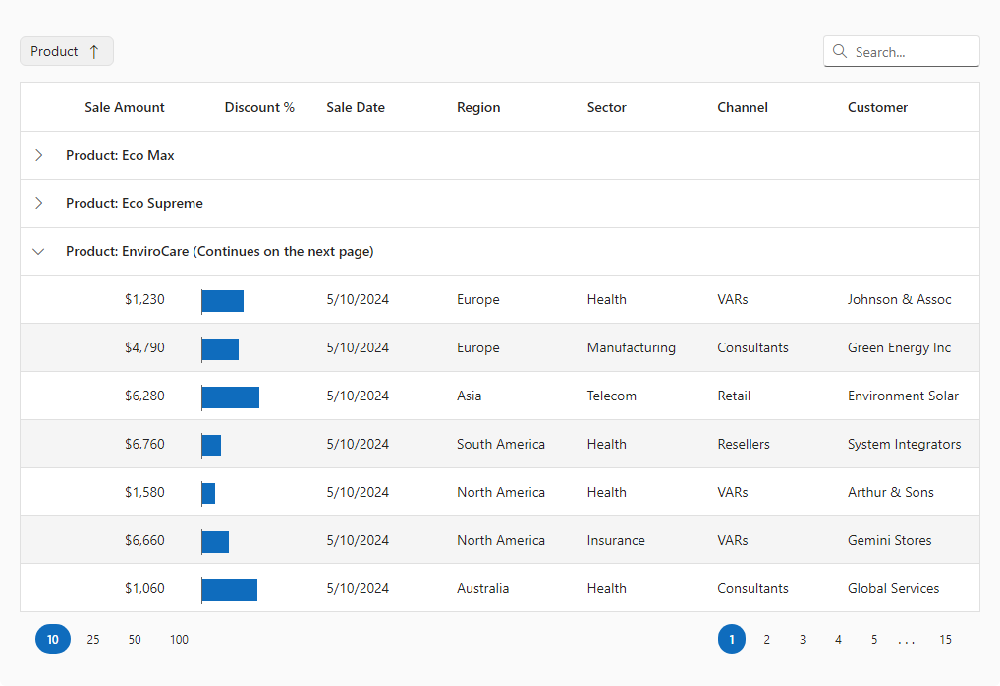

**Critérios de aceite Vortex (preencher na implementação):**

- [ ] Paridade de interação principal da demo
- [ ] API Signals documentada (`input`/`model`/`output`)
- [ ] Tema Fluent Light + Fluent Green sem regressão visual
- [ ] Storybook / Widgets Gallery Vortex com caso equivalente

### Vinculação de dados (Data Binding)

#### 002. Matriz simples / Simple Array

- **Status Vortex:** TODO
- **Slug DX:** `SimpleArray`
- **URL:** https://js.devexpress.com/Angular/Demos/WidgetsGallery/Demo/DataGrid/SimpleArray/FluentBlueLight/
- **Imagem:** `images/002-DataGrid-SimpleArray.png`
- **Raw JSON:** `raw/002-DataGrid-SimpleArray.json`
- **Título página:** Angular Data Grid - Simple Array
- **Descrição (EN, fonte DX):**

> You can use the DataGrid component to display and edit data from an array of objects. Use the dataSource and keyExpr properties to specify the bound array and its key field. For more information, refer to the following help topic: Local Array. Use the columns property to specify a list of data fields you want to display within the DataGrid as columns. If the columns property is not specified, the component creates columns for all data fields available in objects from the bound array.

- **Docs Guide:**
  - [Local Array](https://js.devexpress.com/Angular/Documentation/Guide/Data_Binding/Specify_a_Data_Source/Local_Array/)
- **API Reference:**
  - [dataSource](https://js.devexpress.com/Angular/Documentation/ApiReference/UI_Components/dxDataGrid/Configuration/#dataSource)
  - [keyExpr](https://js.devexpress.com/Angular/Documentation/ApiReference/UI_Components/dxDataGrid/Configuration/#keyExpr)
  - [columns](https://js.devexpress.com/Angular/Documentation/ApiReference/UI_Components/dxDataGrid/Configuration/columns/)

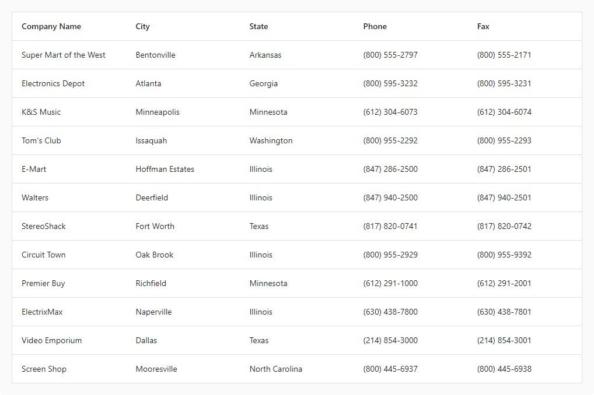

**Critérios de aceite Vortex (preencher na implementação):**

- [ ] Paridade de interação principal da demo
- [ ] API Signals documentada (`input`/`model`/`output`)
- [ ] Tema Fluent Light + Fluent Green sem regressão visual
- [ ] Storybook / Widgets Gallery Vortex com caso equivalente

#### 003. Dados JSON / JSON Data

- **Status Vortex:** TODO
- **Slug DX:** `AjaxRequest`
- **URL:** https://js.devexpress.com/Angular/Demos/WidgetsGallery/Demo/DataGrid/AjaxRequest/FluentBlueLight/
- **Imagem:** `images/003-DataGrid-AjaxRequest.png`
- **Raw JSON:** `raw/003-DataGrid-AjaxRequest.json`
- **Título página:** Angular Data Grid - JSON Data
- **Descrição (EN, fonte DX):**

> If your data is stored in JSON format, the DataGrid does not require making a request for data manually. You can simply assign the URL of your JSON data storage to the dataSource property, and the DataGrid will fetch the data and display it.

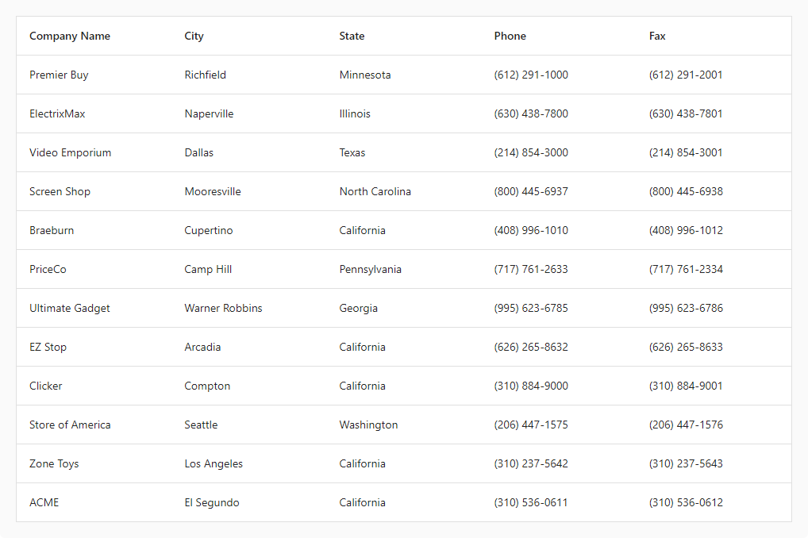

**Critérios de aceite Vortex (preencher na implementação):**

- [ ] Paridade de interação principal da demo
- [ ] API Signals documentada (`input`/`model`/`output`)
- [ ] Tema Fluent Light + Fluent Green sem regressão visual
- [ ] Storybook / Widgets Gallery Vortex com caso equivalente

#### 004. Fonte de dados personalizada / Custom Data Source

- **Status Vortex:** TODO
- **Slug DX:** `CustomDataSource`
- **URL:** https://js.devexpress.com/Angular/Demos/WidgetsGallery/Demo/DataGrid/CustomDataSource/FluentBlueLight/
- **Imagem:** `images/004-DataGrid-CustomDataSource.png`
- **Raw JSON:** `raw/004-DataGrid-CustomDataSource.json`
- **Título página:** Angular Data Grid - Custom Data Source
- **Descrição (EN, fonte DX):**

> DevExtreme provides the CustomStore component to load and edit data from a custom data source. In this demo, the CustomStore fetches data from a custom remote server and displays it in the DataGrid.

- **Docs Guide:**
  - [Server-Side Data Processing](https://js.devexpress.com/Angular/Documentation/Guide/Data_Binding/Specify_a_Data_Source/Custom_Data_Sources/#Load_Data/Server-Side_Data_Processing)
  - [Client-Side Data Processing](https://js.devexpress.com/Angular/Documentation/Guide/Data_Binding/Specify_a_Data_Source/Custom_Data_Sources/#Load_Data/Client-Side_Data_Processing)
- **API Reference:**
  - [CustomStore](https://js.devexpress.com/Angular/Documentation/ApiReference/Data_Layer/CustomStore/)
  - [data processing settings](https://js.devexpress.com/Angular/Documentation/ApiReference/Data_Layer/CustomStore/LoadOptions/)
  - [remoteOperations](https://js.devexpress.com/Angular/Documentation/ApiReference/UI_Components/dxDataGrid/Configuration/remoteOperations/)

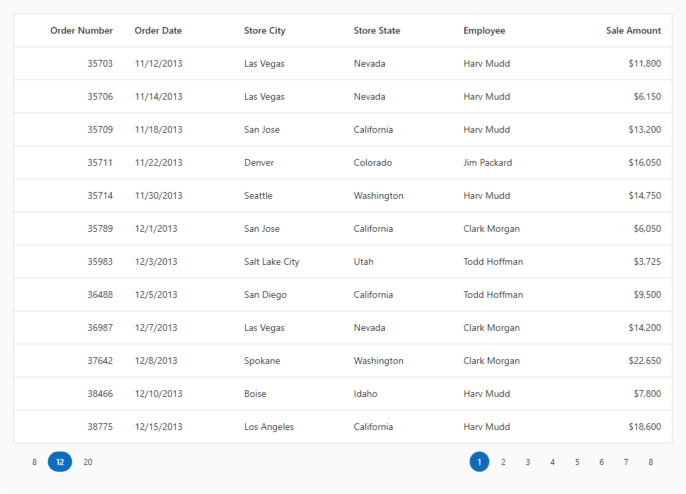

**Critérios de aceite Vortex (preencher na implementação):**

- [ ] Paridade de interação principal da demo
- [ ] API Signals documentada (`input`/`model`/`output`)
- [ ] Tema Fluent Light + Fluent Green sem regressão visual
- [ ] Storybook / Widgets Gallery Vortex com caso equivalente

#### 005. Serviço de API Web / Web API Service

- **Status Vortex:** TODO
- **Slug DX:** `WebAPIService`
- **URL:** https://js.devexpress.com/Angular/Demos/WidgetsGallery/Demo/DataGrid/WebAPIService/FluentBlueLight/
- **Imagem:** `images/005-DataGrid-WebAPIService.png`
- **Raw JSON:** `raw/005-DataGrid-WebAPIService.json`
- **Título página:** Angular Data Grid - Web API Service
- **Descrição (EN, fonte DX):**

> To access a Web API service from the client, use the createStore method which is part of the DevExtreme.AspNet.Data extension. This extension also allows you to process data for DevExtreme components on the server. The server-side implementation is available under the DataGridWebApiController.cs tab in the ASP.NET MVC version of this demo. To notify the DataGrid that data is processed on the server, set the remoteOperations property to true.

- **API Reference:**
  - [remoteOperations](https://js.devexpress.com/Angular/Documentation/ApiReference/UI_Components/dxDataGrid/Configuration/remoteOperations/)

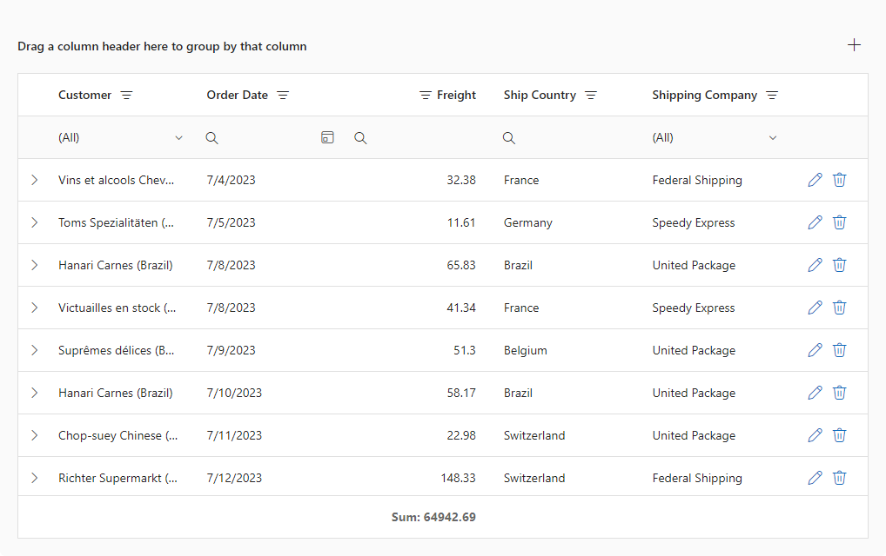

**Critérios de aceite Vortex (preencher na implementação):**

- [ ] Paridade de interação principal da demo
- [ ] API Signals documentada (`input`/`model`/`output`)
- [ ] Tema Fluent Light + Fluent Green sem regressão visual
- [ ] Storybook / Widgets Gallery Vortex com caso equivalente

#### 006. Serviço SignalR / SignalR Service

- **Status Vortex:** TODO
- **Slug DX:** `SignalRService`
- **URL:** https://js.devexpress.com/Angular/Demos/WidgetsGallery/Demo/DataGrid/SignalRService/FluentBlueLight/
- **Imagem:** `images/006-DataGrid-SignalRService.png`
- **Raw JSON:** `raw/006-DataGrid-SignalRService.json`
- **Título página:** Angular Data Grid - SignalR Service
- **Descrição (EN, fonte DX):**

> This example demonstrates real-time data update in a DataGrid bound to a SignalR service. Access to the service is configured in a CustomStore. The CustomStore fetches the remote dataset at launch and keeps its local copy. Whenever the remote dataset changes, the server calls a client-side function that updates the local copy of the dataset (updateStockPrices in this demo). This function uses the store's push(changes) method. For server-side configuration, refer to the ASP.NET MVC version of this demo.

- **Docs Guide:**
  - [Integration with Push Services](https://js.devexpress.com/Angular/Documentation/Guide/Data_Binding/Data_Layer/#Data_Modification/Integration_with_Push_Services)
- **API Reference:**
  - [CustomStore](https://js.devexpress.com/Angular/Documentation/ApiReference/Data_Layer/CustomStore/)
  - [push(changes)](https://js.devexpress.com/Angular/Documentation/ApiReference/Data_Layer/CustomStore/Methods/#pushchanges)

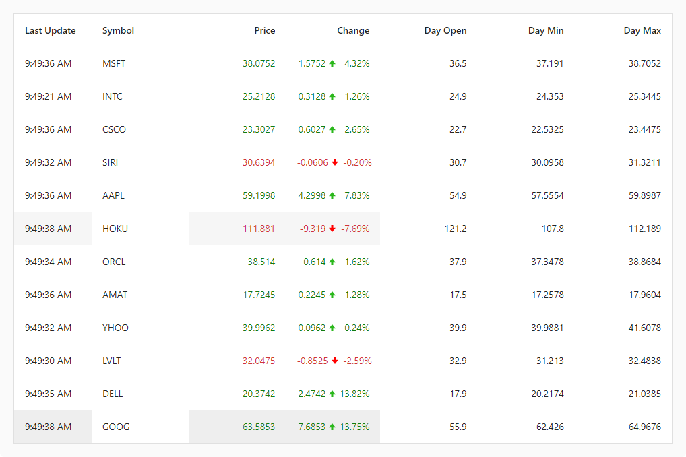

**Critérios de aceite Vortex (preencher na implementação):**

- [ ] Paridade de interação principal da demo
- [ ] API Signals documentada (`input`/`model`/`output`)
- [ ] Tema Fluent Light + Fluent Green sem regressão visual
- [ ] Storybook / Widgets Gallery Vortex com caso equivalente

#### 007. Atualizações em tempo real / Real-Time Updates

- **Status Vortex:** TODO
- **Slug DX:** `RealTimeUpdates`
- **URL:** https://js.devexpress.com/Angular/Demos/WidgetsGallery/Demo/DataGrid/RealTimeUpdates/FluentBlueLight/
- **Imagem:** `images/007-DataGrid-RealTimeUpdates.png`
- **Raw JSON:** `raw/007-DataGrid-RealTimeUpdates.json`
- **Título página:** Angular Data Grid - Real-Time Updates
- **Descrição (EN, fonte DX):**

> The DataGrid component is optimized for real-time updates. You should bind it to a DataSource that contains a store and use the push(changes) method to update the store's data. The rows with changed data are rerendered (see the DataGrid's repaintChangesOnly property). The DataSource object also provides properties that control its behavior when it receives a push. For example, reshapeOnPush is set to true in this demo to allow summaries to be recalculated.

- **API Reference:**
  - [DataSource](https://js.devexpress.com/Angular/Documentation/ApiReference/Data_Layer/DataSource/)
  - [push(changes)](https://js.devexpress.com/Angular/Documentation/ApiReference/Data_Layer/ArrayStore/Methods/#pushchanges)
  - [repaintChangesOnly](https://js.devexpress.com/Angular/Documentation/ApiReference/UI_Components/dxDataGrid/Configuration/#repaintChangesOnly)
  - [reshapeOnPush](https://js.devexpress.com/Angular/Documentation/ApiReference/Data_Layer/DataSource/Configuration/#reshapeOnPush)

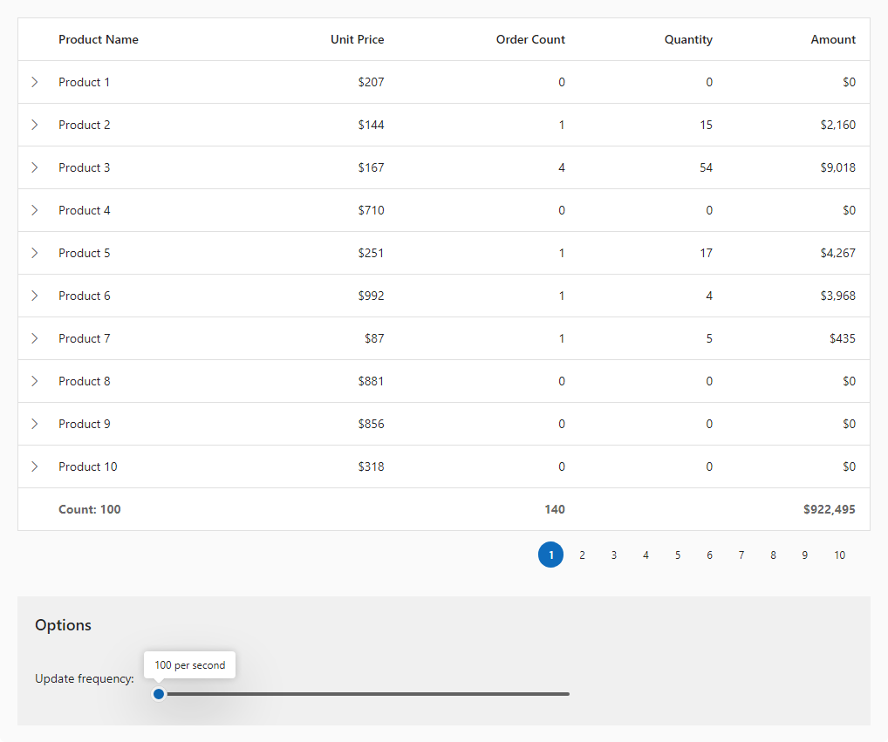

**Critérios de aceite Vortex (preencher na implementação):**

- [ ] Paridade de interação principal da demo
- [ ] API Signals documentada (`input`/`model`/`output`)
- [ ] Tema Fluent Light + Fluent Green sem regressão visual
- [ ] Storybook / Widgets Gallery Vortex com caso equivalente

### Filtragem (Filtering)

#### 008. Filtragem / Filtering

- **Status Vortex:** TODO
- **Slug DX:** `Filtering`
- **URL:** https://js.devexpress.com/Angular/Demos/WidgetsGallery/Demo/DataGrid/Filtering/FluentBlueLight/
- **Imagem:** `images/008-DataGrid-Filtering.png`
- **Raw JSON:** `raw/008-DataGrid-Filtering.json`
- **Título página:** Angular Data Grid - Filtering
- **Descrição (EN, fonte DX):**

> This example demonstrates the DataGrid’s built-in filtering and searching capabilities. The filter row, located under the column headers, allows a user to type any value and select filter operations. With the header filter, which is called by clicking the filter icon in any column header, a user can choose from a set of predefined values. The search panel at the top of the DataGrid allows searching for values in all columns at once.

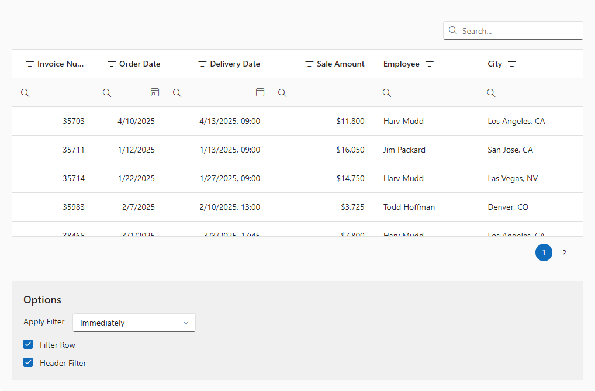

**Critérios de aceite Vortex (preencher na implementação):**

- [ ] Paridade de interação principal da demo
- [ ] API Signals documentada (`input`/`model`/`output`)
- [ ] Tema Fluent Light + Fluent Green sem regressão visual
- [ ] Storybook / Widgets Gallery Vortex com caso equivalente

#### 009. API de filtragem / Filtering API

- **Status Vortex:** TODO
- **Slug DX:** `FilteringAPI`
- **URL:** https://js.devexpress.com/Angular/Demos/WidgetsGallery/Demo/DataGrid/FilteringAPI/FluentBlueLight/
- **Imagem:** `images/009-DataGrid-FilteringAPI.png`
- **Raw JSON:** `raw/009-DataGrid-FilteringAPI.json`
- **Título página:** Angular Data Grid - Filtering API
- **Descrição (EN, fonte DX):**

> The DataGrid includes the following API you can use to filter data.

- **Docs Guide:**
  - [getters](https://js.devexpress.com/Angular/Documentation/Guide/Data_Binding/Data_Layer/#Getters_And_Setters)
- **API Reference:**
  - [filter()](https://js.devexpress.com/Angular/Documentation/ApiReference/UI_Components/dxDataGrid/Methods/#filter)
  - [filter(filterExpr)](https://js.devexpress.com/Angular/Documentation/ApiReference/UI_Components/dxDataGrid/Methods/#filterfilterExpr)
  - [dataSource](https://js.devexpress.com/Angular/Documentation/ApiReference/UI_Components/dxDataGrid/Configuration/#dataSource)
  - [filterValue](https://js.devexpress.com/Angular/Documentation/ApiReference/UI_Components/dxDataGrid/Configuration/#filterValue)
  - [filter row](https://js.devexpress.com/Angular/Documentation/ApiReference/UI_Components/dxDataGrid/Configuration/filterRow/)
  - [header filter](https://js.devexpress.com/Angular/Documentation/ApiReference/UI_Components/dxDataGrid/Configuration/headerFilter/)
  - [filter builder](https://js.devexpress.com/Angular/Documentation/ApiReference/UI_Components/dxDataGrid/Configuration/#filterBuilder)
  - [getCombinedFilter()](https://js.devexpress.com/Angular/Documentation/ApiReference/UI_Components/dxDataGrid/Methods/#getCombinedFilter)

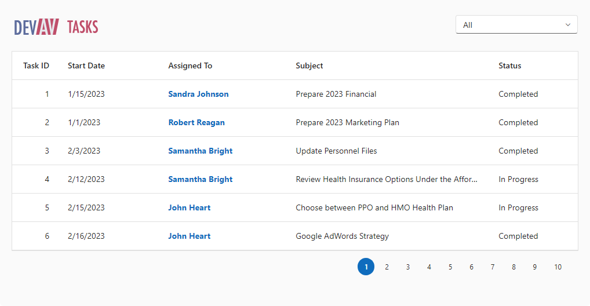

**Critérios de aceite Vortex (preencher na implementação):**

- [ ] Paridade de interação principal da demo
- [ ] API Signals documentada (`input`/`model`/`output`)
- [ ] Tema Fluent Light + Fluent Green sem regressão visual
- [ ] Storybook / Widgets Gallery Vortex com caso equivalente

#### 010. Painel de filtro / Filter Panel

- **Status Vortex:** TODO
- **Slug DX:** `FilterPanel`
- **URL:** https://js.devexpress.com/Angular/Demos/WidgetsGallery/Demo/DataGrid/FilterPanel/FluentBlueLight/
- **Imagem:** `images/010-DataGrid-FilterPanel.png`
- **Raw JSON:** `raw/010-DataGrid-FilterPanel.json`
- **Título página:** Angular Data Grid - Filter Panel
- **Descrição (EN, fonte DX):**

> The Filter panel is a UI element that displays the combined filter. This filter is stored in the filterValue property and consists of filters that users apply in other UI elements (filter row, header filter, filterBuilder). To display the filter panel, set the filterPanel.visible property to true. A click on the combined filter calls the integrated filter builder. You can configure it in the filterBuilder object. In this demo, this object is used to add the weekends custom filter operation.

- **API Reference:**
  - [Filter panel](https://js.devexpress.com/Angular/Documentation/ApiReference/UI_Components/dxDataGrid/Configuration/filterPanel/)
  - [filterValue](https://js.devexpress.com/Angular/Documentation/ApiReference/UI_Components/dxDataGrid/Configuration/#filterValue)
  - [filter row](https://js.devexpress.com/Angular/Documentation/ApiReference/UI_Components/dxDataGrid/Configuration/filterRow/)
  - [header filter](https://js.devexpress.com/Angular/Documentation/ApiReference/UI_Components/dxDataGrid/Configuration/headerFilter/)
  - [filterBuilder](https://js.devexpress.com/Angular/Documentation/ApiReference/UI_Components/dxDataGrid/Configuration/#filterBuilder)
  - [visible](https://js.devexpress.com/Angular/Documentation/ApiReference/UI_Components/dxDataGrid/Configuration/filterPanel/#visible)
  - [filterBuilder](https://js.devexpress.com/Angular/Documentation/ApiReference/UI_Components/dxDataGrid/Configuration/#filterBuilder)
  - [custom filter operation](https://js.devexpress.com/Angular/Documentation/ApiReference/UI_Components/dxFilterBuilder/Configuration/customOperations)

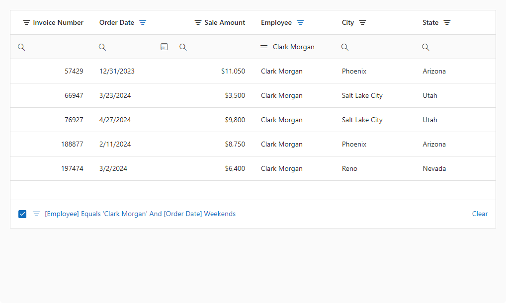

**Critérios de aceite Vortex (preencher na implementação):**

- [ ] Paridade de interação principal da demo
- [ ] API Signals documentada (`input`/`model`/`output`)
- [ ] Tema Fluent Light + Fluent Green sem regressão visual
- [ ] Storybook / Widgets Gallery Vortex com caso equivalente

#### 011. Filtro de cabeçalho de coluna / Column Header Filter

- **Status Vortex:** TODO
- **Slug DX:** `ColumnHeaderFilter`
- **URL:** https://js.devexpress.com/Angular/Demos/WidgetsGallery/Demo/DataGrid/ColumnHeaderFilter/FluentBlueLight/
- **Imagem:** `images/011-DataGrid-ColumnHeaderFilter.png`
- **Raw JSON:** `raw/011-DataGrid-ColumnHeaderFilter.json`
- **Título página:** Angular Data Grid - Column Header Filter
- **Descrição (EN, fonte DX):**

> The DevExtreme Data Grid includes a column header filter option – with it, users can quickly filter rows against values selected in a pop-up menu. To display the built-in filter menu, users can click the Grid’s header filter icon (displayed within the column header).

- **API Reference:**
  - [visible](https://js.devexpress.com/Angular/Documentation/ApiReference/UI_Components/dxDataGrid/Configuration/headerFilter/#visible)
  - [allowHeaderFiltering](https://js.devexpress.com/Angular/Documentation/ApiReference/UI_Components/dxDataGrid/Configuration/columns/#allowHeaderFiltering)
  - [search](https://js.devexpress.com/Angular/Documentation/ApiReference/UI_Components/dxDataGrid/Configuration/headerFilter/search/)
  - [headerFilter](https://js.devexpress.com/Angular/Documentation/ApiReference/UI_Components/dxDataGrid/Configuration/headerFilter/)
  - [headerFilter](https://js.devexpress.com/Angular/Documentation/ApiReference/UI_Components/dxDataGrid/Configuration/columns/headerFilter/)
  - [searchExpr](https://js.devexpress.com/Angular/Documentation/ApiReference/UI_Components/dxDataGrid/Configuration/columns/headerFilter/search/#searchExpr)
  - [mode](https://js.devexpress.com/Angular/Documentation/ApiReference/UI_Components/dxDataGrid/Configuration/columns/headerFilter/search/#mode)

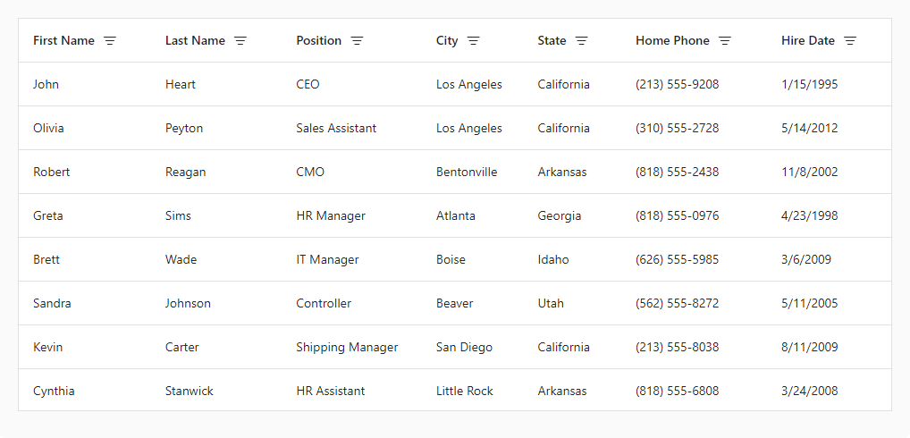

**Critérios de aceite Vortex (preencher na implementação):**

- [ ] Paridade de interação principal da demo
- [ ] API Signals documentada (`input`/`model`/`output`)
- [ ] Tema Fluent Light + Fluent Green sem regressão visual
- [ ] Storybook / Widgets Gallery Vortex com caso equivalente

#### 012. Busca Semântica / Semantic Search · **AI**

- **Status Vortex:** TODO
- **Slug DX:** `SemanticSearch`
- **URL:** https://js.devexpress.com/Angular/Demos/WidgetsGallery/Demo/DataGrid/SemanticSearch/FluentBlueLight/
- **Imagem:** `images/012-DataGrid-SemanticSearch.png`
- **Raw JSON:** `raw/012-DataGrid-SemanticSearch.json`
- **Título página:** Angular Data Grid - Semantic Search
- **Descrição (EN, fonte DX):**

> This demo incorporates server-side semantic search into the DevExtreme DataGrid. Semantic search finds results based on meaning rather than exact wording, understanding the context and intent behind a question or phrase. This allows your DevExtreme-powered app to deliver more relevant answers by connecting related concepts, even if exact words differ. To review benefits of this feature, search for dictionary entries and their descriptions and use synonyms or generic descriptions instead of exact search strings (such as "clothing" instead of a specific product name). You can fine-tune search results: use the Similarity Factor editor to change the search precision.

- **Docs Guide:**
  - [DevExtreme DataGrid](https://js.devexpress.com/Angular/Documentation/Guide/UI_Components/DataGrid/Overview/)
- **API Reference:**
  - [search panel](https://js.devexpress.com/Angular/Documentation/ApiReference/UI_Components/dxDataGrid/Configuration/searchPanel/)
  - [toolbar](https://js.devexpress.com/Angular/Documentation/ApiReference/UI_Components/dxDataGrid/Configuration/toolbar/)

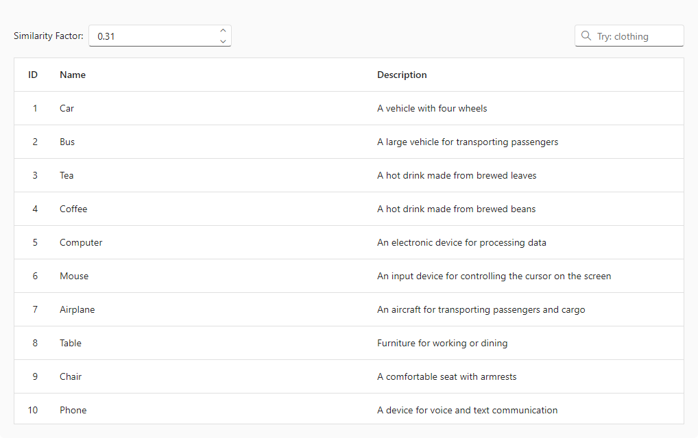

**Critérios de aceite Vortex (preencher na implementação):**

- [ ] Paridade de interação principal da demo
- [ ] API Signals documentada (`input`/`model`/`output`)
- [ ] Tema Fluent Light + Fluent Green sem regressão visual
- [ ] Storybook / Widgets Gallery Vortex com caso equivalente

### Classificação (Sorting)

#### 013. Classificação / Sorting

- **Status Vortex:** TODO
- **Slug DX:** `MultipleSorting`
- **URL:** https://js.devexpress.com/Angular/Demos/WidgetsGallery/Demo/DataGrid/MultipleSorting/FluentBlueLight/
- **Imagem:** `images/013-DataGrid-MultipleSorting.png`
- **Raw JSON:** `raw/013-DataGrid-MultipleSorting.json`
- **Título página:** Angular Data Grid - Sorting
- **Descrição (EN, fonte DX):**

> The DataGrid component can sort values by a single or multiple columns. Use the sorting.mode property to specify the sort mode.

- **API Reference:**
  - [mode](https://js.devexpress.com/Angular/Documentation/ApiReference/UI_Components/dxDataGrid/Configuration/sorting/#mode)
  - [allowSorting](https://js.devexpress.com/Angular/Documentation/ApiReference/UI_Components/dxDataGrid/Configuration/columns/#allowSorting)
  - [sortOrder](https://js.devexpress.com/Angular/Documentation/ApiReference/UI_Components/dxDataGrid/Configuration/columns/#sortOrder)
  - [sortIndex](https://js.devexpress.com/Angular/Documentation/ApiReference/UI_Components/dxDataGrid/Configuration/columns/#sortIndex)

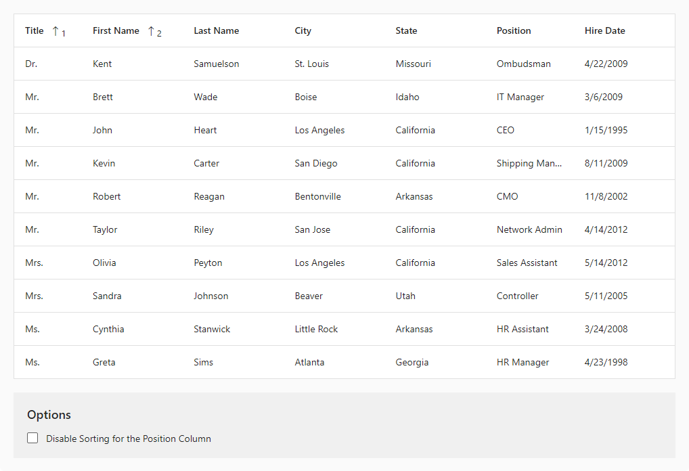

**Critérios de aceite Vortex (preencher na implementação):**

- [ ] Paridade de interação principal da demo
- [ ] API Signals documentada (`input`/`model`/`output`)
- [ ] Tema Fluent Light + Fluent Green sem regressão visual
- [ ] Storybook / Widgets Gallery Vortex com caso equivalente

### Edição (Editing)

#### 014. Edição de linhas / Row Editing

- **Status Vortex:** TODO
- **Slug DX:** `RowEditing`
- **URL:** https://js.devexpress.com/Angular/Demos/WidgetsGallery/Demo/DataGrid/RowEditing/FluentBlueLight/
- **Imagem:** `images/014-DataGrid-RowEditing.png`
- **Raw JSON:** `raw/014-DataGrid-RowEditing.json`
- **Título página:** Angular Data Grid - Row Editing
- **Descrição (EN, fonte DX):**

> The DataGrid allows users to edit data in multiple modes. This demo shows the "row" edit mode. To start editing any row, click "Edit" in it. Only one row can be in the edit state at a time. To enable row edit mode, set the mode property to "row" and assign true to the editing object's allowUpdating, allowAdding, and allowDeleting properties.

- **API Reference:**
  - [mode](https://js.devexpress.com/Angular/Documentation/ApiReference/UI_Components/dxDataGrid/Configuration/editing/#mode)
  - [allowUpdating](https://js.devexpress.com/Angular/Documentation/ApiReference/UI_Components/dxDataGrid/Configuration/editing/#allowUpdating)
  - [allowAdding](https://js.devexpress.com/Angular/Documentation/ApiReference/UI_Components/dxDataGrid/Configuration/editing/#allowAdding)
  - [allowDeleting](https://js.devexpress.com/Angular/Documentation/ApiReference/UI_Components/dxDataGrid/Configuration/editing/#allowDeleting)
  - [onEditingStart](https://js.devexpress.com/Angular/Documentation/ApiReference/UI_Components/dxDataGrid/Configuration/#onEditingStart)
  - [onInitNewRow](https://js.devexpress.com/Angular/Documentation/ApiReference/UI_Components/dxDataGrid/Configuration/#onInitNewRow)
  - [onRowInserting](https://js.devexpress.com/Angular/Documentation/ApiReference/UI_Components/dxDataGrid/Configuration/#onRowInserting)
  - [onRowInserted](https://js.devexpress.com/Angular/Documentation/ApiReference/UI_Components/dxDataGrid/Configuration/#onRowInserted)

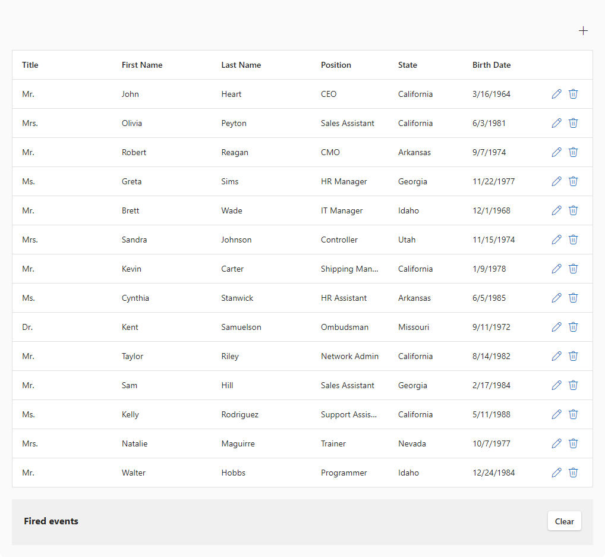

**Critérios de aceite Vortex (preencher na implementação):**

- [ ] Paridade de interação principal da demo
- [ ] API Signals documentada (`input`/`model`/`output`)
- [ ] Tema Fluent Light + Fluent Green sem regressão visual
- [ ] Storybook / Widgets Gallery Vortex com caso equivalente

#### 015. Edição de células / Cell Editing

- **Status Vortex:** TODO
- **Slug DX:** `CellEditing`
- **URL:** https://js.devexpress.com/Angular/Demos/WidgetsGallery/Demo/DataGrid/CellEditing/FluentBlueLight/
- **Imagem:** `images/015-DataGrid-CellEditing.png`
- **Raw JSON:** `raw/015-DataGrid-CellEditing.json`
- **Título página:** Angular Data Grid - Cell Editing
- **Descrição (EN, fonte DX):**

> Users can modify DataGrid data cell by cell. In this mode, only one cell can be in the edit state at a time. DataGrid saves changes immediately after the focus leaves cell. To enable the cell mode, do the following: Set the editing.mode to "cell". Assign true to the editing object's allowUpdating, allowAdding, and allowDeleting properties. This demo also shows how to delete selected records. Review the onSelectionChanged and deleteRecords functions for implementation details.

- **API Reference:**
  - [mode](https://js.devexpress.com/Angular/Documentation/ApiReference/UI_Components/dxDataGrid/Configuration/editing/#mode)
  - [editing](https://js.devexpress.com/Angular/Documentation/ApiReference/UI_Components/dxDataGrid/Configuration/editing/)
  - [allowUpdating](https://js.devexpress.com/Angular/Documentation/ApiReference/UI_Components/dxDataGrid/Configuration/editing/#allowUpdating)
  - [allowAdding](https://js.devexpress.com/Angular/Documentation/ApiReference/UI_Components/dxDataGrid/Configuration/editing/#allowAdding)
  - [allowDeleting](https://js.devexpress.com/Angular/Documentation/ApiReference/UI_Components/dxDataGrid/Configuration/editing/#allowDeleting)
  - [onSelectionChanged](https://js.devexpress.com/Angular/Documentation/ApiReference/UI_Components/dxDataGrid/Configuration/#onSelectionChanged)

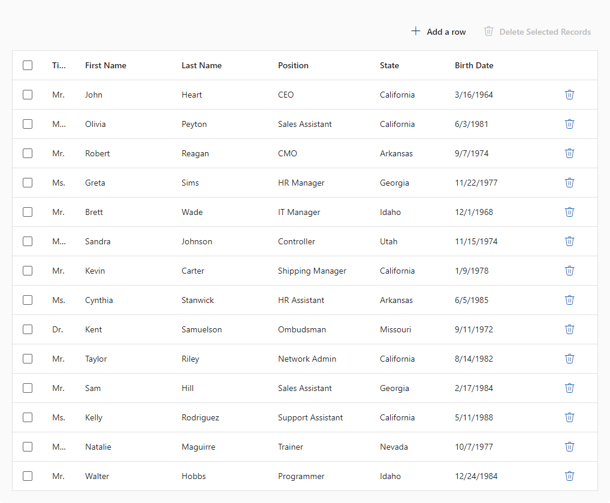

**Critérios de aceite Vortex (preencher na implementação):**

- [ ] Paridade de interação principal da demo
- [ ] API Signals documentada (`input`/`model`/`output`)
- [ ] Tema Fluent Light + Fluent Green sem regressão visual
- [ ] Storybook / Widgets Gallery Vortex com caso equivalente

#### 016. Edição em lote / Batch Editing

- **Status Vortex:** TODO
- **Slug DX:** `BatchEditing`
- **URL:** https://js.devexpress.com/Angular/Demos/WidgetsGallery/Demo/DataGrid/BatchEditing/FluentBlueLight/
- **Imagem:** `images/016-DataGrid-BatchEditing.png`
- **Raw JSON:** `raw/016-DataGrid-BatchEditing.json`
- **Título página:** Angular Data Grid - Batch Editing
- **Descrição (EN, fonte DX):**

> You can use batch edit mode to defer saving multiple cell changes. Changes are stored in a buffer and can be discarded before a user clicks the Save button. To enable batch edit mode, configure the following properties: Set editing.mode to "batch". Assign true to the editing object's allowUpdating, allowAdding, and allowDeleting properties.

- **API Reference:**
  - [mode](https://js.devexpress.com/Angular/Documentation/ApiReference/UI_Components/dxDataGrid/Configuration/editing/#mode)
  - [editing](https://js.devexpress.com/Angular/Documentation/ApiReference/UI_Components/dxDataGrid/Configuration/editing/#mode)
  - [allowUpdating](https://js.devexpress.com/Angular/Documentation/ApiReference/UI_Components/dxDataGrid/Configuration/editing/#allowUpdating)
  - [allowAdding](https://js.devexpress.com/Angular/Documentation/ApiReference/UI_Components/dxDataGrid/Configuration/editing/#allowAdding)
  - [allowDeleting](https://js.devexpress.com/Angular/Documentation/ApiReference/UI_Components/dxDataGrid/Configuration/editing/#allowDeleting)
  - [startEditAction](https://js.devexpress.com/Angular/Documentation/ApiReference/UI_Components/dxDataGrid/Configuration/editing/#startEditAction)
  - [selectTextOnEditStart](https://js.devexpress.com/Angular/Documentation/ApiReference/UI_Components/dxDataGrid/Configuration/editing/#selectTextOnEditStart)

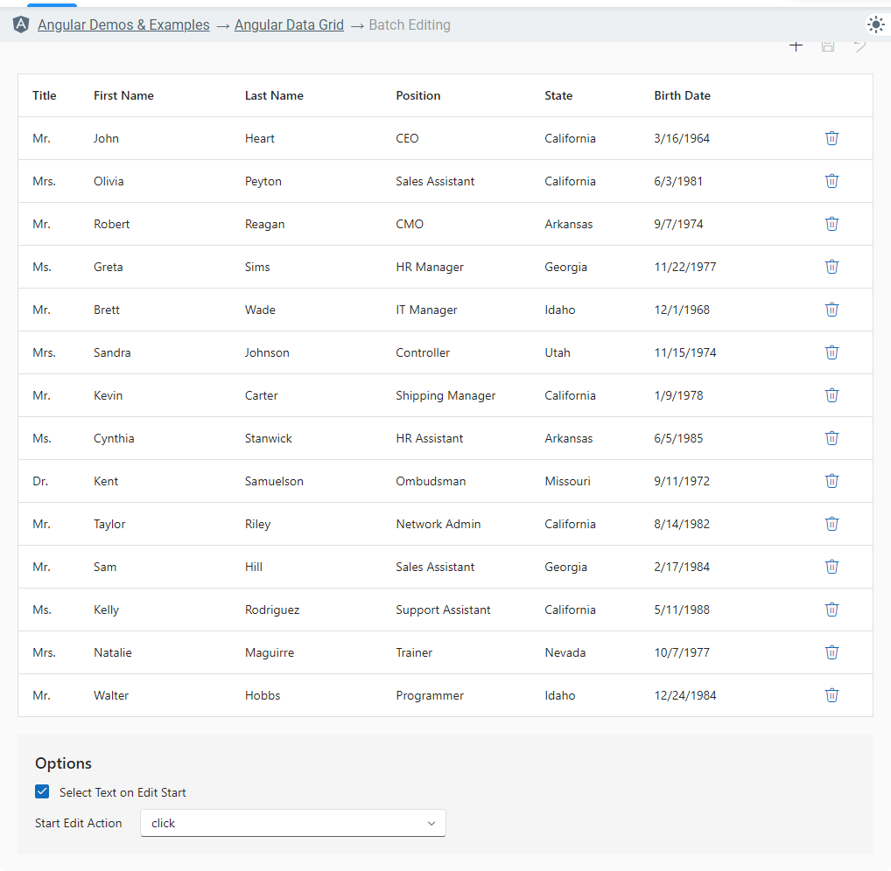

**Critérios de aceite Vortex (preencher na implementação):**

- [ ] Paridade de interação principal da demo
- [ ] API Signals documentada (`input`/`model`/`output`)
- [ ] Tema Fluent Light + Fluent Green sem regressão visual
- [ ] Storybook / Widgets Gallery Vortex com caso equivalente

#### 017. Edição de formulários / Form Editing

- **Status Vortex:** TODO
- **Slug DX:** `FormEditing`
- **URL:** https://js.devexpress.com/Angular/Demos/WidgetsGallery/Demo/DataGrid/FormEditing/FluentBlueLight/
- **Imagem:** `images/017-DataGrid-FormEditing.png`
- **Raw JSON:** `raw/017-DataGrid-FormEditing.json`
- **Título página:** Angular Data Grid - Form Editing
- **Descrição (EN, fonte DX):**

> The DataGrid can use the Form component to arrange cell editors when users modify a row. The Form allows users to edit values from visible and hidden columns (see the Notes column). To enable form edit mode, configure the following properties: Set editing.mode to "form" Assign true to the editing object's allowAdding, allowUpdating, and allowDeleting properties.

- **Docs Guide:**
  - [Customize Edit Form](https://js.devexpress.com/Angular/Documentation/Guide/UI_Components/DataGrid/Editing/#Customize_Edit_Form)
- **API Reference:**
  - [Form](https://js.devexpress.com/Angular/Documentation/ApiReference/UI_Components/dxForm/)
  - [visible and hidden](https://js.devexpress.com/Angular/Documentation/ApiReference/UI_Components/dxDataGrid/Configuration/columns/#visible)
  - [mode](https://js.devexpress.com/Angular/Documentation/ApiReference/UI_Components/dxDataGrid/Configuration/editing/#mode)
  - [editing](https://js.devexpress.com/Angular/Documentation/ApiReference/UI_Components/dxDataGrid/Configuration/editing/)
  - [allowAdding](https://js.devexpress.com/Angular/Documentation/ApiReference/UI_Components/dxDataGrid/Configuration/editing/#allowAdding)
  - [allowUpdating](https://js.devexpress.com/Angular/Documentation/ApiReference/UI_Components/dxDataGrid/Configuration/editing/#allowUpdating)
  - [allowDeleting](https://js.devexpress.com/Angular/Documentation/ApiReference/UI_Components/dxDataGrid/Configuration/editing/#allowDeleting)
  - [dataType](https://js.devexpress.com/Angular/Documentation/ApiReference/UI_Components/dxDataGrid/Configuration/columns/#dataType)

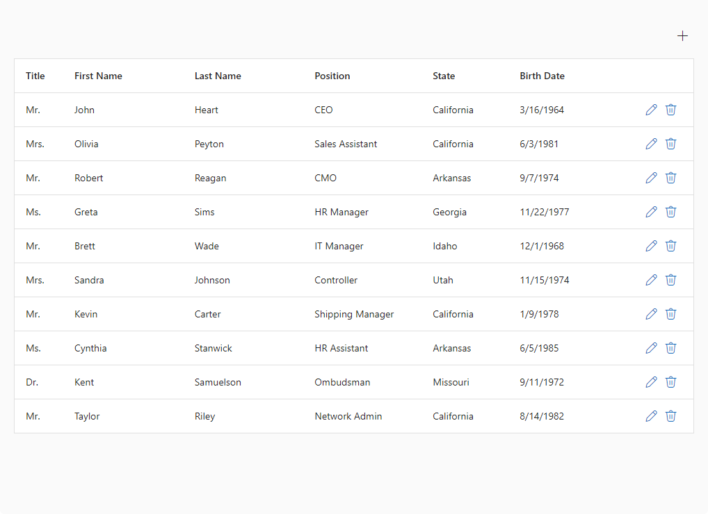

**Critérios de aceite Vortex (preencher na implementação):**

- [ ] Paridade de interação principal da demo
- [ ] API Signals documentada (`input`/`model`/`output`)
- [ ] Tema Fluent Light + Fluent Green sem regressão visual
- [ ] Storybook / Widgets Gallery Vortex com caso equivalente

#### 018. Edição Popup / Popup Editing

- **Status Vortex:** TODO
- **Slug DX:** `PopupEditing`
- **URL:** https://js.devexpress.com/Angular/Demos/WidgetsGallery/Demo/DataGrid/PopupEditing/FluentBlueLight/
- **Imagem:** `images/018-DataGrid-PopupEditing.png`
- **Raw JSON:** `raw/018-DataGrid-PopupEditing.json`
- **Título página:** Angular Data Grid - Popup Editing
- **Descrição (EN, fonte DX):**

> DataGrid can display a popup edit form. The form can include any fields from the bound data source, regardless of whether the corresponding column is visible in the grid (see the Notes and Address columns). To enable this behavior in your application, do the following: Set editing.mode to "popup". Set the editing object's allowUpdating, allowAdding, and allowDeleting properties to true.

- **API Reference:**
  - [mode](https://js.devexpress.com/Angular/Documentation/ApiReference/UI_Components/dxDataGrid/Configuration/editing/#mode)
  - [editing](https://js.devexpress.com/Angular/Documentation/ApiReference/UI_Components/dxDataGrid/Configuration/editing/)
  - [allowUpdating](https://js.devexpress.com/Angular/Documentation/ApiReference/UI_Components/dxDataGrid/Configuration/editing/#allowUpdating)
  - [allowAdding](https://js.devexpress.com/Angular/Documentation/ApiReference/UI_Components/dxDataGrid/Configuration/editing/#allowAdding)
  - [allowDeleting](https://js.devexpress.com/Angular/Documentation/ApiReference/UI_Components/dxDataGrid/Configuration/editing/#allowDeleting)
  - [Form](https://js.devexpress.com/Angular/Documentation/ApiReference/UI_Components/dxForm/)
  - [Popup](https://js.devexpress.com/Angular/Documentation/ApiReference/UI_Components/dxPopup/)
  - [form](https://js.devexpress.com/Angular/Documentation/ApiReference/UI_Components/dxDataGrid/Configuration/editing/#form)

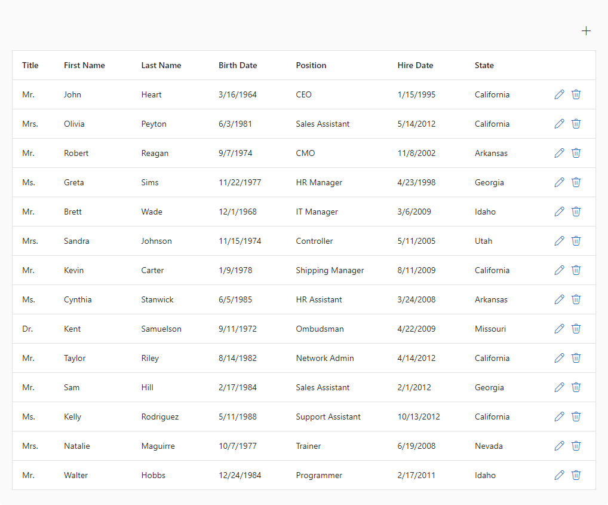

**Critérios de aceite Vortex (preencher na implementação):**

- [ ] Paridade de interação principal da demo
- [ ] API Signals documentada (`input`/`model`/`output`)
- [ ] Tema Fluent Light + Fluent Green sem regressão visual
- [ ] Storybook / Widgets Gallery Vortex com caso equivalente

#### 019. Editores personalizados / Custom Editors

- **Status Vortex:** TODO
- **Slug DX:** `CustomEditors`
- **URL:** https://js.devexpress.com/Angular/Demos/WidgetsGallery/Demo/DataGrid/CustomEditors/FluentBlueLight/
- **Imagem:** `images/019-DataGrid-CustomEditors.png`
- **Raw JSON:** `raw/019-DataGrid-CustomEditors.json`
- **Título página:** Angular Data Grid - Custom Editors
- **Descrição (EN, fonte DX):**

> Different editors can be used to edit cell values in grid columns. The default editor depends on the column configuration. The dependency is illustrated in the editorOptions object's description (this object is used to customize the default editor). In this demo, the SelectBox component is the Status column's default editor, and the editorOptions object is used to specify the component's itemTemplate.

- **API Reference:**
  - [editorOptions](https://js.devexpress.com/Angular/Documentation/ApiReference/UI_Components/dxDataGrid/Configuration/columns/#editorOptions)
  - [SelectBox](https://js.devexpress.com/Angular/Documentation/ApiReference/UI_Components/dxSelectBox/)
  - [itemTemplate](https://js.devexpress.com/Angular/Documentation/ApiReference/UI_Components/dxSelectBox/Configuration/#itemTemplate)
  - [editCellTemplate](https://js.devexpress.com/Angular/Documentation/ApiReference/UI_Components/dxDataGrid/Configuration/columns/#editCellTemplate)
  - [DropDownBox](https://js.devexpress.com/Angular/Documentation/ApiReference/UI_Components/dxDropDownBox/)
  - [TagBox](https://js.devexpress.com/Angular/Documentation/ApiReference/UI_Components/dxTagBox/)

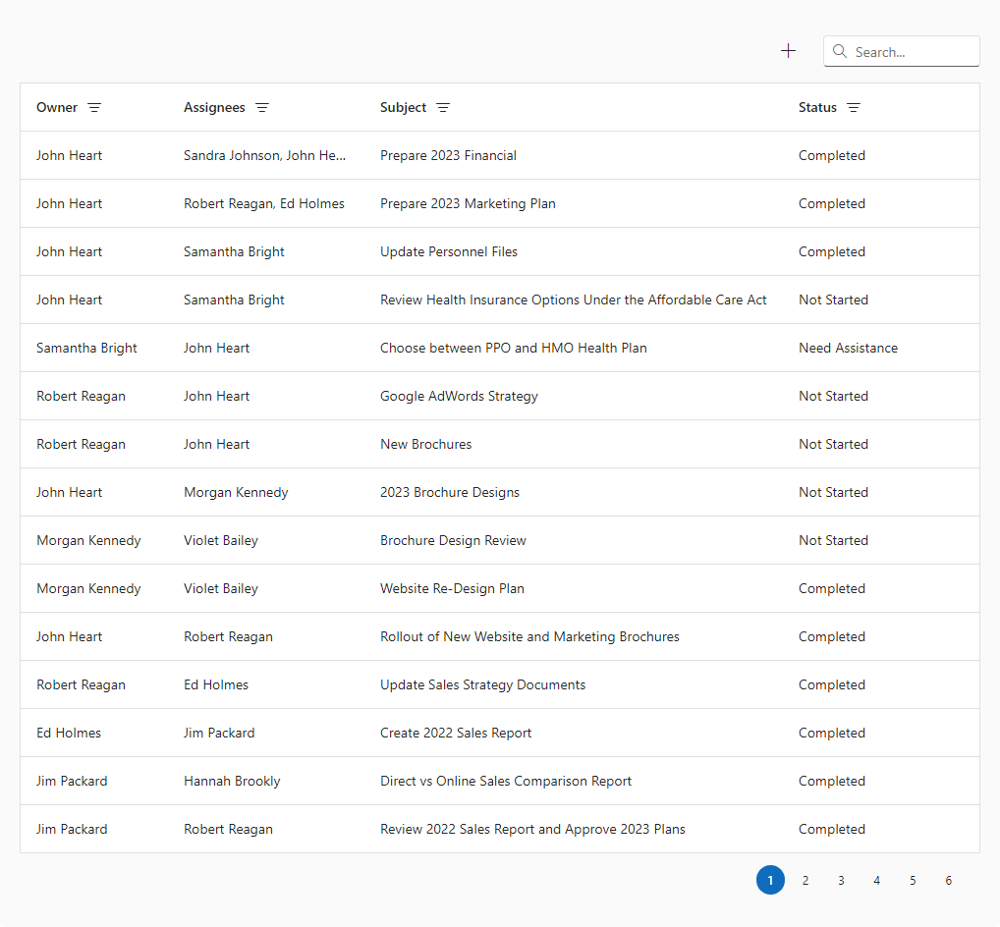

**Critérios de aceite Vortex (preencher na implementação):**

- [ ] Paridade de interação principal da demo
- [ ] API Signals documentada (`input`/`model`/`output`)
- [ ] Tema Fluent Light + Fluent Green sem regressão visual
- [ ] Storybook / Widgets Gallery Vortex com caso equivalente

#### 020. Validação de dados / Data Validation

- **Status Vortex:** TODO
- **Slug DX:** `DataValidation`
- **URL:** https://js.devexpress.com/Angular/Demos/WidgetsGallery/Demo/DataGrid/DataValidation/FluentBlueLight/
- **Imagem:** `images/020-DataGrid-DataValidation.png`
- **Raw JSON:** `raw/020-DataGrid-DataValidation.json`
- **Título página:** Angular Data Grid - Data Validation
- **Descrição (EN, fonte DX):**

> The DataGrid allows you to validate user input. You can apply pre-defined validation rules or custom rules to individual columns.

- **API Reference:**
  - [validation rules](https://js.devexpress.com/Angular/Documentation/ApiReference/UI_Components/dxDataGrid/Configuration/columns/#validationRules)
  - [required](https://js.devexpress.com/Angular/Documentation/ApiReference/UI_Components/dxValidator/Validation_Rules/RequiredRule/)
  - [pattern](https://js.devexpress.com/Angular/Documentation/ApiReference/UI_Components/dxValidator/Validation_Rules/PatternRule/)
  - [email](https://js.devexpress.com/Angular/Documentation/ApiReference/UI_Components/dxValidator/Validation_Rules/EmailRule/)
  - [async](https://js.devexpress.com/Angular/Documentation/ApiReference/UI_Components/dxValidator/Validation_Rules/AsyncRule/)
  - [Validation Rules](https://js.devexpress.com/Angular/Documentation/ApiReference/UI_Components/dxDataGrid/Configuration/columns/#validationRules)

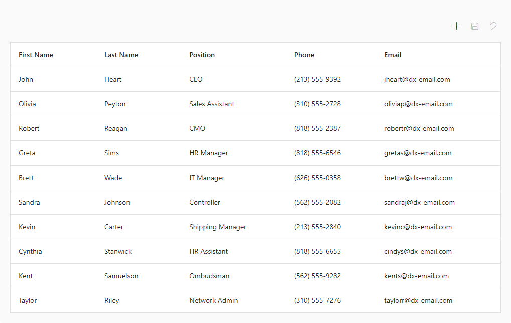

**Critérios de aceite Vortex (preencher na implementação):**

- [ ] Paridade de interação principal da demo
- [ ] API Signals documentada (`input`/`model`/`output`)
- [ ] Tema Fluent Light + Fluent Green sem regressão visual
- [ ] Storybook / Widgets Gallery Vortex com caso equivalente

#### 021. Pesquisas em cascata / Cascading Lookups

- **Status Vortex:** TODO
- **Slug DX:** `CascadingLookups`
- **URL:** https://js.devexpress.com/Angular/Demos/WidgetsGallery/Demo/DataGrid/CascadingLookups/FluentBlueLight/
- **Imagem:** `images/021-DataGrid-CascadingLookups.png`
- **Raw JSON:** `raw/021-DataGrid-CascadingLookups.json`
- **Título página:** Angular Data Grid - Cascading Lookups
- **Descrição (EN, fonte DX):**

> You can assign a lookup editor to a column. This editor displays a drop-down list populated with values from the specified data source. Users can filter the drop-down list to quickly locate required values.

- **API Reference:**
  - [lookup](https://js.devexpress.com/Angular/Documentation/ApiReference/UI_Components/dxDataGrid/Configuration/columns/lookup/)
  - [valueExpr](https://js.devexpress.com/Angular/Documentation/ApiReference/UI_Components/dxDataGrid/Configuration/columns/lookup/#valueExpr)
  - [displayExpr](https://js.devexpress.com/Angular/Documentation/ApiReference/UI_Components/dxDataGrid/Configuration/columns/lookup/#displayExpr)
  - [dataSource](https://js.devexpress.com/Angular/Documentation/ApiReference/UI_Components/dxDataGrid/Configuration/columns/lookup/#dataSource)
  - [filter](https://js.devexpress.com/Angular/Documentation/ApiReference/Data_Layer/DataSource/Configuration/#filter)
  - [setCellValue](https://js.devexpress.com/Angular/Documentation/ApiReference/UI_Components/dxDataGrid/Configuration/columns/#setCellValue)
  - [onEditorPreparing](https://js.devexpress.com/Angular/Documentation/ApiReference/UI_Components/dxDataGrid/Configuration/#onEditorPreparing)
  - [mode](https://js.devexpress.com/Angular/Documentation/ApiReference/UI_Components/dxDataGrid/Configuration/editing/#mode)

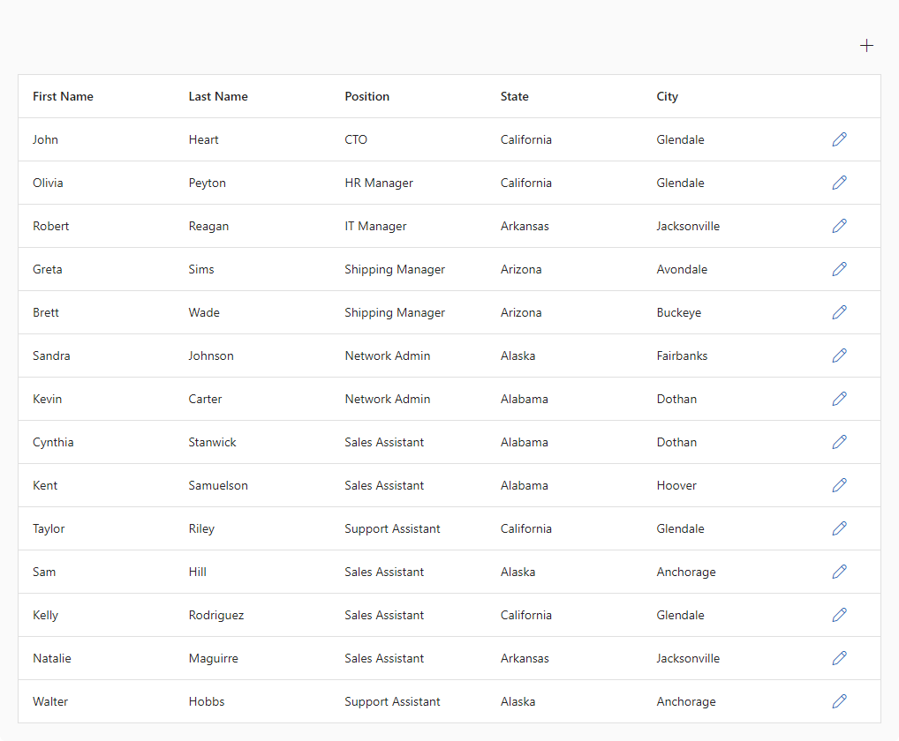

**Critérios de aceite Vortex (preencher na implementação):**

- [ ] Paridade de interação principal da demo
- [ ] API Signals documentada (`input`/`model`/`output`)
- [ ] Tema Fluent Light + Fluent Green sem regressão visual
- [ ] Storybook / Widgets Gallery Vortex com caso equivalente

#### 022. Edição Colaborativa / Collaborative Editing

- **Status Vortex:** TODO
- **Slug DX:** `CollaborativeEditing`
- **URL:** https://js.devexpress.com/Angular/Demos/WidgetsGallery/Demo/DataGrid/CollaborativeEditing/FluentBlueLight/
- **Imagem:** `images/022-DataGrid-CollaborativeEditing.png`
- **Raw JSON:** `raw/022-DataGrid-CollaborativeEditing.json`
- **Título página:** Angular Data Grid - Collaborative Editing
- **Descrição (EN, fonte DX):**

> Multiple users can edit the DataGrid's data in real-time. In this demo, changes made in one DataGrid are broadcasted to the other DataGrid via the SignalR service.

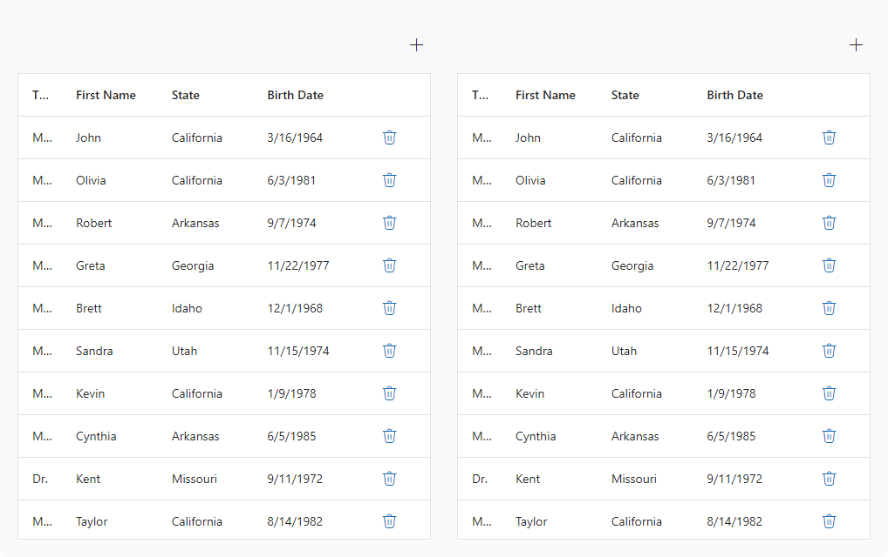

**Critérios de aceite Vortex (preencher na implementação):**

- [ ] Paridade de interação principal da demo
- [ ] API Signals documentada (`input`/`model`/`output`)
- [ ] Tema Fluent Light + Fluent Green sem regressão visual
- [ ] Storybook / Widgets Gallery Vortex com caso equivalente

#### 023. Operações CRUD remotas / Remote CRUD Operations

- **Status Vortex:** TODO
- **Slug DX:** `RemoteCRUDOperations`
- **URL:** https://js.devexpress.com/Angular/Demos/WidgetsGallery/Demo/DataGrid/RemoteCRUDOperations/FluentBlueLight/
- **Imagem:** `images/023-DataGrid-RemoteCRUDOperations.png`
- **Raw JSON:** `raw/023-DataGrid-RemoteCRUDOperations.json`
- **Título página:** Angular Data Grid - Remote CRUD Operations
- **Descrição (EN, fonte DX):**

> This demo shows how to implement remote CRUD operations in the CustomStore. You can view the server implementation under the DataGridWebApiController tab in the ASP.NET MVC version of this demo. The requests sent to the server are displayed under the DataGrid. After a cell is edited, the DataGrid can behave differently depending on the selected refresh mode: reload data from the server (the refreshMode is full), reapply data processing operations (reshape), or merely rerender the changed cells (repaint).

- **API Reference:**
  - [refreshMode](https://js.devexpress.com/Angular/Documentation/ApiReference/UI_Components/dxDataGrid/Configuration/editing/#refreshMode)

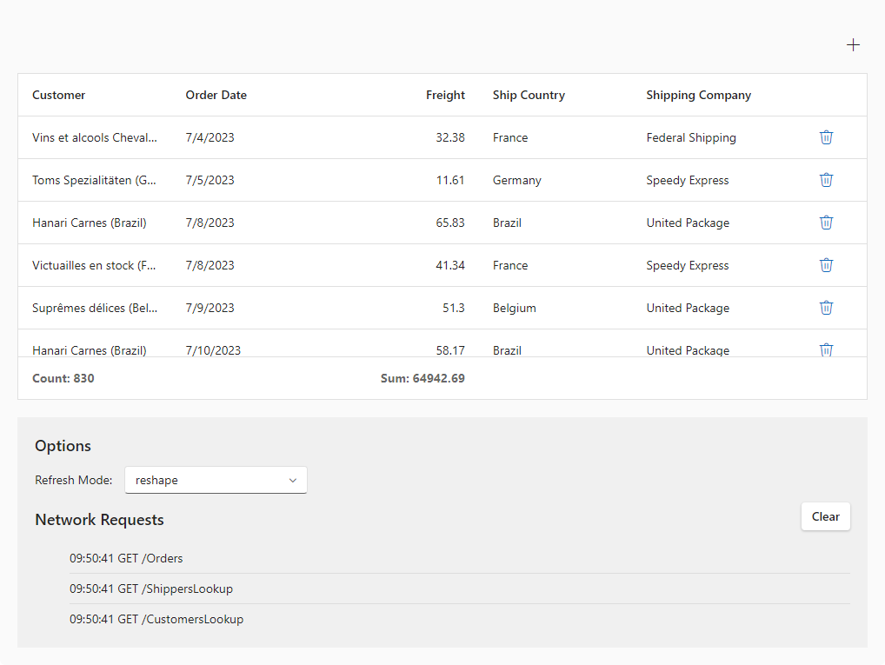

**Critérios de aceite Vortex (preencher na implementação):**

- [ ] Paridade de interação principal da demo
- [ ] API Signals documentada (`input`/`model`/`output`)
- [ ] Tema Fluent Light + Fluent Green sem regressão visual
- [ ] Storybook / Widgets Gallery Vortex com caso equivalente

#### 024. Solicitação de atualização em lote / Batch Update Request

- **Status Vortex:** TODO
- **Slug DX:** `BatchUpdateRequest`
- **URL:** https://js.devexpress.com/Angular/Demos/WidgetsGallery/Demo/DataGrid/BatchUpdateRequest/FluentBlueLight/
- **Imagem:** `images/024-DataGrid-BatchUpdateRequest.png`
- **Raw JSON:** `raw/024-DataGrid-BatchUpdateRequest.json`
- **Título página:** Angular Data Grid - Batch Update Request
- **Descrição (EN, fonte DX):**

> With the DevExtreme DataGrid, users can modify multiple records and submit all changes simultaneously (when editing.mode is set to "batch"). Batch editing allows you to optimize your app, address performance related issues, and deliver the best possible user experience across a variety of usage scenarios.

- **API Reference:**
  - [mode](https://js.devexpress.com/Angular/Documentation/ApiReference/UI_Components/dxDataGrid/Configuration/editing/#mode)
  - [onSaving](https://js.devexpress.com/Angular/Documentation/ApiReference/UI_Components/dxDataGrid/Configuration/#onSaving)
  - [refresh(changesOnly)](https://js.devexpress.com/Angular/Documentation/ApiReference/UI_Components/dxDataGrid/Methods/#refreshchangesOnly)
  - [cancelEditData()](https://js.devexpress.com/Angular/Documentation/ApiReference/UI_Components/dxDataGrid/Methods/#cancelEditData)

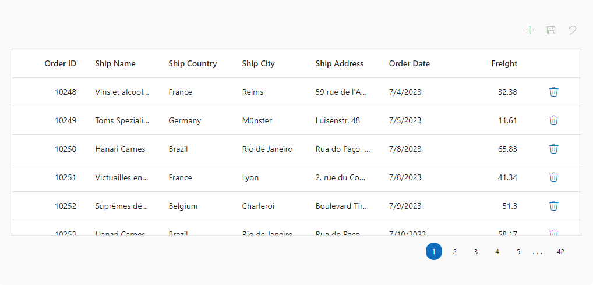

**Critérios de aceite Vortex (preencher na implementação):**

- [ ] Paridade de interação principal da demo
- [ ] API Signals documentada (`input`/`model`/`output`)
- [ ] Tema Fluent Light + Fluent Green sem regressão visual
- [ ] Storybook / Widgets Gallery Vortex com caso equivalente

#### 025. Editar gerenciamento de estado / Edit State Management

- **Status Vortex:** TODO
- **Slug DX:** `EditStateManagement`
- **URL:** https://js.devexpress.com/Angular/Demos/WidgetsGallery/Demo/DataGrid/EditStateManagement/FluentBlueLight/
- **Imagem:** `images/025-DataGrid-EditStateManagement.png`
- **Raw JSON:** `raw/025-DataGrid-EditStateManagement.json`
- **Título página:** Angular Data Grid - Edit State Management
- **Descrição (EN, fonte DX):**

> Our DataGrid component manages its edit state automatically. If your use case requires full control over the editing process, you can use the API members below to manage state manually. In this demo, we manage state with a help of the RxJS library.

- **API Reference:**
  - [editRowKey](https://js.devexpress.com/Angular/Documentation/ApiReference/UI_Components/dxDataGrid/Configuration/editing/#editRowKey)
  - [editColumnName](https://js.devexpress.com/Angular/Documentation/ApiReference/UI_Components/dxDataGrid/Configuration/editing/#editColumnName)
  - [changes](https://js.devexpress.com/Angular/Documentation/ApiReference/UI_Components/dxDataGrid/Configuration/editing/#changes)
  - [DevExpress.data.applyChanges(data, changes, options)](https://js.devexpress.com/Angular/Documentation/ApiReference/Data_Layer/Utils/#applyChangesdata_changes_options)
  - [onSaving](https://js.devexpress.com/Angular/Documentation/ApiReference/UI_Components/dxDataGrid/Configuration/#onSaving)
  - [onSaved](https://js.devexpress.com/Angular/Documentation/ApiReference/UI_Components/dxDataGrid/Configuration/#onSaved)
  - [onEditCanceling](https://js.devexpress.com/Angular/Documentation/ApiReference/UI_Components/dxDataGrid/Configuration/#onEditCanceling)
  - [onEditCanceled](https://js.devexpress.com/Angular/Documentation/ApiReference/UI_Components/dxDataGrid/Configuration/#onEditCanceled)

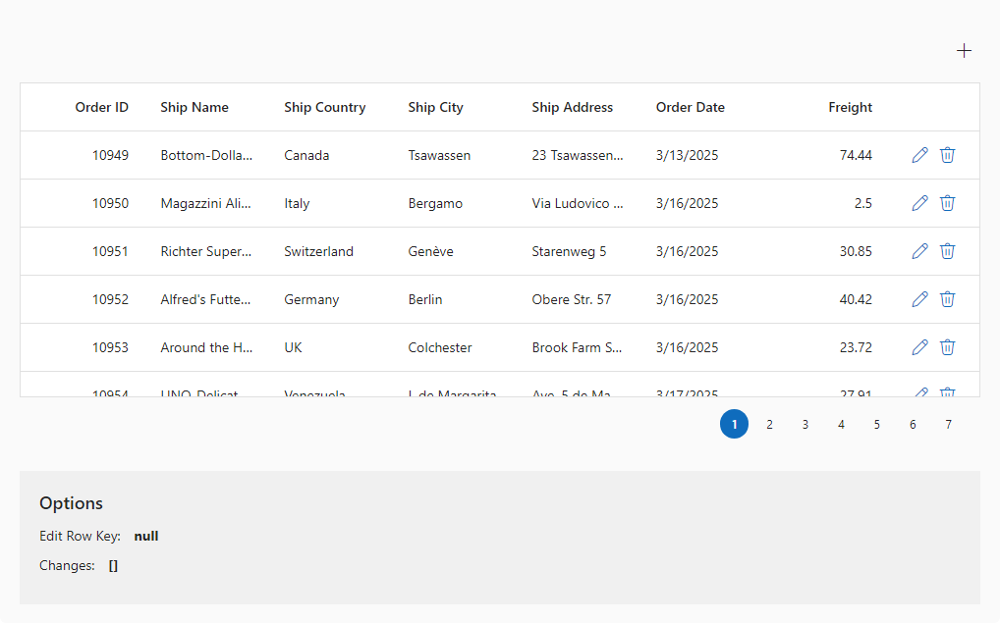

**Critérios de aceite Vortex (preencher na implementação):**

- [ ] Paridade de interação principal da demo
- [ ] API Signals documentada (`input`/`model`/`output`)
- [ ] Tema Fluent Light + Fluent Green sem regressão visual
- [ ] Storybook / Widgets Gallery Vortex com caso equivalente

#### 026. Nova posição recorde / New Record Position

- **Status Vortex:** TODO
- **Slug DX:** `NewRecordPosition`
- **URL:** https://js.devexpress.com/Angular/Demos/WidgetsGallery/Demo/DataGrid/NewRecordPosition/FluentBlueLight/
- **Imagem:** `images/026-DataGrid-NewRecordPosition.png`
- **Raw JSON:** `raw/026-DataGrid-NewRecordPosition.json`
- **Título página:** Angular Data Grid - New Record Position
- **Descrição (EN, fonte DX):**

> The DevExtreme DataGrid API includes a newRowPosition property. With this property, you can specify the desired "new record" position as follows.

- **API Reference:**
  - [newRowPosition](https://js.devexpress.com/Angular/Documentation/ApiReference/UI_Components/dxDataGrid/Configuration/editing/#newRowPosition)
  - [scrolling modes](https://js.devexpress.com/Angular/Documentation/ApiReference/UI_Components/dxDataGrid/Configuration/scrolling/#mode)
  - [insertBeforeKey](https://js.devexpress.com/Angular/Documentation/ApiReference/UI_Components/dxDataGrid/Configuration/editing/changes/#insertBeforeKey)
  - [insertAfterKey](https://js.devexpress.com/Angular/Documentation/ApiReference/UI_Components/dxDataGrid/Configuration/editing/changes/#insertAfterKey)
  - [changes](https://js.devexpress.com/Angular/Documentation/ApiReference/UI_Components/dxDataGrid/Configuration/editing/changes/)
  - [navigateToRow(key)](https://js.devexpress.com/Angular/Documentation/ApiReference/UI_Components/dxDataGrid/Methods/#navigateToRowkey)
  - [onRowInserted](https://js.devexpress.com/Angular/Documentation/ApiReference/UI_Components/dxDataGrid/Configuration/#onRowInserted)
  - [refreshMode](https://js.devexpress.com/Angular/Documentation/ApiReference/UI_Components/dxDataGrid/Configuration/editing/#refreshMode)

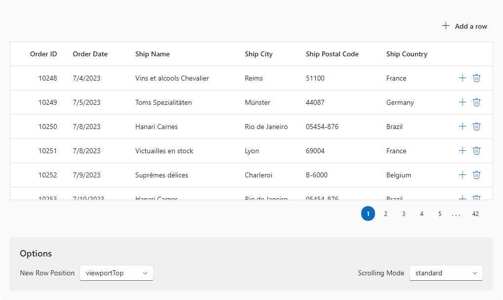

**Critérios de aceite Vortex (preencher na implementação):**

- [ ] Paridade de interação principal da demo
- [ ] API Signals documentada (`input`/`model`/`output`)
- [ ] Tema Fluent Light + Fluent Green sem regressão visual
- [ ] Storybook / Widgets Gallery Vortex com caso equivalente

### Agrupamento (Grouping)

#### 027. Agrupamento de Registros / Record Grouping

- **Status Vortex:** TODO
- **Slug DX:** `RecordGrouping`
- **URL:** https://js.devexpress.com/Angular/Demos/WidgetsGallery/Demo/DataGrid/RecordGrouping/FluentBlueLight/
- **Imagem:** `images/027-DataGrid-RecordGrouping.png`
- **Raw JSON:** `raw/027-DataGrid-RecordGrouping.json`
- **Título página:** Angular Data Grid - Record Grouping
- **Descrição (EN, fonte DX):**

> To group data by columns, users can utilize the group panel. Enable the groupPanel.visible property to display the group panel area.

- **API Reference:**
  - [groupPanel](https://js.devexpress.com/Angular/Documentation/ApiReference/UI_Components/dxDataGrid/Configuration/groupPanel/)
  - [visible](https://js.devexpress.com/Angular/Documentation/ApiReference/UI_Components/dxDataGrid/Configuration/groupPanel/#visible)
  - [showWhenGrouped](https://js.devexpress.com/Angular/Documentation/ApiReference/UI_Components/dxDataGrid/Configuration/columns/#showWhenGrouped)
  - [allowColumnReordering](https://js.devexpress.com/Angular/Documentation/ApiReference/UI_Components/dxDataGrid/Configuration/#allowColumnReordering)
  - [groupIndex](https://js.devexpress.com/Angular/Documentation/ApiReference/UI_Components/dxDataGrid/Configuration/columns/#groupIndex)
  - [grouping](https://js.devexpress.com/Angular/Documentation/ApiReference/UI_Components/dxDataGrid/Configuration/grouping/)
  - [autoExpandAll](https://js.devexpress.com/Angular/Documentation/ApiReference/UI_Components/dxDataGrid/Configuration/grouping/#autoExpandAll)

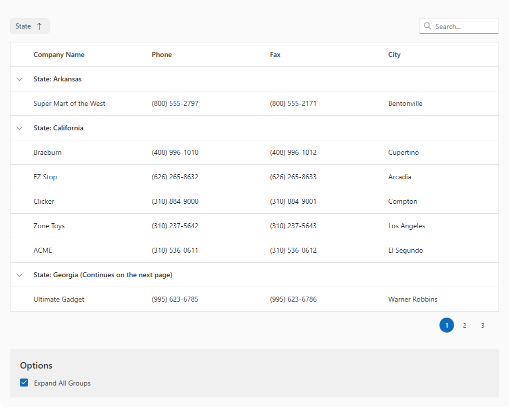

**Critérios de aceite Vortex (preencher na implementação):**

- [ ] Paridade de interação principal da demo
- [ ] API Signals documentada (`input`/`model`/`output`)
- [ ] Tema Fluent Light + Fluent Green sem regressão visual
- [ ] Storybook / Widgets Gallery Vortex com caso equivalente

#### 028. Agrupamento remoto / Remote Grouping

- **Status Vortex:** TODO
- **Slug DX:** `RemoteGrouping`
- **URL:** https://js.devexpress.com/Angular/Demos/WidgetsGallery/Demo/DataGrid/RemoteGrouping/FluentBlueLight/
- **Imagem:** `images/028-DataGrid-RemoteGrouping.png`
- **Raw JSON:** `raw/028-DataGrid-RemoteGrouping.json`
- **Título página:** Angular Data Grid - Remote Grouping
- **Descrição (EN, fonte DX):**

> Remote (server-side) operations can boost the DataGrid's performance on large datasets. In this demo, the DataGrid works with a million records seamlessly because they are processed on the server. To notify the DataGrid that it works with a pre-processed dataset, set the remoteOperations property to true.

- **Docs Guide:**
  - [Server-Side Data Processing](https://js.devexpress.com/Angular/Documentation/Guide/Data_Binding/Specify_a_Data_Source/Custom_Data_Sources/#Load_Data/Server-Side_Data_Processing)
- **API Reference:**
  - [remoteOperations](https://js.devexpress.com/Angular/Documentation/ApiReference/UI_Components/dxDataGrid/Configuration/remoteOperations/)
  - [autoExpandAll](https://js.devexpress.com/Angular/Documentation/ApiReference/UI_Components/dxDataGrid/Configuration/grouping/#autoExpandAll)
  - [mode](https://js.devexpress.com/Angular/Documentation/ApiReference/UI_Components/dxDataGrid/Configuration/scrolling/#mode)

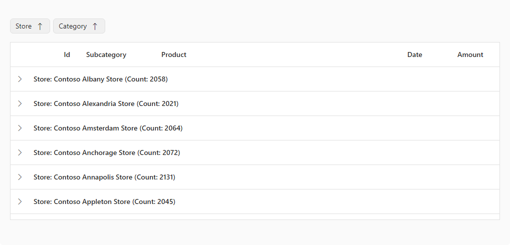

**Critérios de aceite Vortex (preencher na implementação):**

- [ ] Paridade de interação principal da demo
- [ ] API Signals documentada (`input`/`model`/`output`)
- [ ] Tema Fluent Light + Fluent Green sem regressão visual
- [ ] Storybook / Widgets Gallery Vortex com caso equivalente

### Seleção (Selection)

#### 029. Seleção de linha / Row Selection

- **Status Vortex:** TODO
- **Slug DX:** `RowSelection`
- **URL:** https://js.devexpress.com/Angular/Demos/WidgetsGallery/Demo/DataGrid/RowSelection/FluentBlueLight/
- **Imagem:** `images/029-DataGrid-RowSelection.png`
- **Raw JSON:** `raw/029-DataGrid-RowSelection.json`
- **Título página:** Angular Data Grid - Row Selection
- **Descrição (EN, fonte DX):**

> In this demo, the DataGrid allows users to select only one row at a time. To enable this mode, set the selection.mode property to "single". You can click a row to select it, and Ctrl+Click to unselect it. Focus the component's data cells with the arrow keys, Tab, Shift+Tab, Home, and End, and press Space to select a row. Use Ctrl+Space to unselect the selected row. You can access the selected row data from the onSelectionChanged function. In this demo, this function fetches the selected row's information and displays it under the grid.

- **API Reference:**
  - [mode](https://js.devexpress.com/Angular/Documentation/ApiReference/UI_Components/dxDataGrid/Configuration/selection/#mode)
  - [onSelectionChanged](https://js.devexpress.com/Angular/Documentation/ApiReference/UI_Components/dxDataGrid/Configuration/#onSelectionChanged)

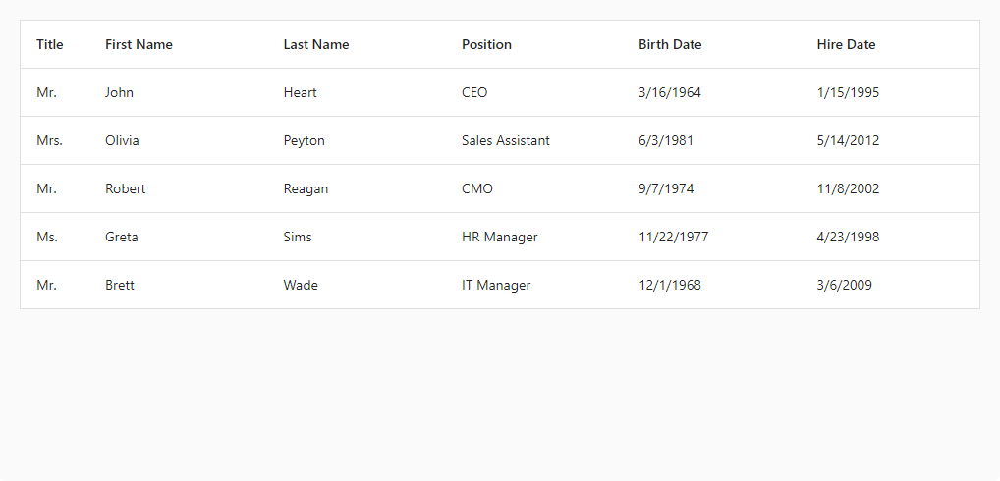

**Critérios de aceite Vortex (preencher na implementação):**

- [ ] Paridade de interação principal da demo
- [ ] API Signals documentada (`input`/`model`/`output`)
- [ ] Tema Fluent Light + Fluent Green sem regressão visual
- [ ] Storybook / Widgets Gallery Vortex com caso equivalente

#### 030. Seleção de múltiplos registros / Multiple Record Selection

- **Status Vortex:** TODO
- **Slug DX:** `MultipleRecordSelectionModes`
- **URL:** https://js.devexpress.com/Angular/Demos/WidgetsGallery/Demo/DataGrid/MultipleRecordSelectionModes/FluentBlueLight/
- **Imagem:** `images/030-DataGrid-MultipleRecordSelectionModes.png`
- **Raw JSON:** `raw/030-DataGrid-MultipleRecordSelectionModes.json`
- **Título página:** Angular Data Grid - Multiple Record Selection
- **Descrição (EN, fonte DX):**

> This demo sets selection.mode to "multiple". This allows users to select multiple rows using checkboxes or keyboard shortcuts. To configure when the checkboxes appear, set the showCheckBoxesMode property. The checkbox in the header selects all rows or current page rows, depending on the selectAllMode value. If you want to disable this checkbox, set allowSelectAll to false. In this demo, you can use the drop-down menus under the grid to change the showCheckBoxesMode and selectAllMode values.

- **Docs Guide:**
  - [Keyboard Navigation](https://js.devexpress.com/Angular/Documentation/Guide/UI_Components/DataGrid/Accessibility/#Keyboard_Navigation)
- **API Reference:**
  - [mode](https://js.devexpress.com/Angular/Documentation/ApiReference/UI_Components/dxDataGrid/Configuration/selection/#mode)
  - [showCheckBoxesMode](https://js.devexpress.com/Angular/Documentation/ApiReference/UI_Components/dxDataGrid/Configuration/selection/#showCheckBoxesMode)
  - [selectAllMode](https://js.devexpress.com/Angular/Documentation/ApiReference/UI_Components/dxDataGrid/Configuration/selection/#selectAllMode)
  - [allowSelectAll](https://js.devexpress.com/Angular/Documentation/ApiReference/UI_Components/dxDataGrid/Configuration/selection/#allowSelectAll)

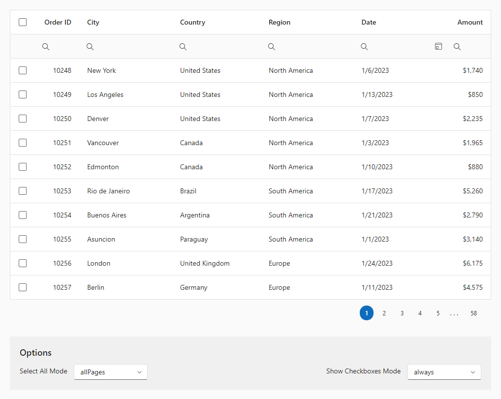

**Critérios de aceite Vortex (preencher na implementação):**

- [ ] Paridade de interação principal da demo
- [ ] API Signals documentada (`input`/`model`/`output`)
- [ ] Tema Fluent Light + Fluent Green sem regressão visual
- [ ] Storybook / Widgets Gallery Vortex com caso equivalente

#### 031. API de seleção de múltiplos registros / Multiple Record Selection API

- **Status Vortex:** TODO
- **Slug DX:** `MultipleRecordSelectionAPI`
- **URL:** https://js.devexpress.com/Angular/Demos/WidgetsGallery/Demo/DataGrid/MultipleRecordSelectionAPI/FluentBlueLight/
- **Imagem:** `images/031-DataGrid-MultipleRecordSelectionAPI.png`
- **Raw JSON:** `raw/031-DataGrid-MultipleRecordSelectionAPI.json`
- **Título página:** Angular Data Grid - Multiple Record Selection API
- **Descrição (EN, fonte DX):**

> DataGrid has the following API for multiple record selection: selectAll() / deselectAll() Selects / deselects all rows or current page rows, depending on the value of selectAllMode. selectRows(keys, preserve) / deselectRows(keys) Selects / deselects rows with the specified keys. selectRowsByIndexes(indexes) Selects rows with specific indexes. clearSelection() Clears the selection of all rows on all pages. getSelectedRowKeys() / getSelectedRowsData() Gets the selected rows' keys or data objects.

- **API Reference:**
  - [selectAll()](https://js.devexpress.com/Angular/Documentation/ApiReference/UI_Components/dxDataGrid/Methods/#selectAll)
  - [deselectAll()](https://js.devexpress.com/Angular/Documentation/ApiReference/UI_Components/dxDataGrid/Methods/#deselectAll)
  - [selectAllMode](https://js.devexpress.com/Angular/Documentation/ApiReference/UI_Components/dxDataGrid/Configuration/selection/#selectAllMode)
  - [selectRows(keys, preserve)](https://js.devexpress.com/Angular/Documentation/ApiReference/UI_Components/dxDataGrid/Methods/#selectRowskeys_preserve)
  - [deselectRows(keys)](https://js.devexpress.com/Angular/Documentation/ApiReference/UI_Components/dxDataGrid/Methods/#deselectRowskeys)
  - [selectRowsByIndexes(indexes)](https://js.devexpress.com/Angular/Documentation/ApiReference/UI_Components/dxDataGrid/Methods/#selectRowsByIndexesindexes)
  - [clearSelection()](https://js.devexpress.com/Angular/Documentation/ApiReference/UI_Components/dxDataGrid/Methods/#clearSelection)
  - [getSelectedRowKeys()](https://js.devexpress.com/Angular/Documentation/ApiReference/UI_Components/dxDataGrid/Methods/#getSelectedRowKeys)

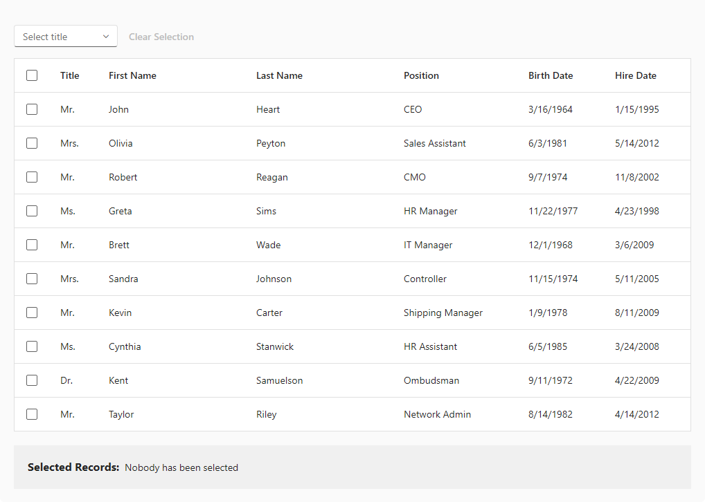

**Critérios de aceite Vortex (preencher na implementação):**

- [ ] Paridade de interação principal da demo
- [ ] API Signals documentada (`input`/`model`/`output`)
- [ ] Tema Fluent Light + Fluent Green sem regressão visual
- [ ] Storybook / Widgets Gallery Vortex com caso equivalente

#### 032. Seleção Diferida / Deferred Selection

- **Status Vortex:** TODO
- **Slug DX:** `DeferredSelection`
- **URL:** https://js.devexpress.com/Angular/Demos/WidgetsGallery/Demo/DataGrid/DeferredSelection/FluentBlueLight/
- **Imagem:** `images/032-DataGrid-DeferredSelection.png`
- **Raw JSON:** `raw/032-DataGrid-DeferredSelection.json`
- **Título página:** Angular Data Grid - Deferred Selection
- **Descrição (EN, fonte DX):**

> If you enable deferred row selection, the grid does not request selected rows' data with every selection change. For example, if a user clicks the checkbox in the column header to select all the rows, the grid does not immediately fetch all data from the server. This is helpful in the following cases: You process data on the server and do not want to load the selected rows' data. You do process selected records on the client, but want to reduce the number of requests that are sent.

- **API Reference:**
  - [deferred](https://js.devexpress.com/Angular/Documentation/ApiReference/UI_Components/dxDataGrid/Configuration/selection/#deferred)
  - [selectionFilter](https://js.devexpress.com/Angular/Documentation/ApiReference/UI_Components/dxDataGrid/Configuration/#selectionFilter)
  - [getSelectedRowsData()](https://js.devexpress.com/Angular/Documentation/ApiReference/UI_Components/dxDataGrid/Methods/#getSelectedRowsData)

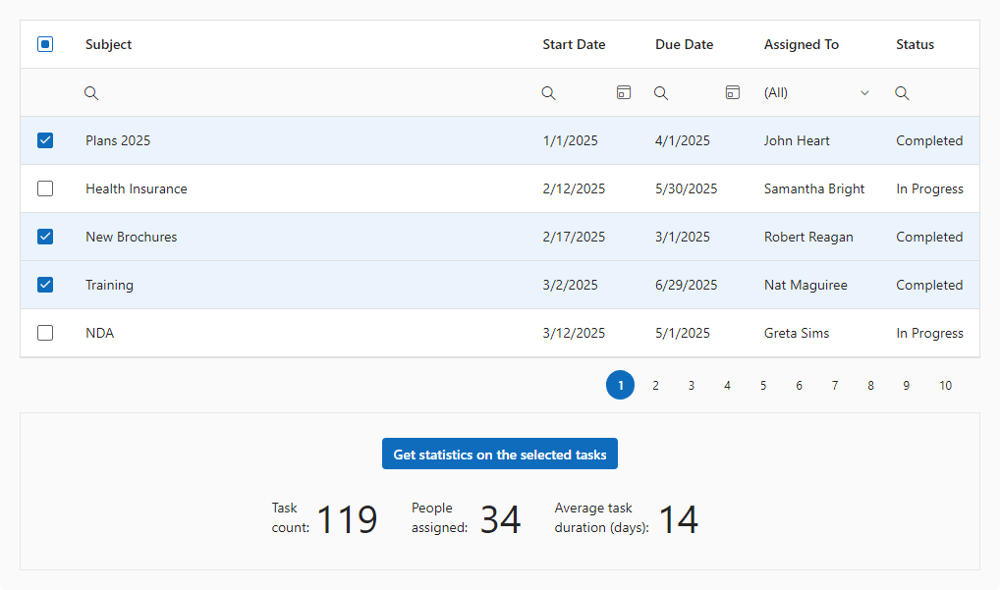

**Critérios de aceite Vortex (preencher na implementação):**

- [ ] Paridade de interação principal da demo
- [ ] API Signals documentada (`input`/`model`/`output`)
- [ ] Tema Fluent Light + Fluent Green sem regressão visual
- [ ] Storybook / Widgets Gallery Vortex com caso equivalente

#### 033. Linha focada / Focused Row

- **Status Vortex:** TODO
- **Slug DX:** `FocusedRow`
- **URL:** https://js.devexpress.com/Angular/Demos/WidgetsGallery/Demo/DataGrid/FocusedRow/FluentBlueLight/
- **Imagem:** `images/033-DataGrid-FocusedRow.png`
- **Raw JSON:** `raw/033-DataGrid-FocusedRow.json`
- **Título página:** Angular Data Grid - Focused Row
- **Descrição (EN, fonte DX):**

> The DataGrid component can highlight the focused row. To enable this feature, set the focusedRowEnabled property to true. To focus a row programmatically, specify the focusedRowKey property. The DataGrid automatically scrolls to the focused row if the autoNavigateToFocusedRow property is enabled. In the UI, users can click a row to focus it. The focused row is saved in the DataGrid's state. You can use the onFocusedRowChanging or onFocusedRowChanged property to specify a custom function that is executed before or after a row is focused.

- **API Reference:**
  - [focusedRowEnabled](https://js.devexpress.com/Angular/Documentation/ApiReference/UI_Components/dxDataGrid/Configuration/#focusedRowEnabled)
  - [focusedRowKey](https://js.devexpress.com/Angular/Documentation/ApiReference/UI_Components/dxDataGrid/Configuration/#focusedRowKey)
  - [autoNavigateToFocusedRow](https://js.devexpress.com/Angular/Documentation/ApiReference/UI_Components/dxDataGrid/Configuration/#autoNavigateToFocusedRow)
  - [state](https://js.devexpress.com/Angular/Documentation/ApiReference/UI_Components/dxDataGrid/Configuration/stateStoring/)
  - [onFocusedRowChanging](https://js.devexpress.com/Angular/Documentation/ApiReference/UI_Components/dxDataGrid/Configuration/#onFocusedRowChanging)
  - [onFocusedRowChanged](https://js.devexpress.com/Angular/Documentation/ApiReference/UI_Components/dxDataGrid/Configuration/#onFocusedRowChanged)

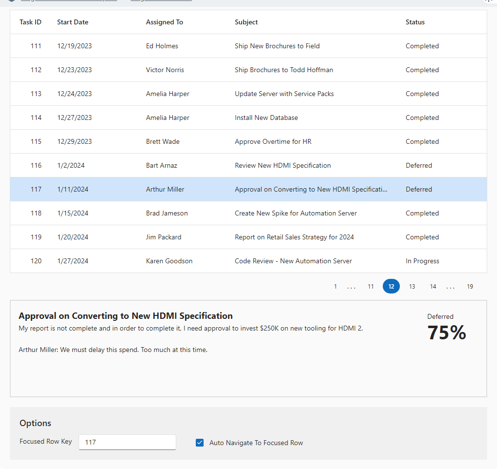

**Critérios de aceite Vortex (preencher na implementação):**

- [ ] Paridade de interação principal da demo
- [ ] API Signals documentada (`input`/`model`/`output`)
- [ ] Tema Fluent Light + Fluent Green sem regressão visual
- [ ] Storybook / Widgets Gallery Vortex com caso equivalente

### Chamada (Paging)

#### 034. Chamada (paginação) / Paging

- **Status Vortex:** TODO
- **Slug DX:** `RecordPaging`
- **URL:** https://js.devexpress.com/Angular/Demos/WidgetsGallery/Demo/DataGrid/RecordPaging/FluentBlueLight/
- **Imagem:** `images/034-DataGrid-RecordPaging.png`
- **Raw JSON:** `raw/034-DataGrid-RecordPaging.json`
- **Título página:** Angular Data Grid - Paging
- **Descrição (EN, fonte DX):**

> The DevExtreme DataGrid ships with comprehensive data paging support and can load rows in chunks to improve performance when displaying large data sets. This demo allows you to navigate between pages using the DataGrid’s integrated pager. You can use the controls below the DataGrid to change pager display mode and toggle visibility of individual pager elements. Note: navigation buttons are always visible in compact mode.

- **Docs Guide:**
  - [Pagination](https://js.devexpress.com/Angular/Documentation/Guide/UI_Components/Pagination/Overview/)
- **API Reference:**
  - [pager](https://js.devexpress.com/Angular/Documentation/ApiReference/UI_Components/dxDataGrid/Configuration/pager/)
  - [showPageSizeSelector](https://js.devexpress.com/Angular/Documentation/ApiReference/UI_Components/dxDataGrid/Configuration/pager/#showPageSizeSelector)
  - [allowed page sizes](https://js.devexpress.com/Angular/Documentation/ApiReference/UI_Components/dxDataGrid/Configuration/pager/#allowedPageSizes)
  - [page size](https://js.devexpress.com/Angular/Documentation/ApiReference/UI_Components/dxDataGrid/Configuration/paging/#pageSize)
  - [showInfo](https://js.devexpress.com/Angular/Documentation/ApiReference/UI_Components/dxDataGrid/Configuration/pager/#showInfo)
  - [information text](https://js.devexpress.com/Angular/Documentation/ApiReference/UI_Components/dxDataGrid/Configuration/pager/#infoText)
  - [display modes](https://js.devexpress.com/Angular/Documentation/ApiReference/UI_Components/dxDataGrid/Configuration/pager/#displayMode)

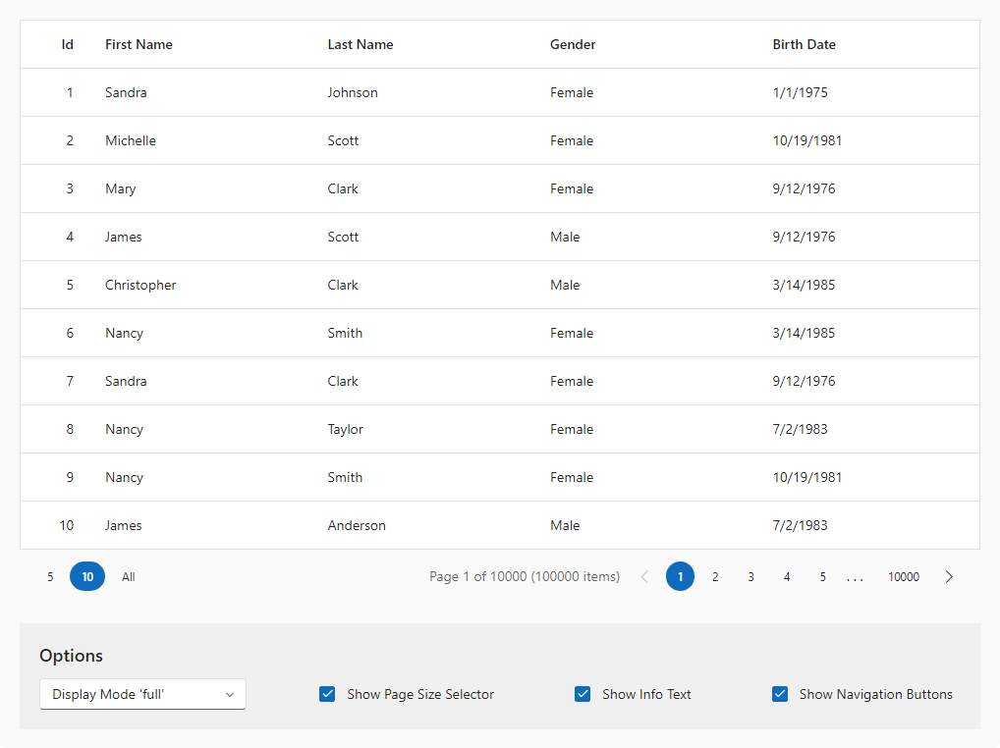

**Critérios de aceite Vortex (preencher na implementação):**

- [ ] Paridade de interação principal da demo
- [ ] API Signals documentada (`input`/`model`/`output`)
- [ ] Tema Fluent Light + Fluent Green sem regressão visual
- [ ] Storybook / Widgets Gallery Vortex com caso equivalente

### Rolagem (Scrolling)

#### 035. Rolagem virtual local / Local Virtual Scrolling

- **Status Vortex:** TODO
- **Slug DX:** `VirtualScrolling`
- **URL:** https://js.devexpress.com/Angular/Demos/WidgetsGallery/Demo/DataGrid/VirtualScrolling/FluentBlueLight/
- **Imagem:** `images/035-DataGrid-VirtualScrolling.png`
- **Raw JSON:** `raw/035-DataGrid-VirtualScrolling.json`
- **Título página:** Angular Data Grid - Local Virtual Scrolling
- **Descrição (EN, fonte DX):**

> To optimize data load times and improve user navigation when binding DataGrid to a large dataset, you can enable virtual scrolling. In this demo, we bind the component to a dataset of 100,000 records. To enable virtual scrolling, set scrolling.mode to "virtual".

- **API Reference:**
  - [mode](https://js.devexpress.com/Angular/Documentation/ApiReference/UI_Components/dxDataGrid/Configuration/scrolling/#mode)

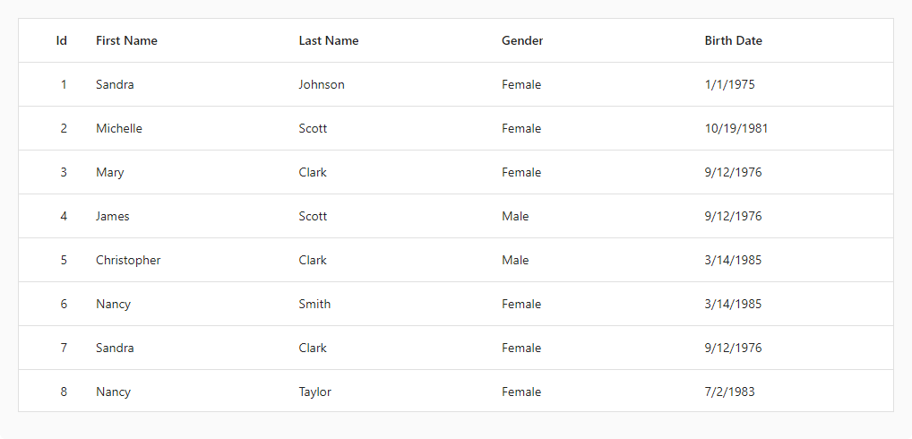

**Critérios de aceite Vortex (preencher na implementação):**

- [ ] Paridade de interação principal da demo
- [ ] API Signals documentada (`input`/`model`/`output`)
- [ ] Tema Fluent Light + Fluent Green sem regressão visual
- [ ] Storybook / Widgets Gallery Vortex com caso equivalente

#### 036. Rolagem virtual remota / Remote Virtual Scrolling

- **Status Vortex:** TODO
- **Slug DX:** `RemoteVirtualScrolling`
- **URL:** https://js.devexpress.com/Angular/Demos/WidgetsGallery/Demo/DataGrid/RemoteVirtualScrolling/FluentBlueLight/
- **Imagem:** `images/036-DataGrid-RemoteVirtualScrolling.png`
- **Raw JSON:** `raw/036-DataGrid-RemoteVirtualScrolling.json`
- **Título página:** Angular Data Grid - Remote Virtual Scrolling
- **Descrição (EN, fonte DX):**

> With remote virtual scrolling, pages are loaded from the server when they enter the viewport. To enable this feature, set the scrolling.mode property to "virtual" and the remoteOperations property to true. The latter informs the DataGrid that the server handles paging.

- **API Reference:**
  - [mode](https://js.devexpress.com/Angular/Documentation/ApiReference/UI_Components/dxDataGrid/Configuration/scrolling/#mode)
  - [remoteOperations](https://js.devexpress.com/Angular/Documentation/ApiReference/UI_Components/dxDataGrid/Configuration/remoteOperations/)
  - [pageSize](https://js.devexpress.com/Angular/Documentation/ApiReference/UI_Components/dxDataGrid/Configuration/paging/#pageSize)
  - [rowRenderingMode](https://js.devexpress.com/Angular/Documentation/ApiReference/UI_Components/dxDataGrid/Configuration/scrolling/#rowRenderingMode)

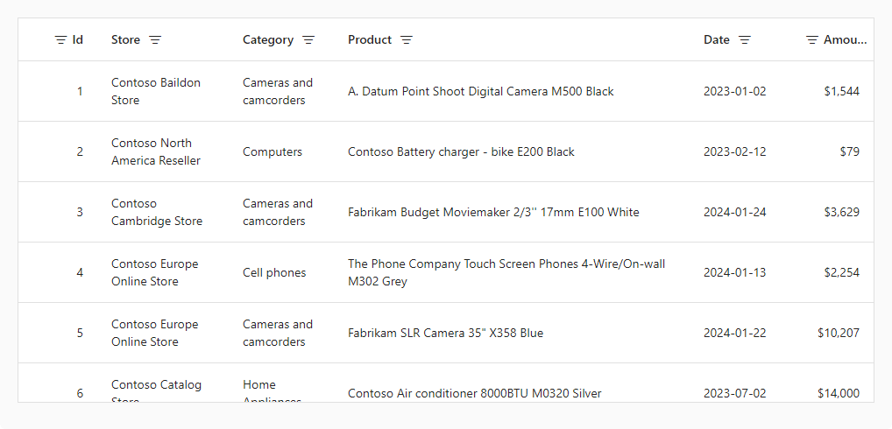

**Critérios de aceite Vortex (preencher na implementação):**

- [ ] Paridade de interação principal da demo
- [ ] API Signals documentada (`input`/`model`/`output`)
- [ ] Tema Fluent Light + Fluent Green sem regressão visual
- [ ] Storybook / Widgets Gallery Vortex com caso equivalente

#### 037. Rolagem virtual horizontal / Horizontal Virtual Scrolling

- **Status Vortex:** TODO
- **Slug DX:** `HorizontalVirtualScrolling`
- **URL:** https://js.devexpress.com/Angular/Demos/WidgetsGallery/Demo/DataGrid/HorizontalVirtualScrolling/FluentBlueLight/
- **Imagem:** `images/037-DataGrid-HorizontalVirtualScrolling.png`
- **Raw JSON:** `raw/037-DataGrid-HorizontalVirtualScrolling.json`
- **Título página:** Angular Data Grid - Horizontal Virtual Scrolling
- **Descrição (EN, fonte DX):**

> Horizontal virtual scrolling improves performance by rendering only displayed columns. To enable this feature, set scrolling.columnRenderingMode to "virtual".

- **API Reference:**
  - [columnRenderingMode](https://js.devexpress.com/Angular/Documentation/ApiReference/UI_Components/dxDataGrid/Configuration/scrolling/#columnRenderingMode)

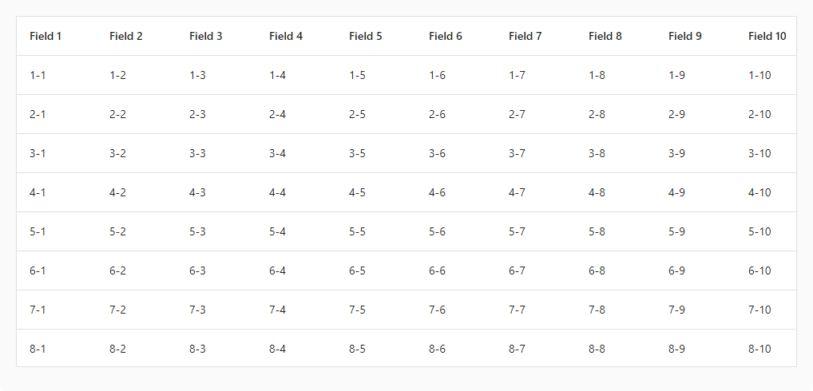

**Critérios de aceite Vortex (preencher na implementação):**

- [ ] Paridade de interação principal da demo
- [ ] API Signals documentada (`input`/`model`/`output`)
- [ ] Tema Fluent Light + Fluent Green sem regressão visual
- [ ] Storybook / Widgets Gallery Vortex com caso equivalente

#### 038. Rolagem infinita / Infinite Scrolling

- **Status Vortex:** TODO
- **Slug DX:** `InfiniteScrolling`
- **URL:** https://js.devexpress.com/Angular/Demos/WidgetsGallery/Demo/DataGrid/InfiniteScrolling/FluentBlueLight/
- **Imagem:** `images/038-DataGrid-InfiniteScrolling.png`
- **Raw JSON:** `raw/038-DataGrid-InfiniteScrolling.json`
- **Título página:** Angular Data Grid - Infinite Scrolling
- **Descrição (EN, fonte DX):**

> To optimize data load times and improve user navigation when binding DataGrid to a large dataset, you can enable infinite scrolling. In this demo, we bind the component to a dataset of 100,000 records. To enable infinite scrolling, set scrolling.mode to "infinite".

- **API Reference:**
  - [mode](https://js.devexpress.com/Angular/Documentation/ApiReference/UI_Components/dxDataGrid/Configuration/scrolling/#mode)

**Critérios de aceite Vortex (preencher na implementação):**

- [ ] Paridade de interação principal da demo
- [ ] API Signals documentada (`input`/`model`/`output`)
- [ ] Tema Fluent Light + Fluent Green sem regressão visual
- [ ] Storybook / Widgets Gallery Vortex com caso equivalente

### Colunas (Columns)

#### 039. Colunas preenchidas automaticamente / Auto-Populated Columns

- **Status Vortex:** TODO
- **Slug DX:** `AutoPopulatedColumns`
- **URL:** https://js.devexpress.com/Angular/Demos/WidgetsGallery/Demo/DataGrid/AutoPopulatedColumns/FluentBlueLight/
- **Imagem:** `images/039-DataGrid-AutoPopulatedColumns.png`
- **Raw JSON:** `raw/039-DataGrid-AutoPopulatedColumns.json`
- **Título página:** Angular Data Grid - Auto-Populated Columns
- **Descrição (EN, fonte DX):**

> To use data source object fields to automatically generate columns, pass an array of objects to the dataSource property and specify the keyExpr - as shown in this example.

- **API Reference:**
  - [dataSource](https://js.devexpress.com/Angular/Documentation/ApiReference/UI_Components/dxDataGrid/Configuration/#dataSource)
  - [keyExpr](https://js.devexpress.com/Angular/Documentation/ApiReference/UI_Components/dxDataGrid/Configuration/#keyExpr)

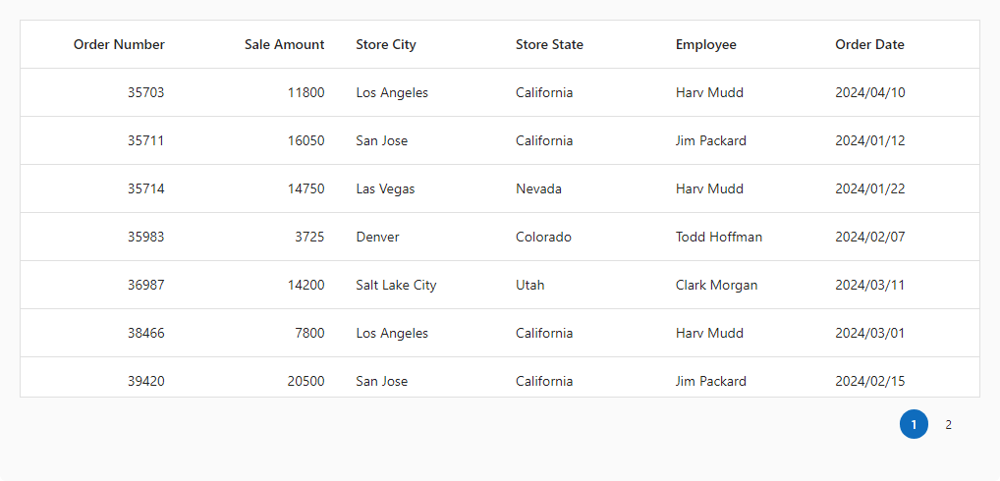

**Critérios de aceite Vortex (preencher na implementação):**

- [ ] Paridade de interação principal da demo
- [ ] API Signals documentada (`input`/`model`/`output`)
- [ ] Tema Fluent Light + Fluent Green sem regressão visual
- [ ] Storybook / Widgets Gallery Vortex com caso equivalente

#### 040. Cabeçalhos (bandas) de vários níveis / Multi-Level Headers (Bands)

- **Status Vortex:** TODO
- **Slug DX:** `MultiRowHeadersBands`
- **URL:** https://js.devexpress.com/Angular/Demos/WidgetsGallery/Demo/DataGrid/MultiRowHeadersBands/FluentBlueLight/
- **Imagem:** `images/040-DataGrid-MultiRowHeadersBands.png`
- **Raw JSON:** `raw/040-DataGrid-MultiRowHeadersBands.json`
- **Título página:** Angular Data Grid - Multi-Level Headers (Bands)
- **Descrição (EN, fonte DX):**

> Our DataGrid component allows you to group multiple columns under one header (band). This demo shows an example: the "Nominal GDP" and "Population" bands have banded columns. You can drag one of the bands across the grid to reorder all its banded columns simultaneously. You can also move the band to the column chooser and hide the banded columns. Banded columns remain interactive.

- **API Reference:**
  - [columns](https://js.devexpress.com/Angular/Documentation/ApiReference/UI_Components/dxDataGrid/Configuration/columns/)
  - [customizeColumns](https://js.devexpress.com/Angular/Documentation/ApiReference/UI_Components/dxDataGrid/Configuration/#customizeColumns)
  - [ownerBand](https://js.devexpress.com/Angular/Documentation/ApiReference/UI_Components/dxDataGrid/Configuration/columns/#ownerBand)
  - [isBand](https://js.devexpress.com/Angular/Documentation/ApiReference/UI_Components/dxDataGrid/Configuration/columns/#isBand)

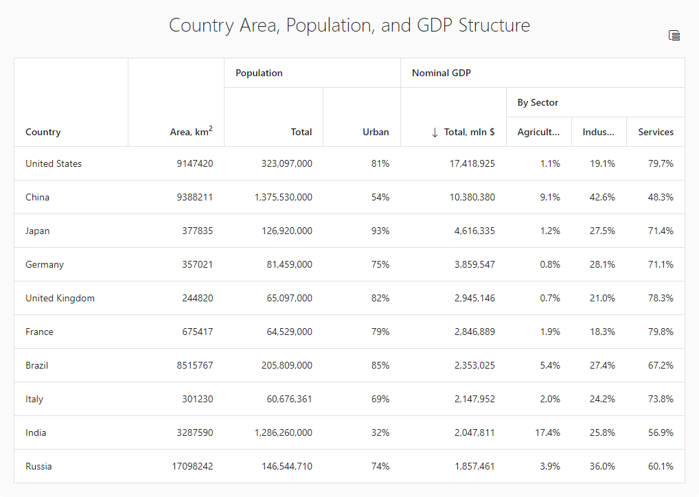

**Critérios de aceite Vortex (preencher na implementação):**

- [ ] Paridade de interação principal da demo
- [ ] API Signals documentada (`input`/`model`/`output`)
- [ ] Tema Fluent Light + Fluent Green sem regressão visual
- [ ] Storybook / Widgets Gallery Vortex com caso equivalente

#### 041. Reordenação de colunas / Column Reordering

- **Status Vortex:** TODO
- **Slug DX:** `ColumnReordering`
- **URL:** https://js.devexpress.com/Angular/Demos/WidgetsGallery/Demo/DataGrid/ColumnReordering/FluentBlueLight/
- **Imagem:** `images/041-DataGrid-ColumnReordering.png`
- **Raw JSON:** `raw/041-DataGrid-ColumnReordering.json`
- **Título página:** Angular Data Grid - Column Reordering
- **Descrição (EN, fonte DX):**

> DevExtreme DataGrid columns use the same display order as fields in the component's dataSource. You can specify a different display order with the columns[] array. To reorder a column at runtime, change the columns[].visibleIndex property.

- **API Reference:**
  - [dataSource](https://js.devexpress.com/Angular/Documentation/ApiReference/UI_Components/dxDataGrid/Configuration/#dataSource)
  - [columns[]](https://js.devexpress.com/Angular/Documentation/ApiReference/UI_Components/dxDataGrid/Configuration/columns/)
  - [visibleIndex](https://js.devexpress.com/Angular/Documentation/ApiReference/UI_Components/dxDataGrid/Configuration/columns/#visibleIndex)
  - [allowColumnReordering](https://js.devexpress.com/Angular/Documentation/ApiReference/UI_Components/dxDataGrid/Configuration/#allowColumnReordering)
  - [allowReordering](https://js.devexpress.com/Angular/Documentation/ApiReference/UI_Components/dxDataGrid/Configuration/columns/#allowReordering)
  - [fixed](https://js.devexpress.com/Angular/Documentation/ApiReference/UI_Components/dxDataGrid/Configuration/columns/#fixed)
  - [position](https://js.devexpress.com/Angular/Documentation/ApiReference/UI_Components/dxDataGrid/Configuration/columns/#fixedPosition)

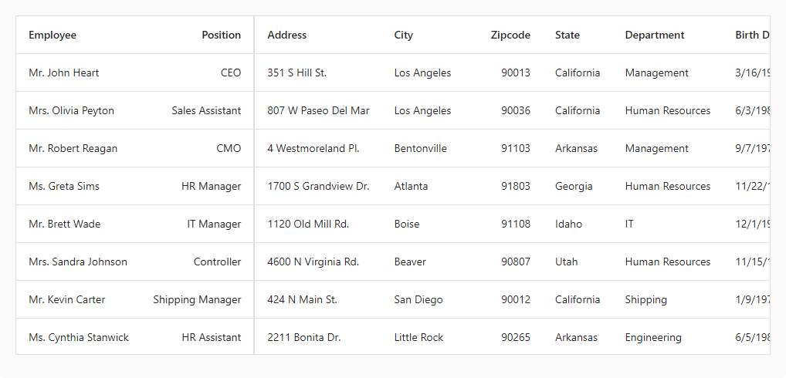

**Critérios de aceite Vortex (preencher na implementação):**

- [ ] Paridade de interação principal da demo
- [ ] API Signals documentada (`input`/`model`/`output`)
- [ ] Tema Fluent Light + Fluent Green sem regressão visual
- [ ] Storybook / Widgets Gallery Vortex com caso equivalente

#### 042. Redimensionamento de colunas / Column Resizing

- **Status Vortex:** TODO
- **Slug DX:** `ColumnResizing`
- **URL:** https://js.devexpress.com/Angular/Demos/WidgetsGallery/Demo/DataGrid/ColumnResizing/FluentBlueLight/
- **Imagem:** `images/042-DataGrid-ColumnResizing.png`
- **Raw JSON:** `raw/042-DataGrid-ColumnResizing.json`
- **Título página:** Angular Data Grid - Column Resizing
- **Descrição (EN, fonte DX):**

> The DataGrid sets the same width for all columns, but you can change column widths as described below.

- **API Reference:**
  - [columnWidth](https://js.devexpress.com/Angular/Documentation/ApiReference/UI_Components/dxDataGrid/Configuration/#columnWidth)
  - [width](https://js.devexpress.com/Angular/Documentation/ApiReference/UI_Components/dxDataGrid/Configuration/columns/#width)
  - [columnMinWidth](https://js.devexpress.com/Angular/Documentation/ApiReference/UI_Components/dxDataGrid/Configuration/#columnMinWidth)
  - [minWidth](https://js.devexpress.com/Angular/Documentation/ApiReference/UI_Components/dxDataGrid/Configuration/columns/#minWidth)
  - [columnAutoWidth](https://js.devexpress.com/Angular/Documentation/ApiReference/UI_Components/dxDataGrid/Configuration/#columnAutoWidth)
  - [allowColumnResizing](https://js.devexpress.com/Angular/Documentation/ApiReference/UI_Components/dxDataGrid/Configuration/#allowColumnResizing)
  - [columnResizingMode](https://js.devexpress.com/Angular/Documentation/ApiReference/UI_Components/dxDataGrid/Configuration/#columnResizingMode)
  - [allowResizing](https://js.devexpress.com/Angular/Documentation/ApiReference/UI_Components/dxDataGrid/Configuration/columns/#allowResizing)

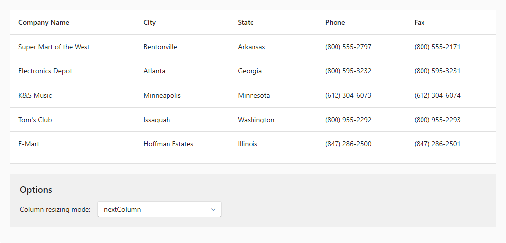

**Critérios de aceite Vortex (preencher na implementação):**

- [ ] Paridade de interação principal da demo
- [ ] API Signals documentada (`input`/`model`/`output`)
- [ ] Tema Fluent Light + Fluent Green sem regressão visual
- [ ] Storybook / Widgets Gallery Vortex com caso equivalente

#### 043. Colunas fixas e adesivas / Fixed and Sticky Columns

- **Status Vortex:** TODO
- **Slug DX:** `FixedAndStickyColumns`
- **URL:** https://js.devexpress.com/Angular/Demos/WidgetsGallery/Demo/DataGrid/FixedAndStickyColumns/FluentBlueLight/
- **Imagem:** `images/043-DataGrid-FixedAndStickyColumns.png`
- **Raw JSON:** `raw/043-DataGrid-FixedAndStickyColumns.json`
- **Título página:** Angular Data Grid - Fixed and Sticky Columns
- **Descrição (EN, fonte DX):**

> A horizontal scrollbar appears when the total width of all grid columns exceeds the DevExtreme DataGrid’s overall width. To maintain column visibility when scrolling horizontally, set the columnFixing.enabled property to true. To fix a column programmatically, set its fixed property to true and specify the desired fixedPosition: 'left' (default if fixed: true) The column is fixed to the leftmost edge of the grid. 'right' The column is fixed to the rightmost edge of the grid. 'sticky' The column "sticks" to the left or rightmost edge when it reaches either side of the grid. To fix (or unfix) a column, right-click a column header and select the desired operation using the DataGrid’s built-in context menu. To prevent users from fixing/unfixing a column, set its allowFixing property to false.

- **API Reference:**
  - [enabled](https://js.devexpress.com/Angular/Documentation/ApiReference/UI_Components/dxDataGrid/Configuration/columnFixing/#enabled)
  - [fixed](https://js.devexpress.com/Angular/Documentation/ApiReference/UI_Components/dxDataGrid/Configuration/columns/#fixed)
  - [fixedPosition](https://js.devexpress.com/Angular/Documentation/ApiReference/UI_Components/dxDataGrid/Configuration/columns/#fixedPosition)
  - [allowFixing](https://js.devexpress.com/Angular/Documentation/ApiReference/UI_Components/dxDataGrid/Configuration/columns/#allowFixing)

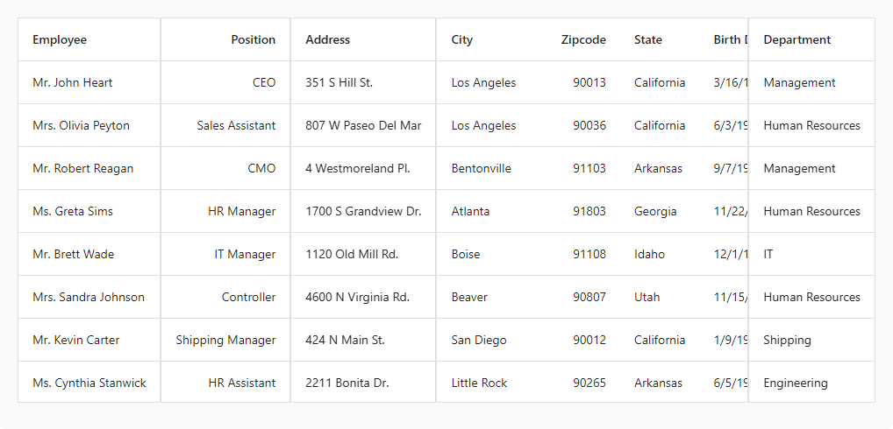

**Critérios de aceite Vortex (preencher na implementação):**

- [ ] Paridade de interação principal da demo
- [ ] API Signals documentada (`input`/`model`/`output`)
- [ ] Tema Fluent Light + Fluent Green sem regressão visual
- [ ] Storybook / Widgets Gallery Vortex com caso equivalente

#### 044. Configuração da coluna de comando / Command Column Configuration

- **Status Vortex:** TODO
- **Slug DX:** `CommandColumnConfiguration`
- **URL:** https://js.devexpress.com/Angular/Demos/WidgetsGallery/Demo/DataGrid/CommandColumnConfiguration/FluentBlueLight/
- **Imagem:** `images/044-DataGrid-CommandColumnConfiguration.png`
- **Raw JSON:** `raw/044-DataGrid-CommandColumnConfiguration.json`
- **Título página:** Angular Data Grid - Command Column Configuration
- **Descrição (EN, fonte DX):**

> The DataGrid supports multiple predefined types of command columns. Each column type supports one type of action (edit, select, drag, etc.). This demo shows how to customize the Edit Command Column. This column type contains predefined edit buttons and optional custom buttons.

- **Docs Guide:**
  - [command columns](https://js.devexpress.com/Angular/Documentation/Guide/UI_Components/DataGrid/Columns/Column_Types/Command_Columns/)
- **API Reference:**
  - [edit mode](https://js.devexpress.com/Angular/Documentation/ApiReference/UI_Components/dxDataGrid/Configuration/editing/#mode)
  - [allowUpdating](https://js.devexpress.com/Angular/Documentation/ApiReference/UI_Components/dxDataGrid/Configuration/editing/#allowUpdating)
  - [allowDeleting](https://js.devexpress.com/Angular/Documentation/ApiReference/UI_Components/dxDataGrid/Configuration/editing/#allowDeleting)
  - [useIcons](https://js.devexpress.com/Angular/Documentation/ApiReference/UI_Components/dxDataGrid/Configuration/editing/#useIcons)
  - [columns](https://js.devexpress.com/Angular/Documentation/ApiReference/UI_Components/dxDataGrid/Configuration/columns/)
  - [type](https://js.devexpress.com/Angular/Documentation/ApiReference/UI_Components/dxDataGrid/Configuration/columns/#type)
  - [buttons](https://js.devexpress.com/Angular/Documentation/ApiReference/UI_Components/dxDataGrid/Configuration/columns/buttons/)
  - [name](https://js.devexpress.com/Angular/Documentation/ApiReference/UI_Components/dxDataGrid/Configuration/columns/buttons/#name)

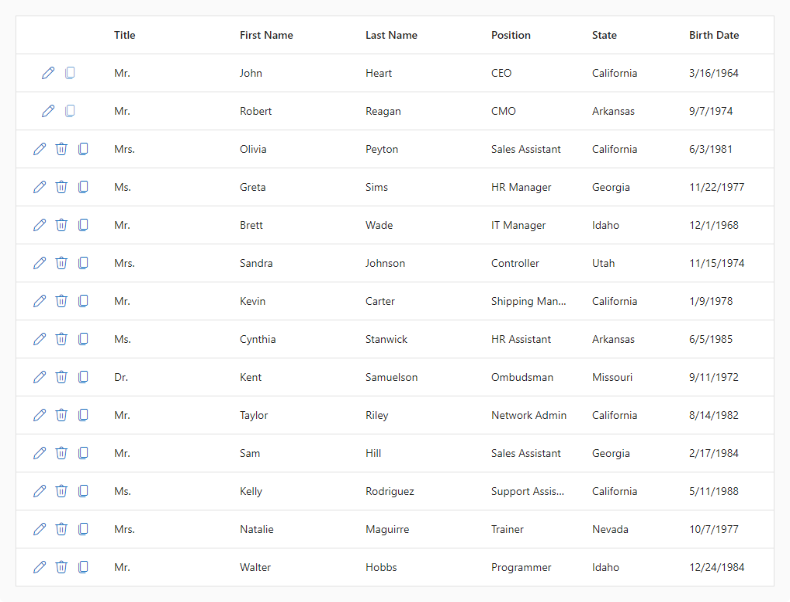

**Critérios de aceite Vortex (preencher na implementação):**

- [ ] Paridade de interação principal da demo
- [ ] API Signals documentada (`input`/`model`/`output`)
- [ ] Tema Fluent Light + Fluent Green sem regressão visual
- [ ] Storybook / Widgets Gallery Vortex com caso equivalente

#### 045. Seletor de colunas / Column Chooser

- **Status Vortex:** TODO
- **Slug DX:** `ColumnChooser`
- **URL:** https://js.devexpress.com/Angular/Demos/WidgetsGallery/Demo/DataGrid/ColumnChooser/FluentBlueLight/
- **Imagem:** `images/045-DataGrid-ColumnChooser.png`
- **Raw JSON:** `raw/045-DataGrid-ColumnChooser.json`
- **Título página:** Angular Data Grid - Column Chooser
- **Descrição (EN, fonte DX):**

> To change column visibility at runtime, set the columnChooser.enabled property to true. To make certain that a given column(s) always stay visible, set the columns[].allowHiding property to false.

- **API Reference:**
  - [enabled](https://js.devexpress.com/Angular/Documentation/ApiReference/UI_Components/dxDataGrid/Configuration/columnChooser/#enabled)
  - [allowHiding](https://js.devexpress.com/Angular/Documentation/ApiReference/UI_Components/dxDataGrid/Configuration/columns/#allowHiding)
  - [position](https://js.devexpress.com/Angular/Documentation/ApiReference/UI_Components/dxDataGrid/Configuration/columnChooser/#position)
  - [mode](https://js.devexpress.com/Angular/Documentation/ApiReference/UI_Components/dxDataGrid/Configuration/columnChooser/#mode)
  - [recursive](https://js.devexpress.com/Angular/Documentation/ApiReference/UI_Components/dxDataGrid/Configuration/columnChooser/selection/#recursive)
  - [enabled](https://js.devexpress.com/Angular/Documentation/ApiReference/UI_Components/dxDataGrid/Configuration/columnChooser/search/#enabled)
  - [visible](https://js.devexpress.com/Angular/Documentation/ApiReference/UI_Components/dxDataGrid/Configuration/columns/#visible)

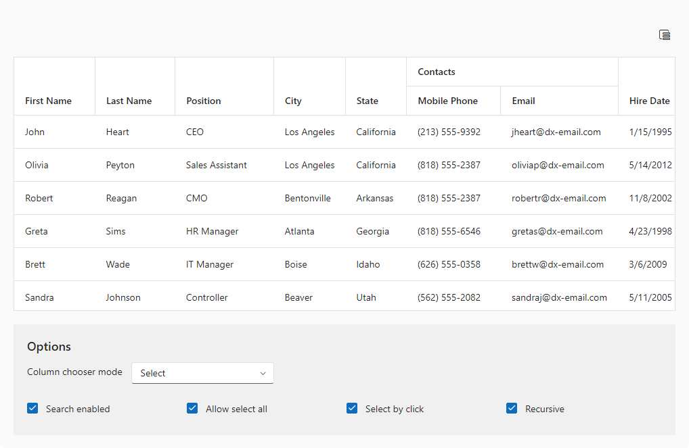

**Critérios de aceite Vortex (preencher na implementação):**

- [ ] Paridade de interação principal da demo
- [ ] API Signals documentada (`input`/`model`/`output`)
- [ ] Tema Fluent Light + Fluent Green sem regressão visual
- [ ] Storybook / Widgets Gallery Vortex com caso equivalente

#### 046. Colunas de IA / AI Columns · **AI**

- **Status Vortex:** TODO
- **Slug DX:** `AIColumns`
- **URL:** https://js.devexpress.com/Angular/Demos/WidgetsGallery/Demo/DataGrid/AIColumns/FluentBlueLight/
- **Imagem:** `images/046-DataGrid-AIColumns.png`
- **Raw JSON:** `raw/046-DataGrid-AIColumns.json`
- **Título página:** Angular Data Grid - AI Columns
- **Descrição (EN, fonte DX):**

> DevExtreme DataGrid allows you to add multiple AI columns to the grid. These columns auto generate meaningful cell values based on component data and a custom prompt, transforming DevExtreme DataGrid into an AI-powered data analysis tool. In this demo, an AI column is fixed to the right side of the component.

- **API Reference:**
  - [aiIntegration](https://js.devexpress.com/Angular/Documentation/ApiReference/UI_Components/dxDataGrid/Configuration/#aiIntegration)
  - [aiIntegration](https://js.devexpress.com/Angular/Documentation/ApiReference/UI_Components/dxDataGrid/Configuration/columns/ai/#aiIntegration)
  - [type](https://js.devexpress.com/Angular/Documentation/ApiReference/UI_Components/dxDataGrid/Configuration/columns/#type)
  - [name](https://js.devexpress.com/Angular/Documentation/ApiReference/UI_Components/dxDataGrid/Configuration/columns/#name)
  - [mode](https://js.devexpress.com/Angular/Documentation/ApiReference/UI_Components/dxDataGrid/Configuration/columns/ai/#mode)
  - [prompt](https://js.devexpress.com/Angular/Documentation/ApiReference/UI_Components/dxDataGrid/Configuration/columns/ai/#prompt)
  - [no data text](https://js.devexpress.com/Angular/Documentation/ApiReference/UI_Components/dxDataGrid/Configuration/columns/ai/#noDataText)
  - [data](https://js.devexpress.com/Angular/Documentation/ApiReference/UI_Components/dxDataGrid/Types/AIColumnRequestCreatingEvent/#data)

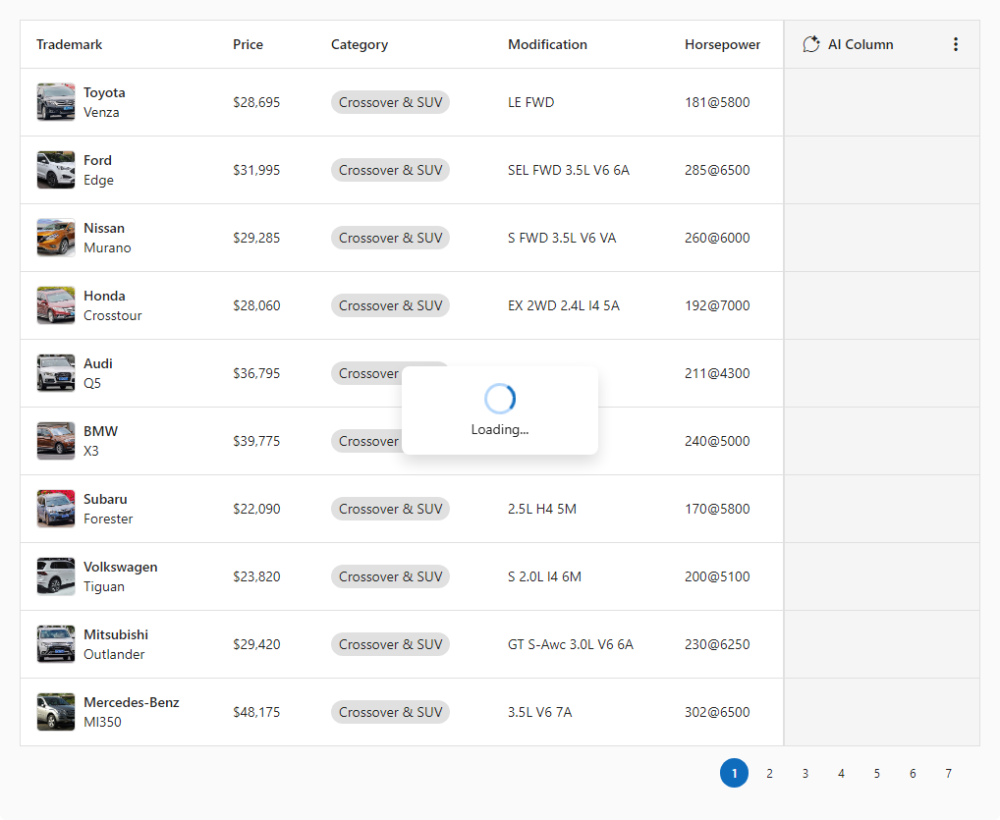

**Critérios de aceite Vortex (preencher na implementação):**

- [ ] Paridade de interação principal da demo
- [ ] API Signals documentada (`input`/`model`/`output`)
- [ ] Tema Fluent Light + Fluent Green sem regressão visual
- [ ] Storybook / Widgets Gallery Vortex com caso equivalente

### Assistente de IA (AI Assistant)

#### 047. Assistente de IA / AI Assistant · **AI**

- **Status Vortex:** TODO
- **Slug DX:** `AIAssistant`
- **URL:** https://js.devexpress.com/Angular/Demos/WidgetsGallery/Demo/DataGrid/AIAssistant/FluentBlueLight/
- **Imagem:** `images/047-DataGrid-AIAssistant.png`
- **Raw JSON:** `raw/047-DataGrid-AIAssistant.json`
- **Título página:** Angular Data Grid - AI Assistant
- **Descrição (EN, fonte DX):**

> The AI Assistant for the DevExtreme DataGrid allows you to interact with the component using natural language. You can use/configure the following DataGrid features via AI Assistant Chat prompts: Filtering and Searching Sorting Grouping Paging Focused Row Selection Summaries Column Fixing, Resizing, and Reordering This AI Assistant feature is also available in the DevExtreme TreeList component.

- **Docs Guide:**
  - [DataGrid](https://js.devexpress.com/Angular/Documentation/Guide/UI_Components/DataGrid/Overview/)
  - [Filtering and Searching](https://js.devexpress.com/Angular/Documentation/Guide/UI_Components/DataGrid/Filtering_and_Searching/)
  - [Sorting](https://js.devexpress.com/Angular/Documentation/Guide/UI_Components/DataGrid/Sorting/)
  - [Grouping](https://js.devexpress.com/Angular/Documentation/Guide/UI_Components/DataGrid/Grouping/)
  - [Paging](https://js.devexpress.com/Angular/Documentation/Guide/UI_Components/DataGrid/Paging/)
  - [Focused Row](https://js.devexpress.com/Angular/Documentation/Guide/UI_Components/DataGrid/Focused_Row/)
  - [Selection](https://js.devexpress.com/Angular/Documentation/Guide/UI_Components/DataGrid/Selection/)
  - [Summaries](https://js.devexpress.com/Angular/Documentation/Guide/UI_Components/DataGrid/Summaries/Predefined_Aggregate_Functions/)
- **API Reference:**
  - [TreeList](https://js.devexpress.com/Angular/Documentation/ApiReference/UI_Components/dxTreeList/Configuration/#aiAssistant)
  - [aiIntegration](https://js.devexpress.com/Angular/Documentation/ApiReference/UI_Components/dxDataGrid/Configuration/#aiIntegration)
  - [aiIntegration](https://js.devexpress.com/Angular/Documentation/ApiReference/UI_Components/dxDataGrid/Configuration/aiAssistant/#aiIntegration)
  - [enabled](https://js.devexpress.com/Angular/Documentation/ApiReference/UI_Components/dxDataGrid/Configuration/aiAssistant/#enabled)
  - [speech-to-text input](https://js.devexpress.com/Angular/Documentation/ApiReference/UI_Components/dxChat/Configuration/#speechToTextEnabled)
  - [suggestions](https://js.devexpress.com/Angular/Documentation/ApiReference/UI_Components/dxChat/Configuration/#suggestions)

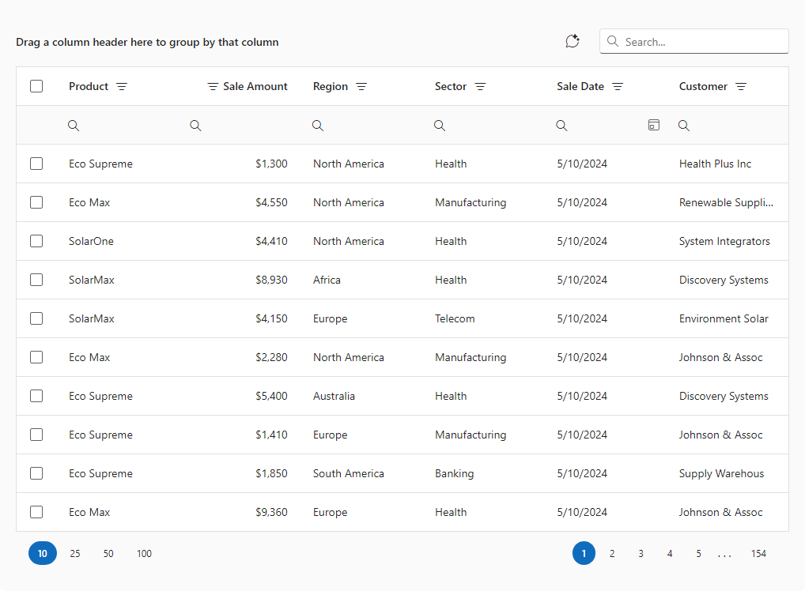

**Critérios de aceite Vortex (preencher na implementação):**

- [ ] Paridade de interação principal da demo
- [ ] API Signals documentada (`input`/`model`/`output`)
- [ ] Tema Fluent Light + Fluent Green sem regressão visual
- [ ] Storybook / Widgets Gallery Vortex com caso equivalente

### Detalhe mestre (Master Detail)

#### 048. Vista mestre-detalhe / Master-Detail View

- **Status Vortex:** TODO
- **Slug DX:** `MasterDetailView`
- **URL:** https://js.devexpress.com/Angular/Demos/WidgetsGallery/Demo/DataGrid/MasterDetailView/FluentBlueLight/
- **Imagem:** `images/048-DataGrid-MasterDetailView.png`
- **Raw JSON:** `raw/048-DataGrid-MasterDetailView.json`
- **Título página:** Angular Data Grid - Master-Detail View
- **Descrição (EN, fonte DX):**

> The Master-Detail View allows users to expand a row ('master') and display the related content ('details') in the expanded section. To configure this feature, set the the masterDetail object's enabled property to true and use a template to specify detail section content. In this demo, the detail section displays another DataGrid.

- **API Reference:**
  - [masterDetail](https://js.devexpress.com/Angular/Documentation/ApiReference/UI_Components/dxDataGrid/Configuration/masterDetail/)
  - [enabled](https://js.devexpress.com/Angular/Documentation/ApiReference/UI_Components/dxDataGrid/Configuration/masterDetail/#enabled)
  - [template](https://js.devexpress.com/Angular/Documentation/ApiReference/UI_Components/dxDataGrid/Configuration/masterDetail/#template)

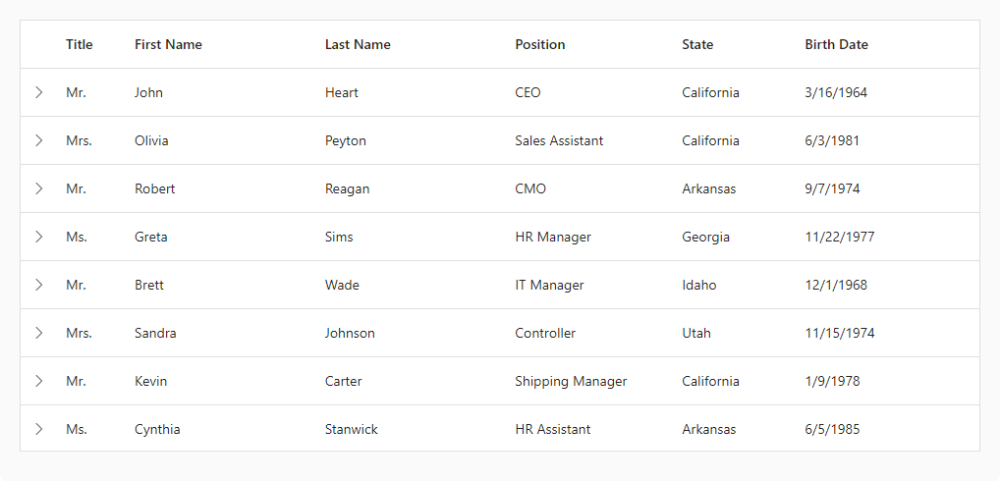

**Critérios de aceite Vortex (preencher na implementação):**

- [ ] Paridade de interação principal da demo
- [ ] API Signals documentada (`input`/`model`/`output`)
- [ ] Tema Fluent Light + Fluent Green sem regressão visual
- [ ] Storybook / Widgets Gallery Vortex com caso equivalente

#### 049. API Mestre-Detalhe / Master-Detail API

- **Status Vortex:** TODO
- **Slug DX:** `MasterDetailAPI`
- **URL:** https://js.devexpress.com/Angular/Demos/WidgetsGallery/Demo/DataGrid/MasterDetailAPI/FluentBlueLight/
- **Imagem:** `images/049-DataGrid-MasterDetailAPI.png`
- **Raw JSON:** `raw/049-DataGrid-MasterDetailAPI.json`
- **Título página:** Angular Data Grid - Master-Detail API
- **Descrição (EN, fonte DX):**

> DataGrid API allows you to implement custom expand/collapse logic for master-detail rows. This example uses the expandRow(key) and collapseAll(groupIndex) methods inside the onSelectionChanged event handler to allow you to expand only one row at a time.

- **API Reference:**
  - [expandRow(key)](https://js.devexpress.com/Angular/Documentation/ApiReference/UI_Components/dxDataGrid/Methods/#expandRowkey)
  - [collapseAll(groupIndex)](https://js.devexpress.com/Angular/Documentation/ApiReference/UI_Components/dxDataGrid/Methods/#collapseAllgroupIndex)
  - [onSelectionChanged](https://js.devexpress.com/Angular/Documentation/ApiReference/UI_Components/dxDataGrid/Configuration/#onSelectionChanged)

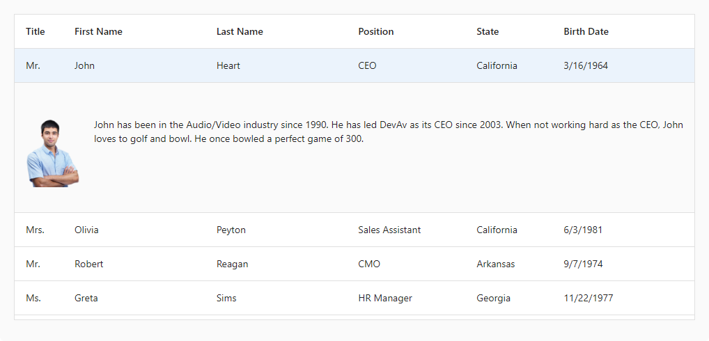

**Critérios de aceite Vortex (preencher na implementação):**

- [ ] Paridade de interação principal da demo
- [ ] API Signals documentada (`input`/`model`/`output`)
- [ ] Tema Fluent Light + Fluent Green sem regressão visual
- [ ] Storybook / Widgets Gallery Vortex com caso equivalente

#### 050. Visão detalhada com inteligência artificial / AI-powered Detail View · **AI**

- **Status Vortex:** TODO
- **Slug DX:** `AIPoweredDetailView`
- **URL:** https://js.devexpress.com/Angular/Demos/WidgetsGallery/Demo/DataGrid/AIPoweredDetailView/FluentBlueLight/
- **Imagem:** `images/050-DataGrid-AIPoweredDetailView.png`
- **Raw JSON:** `raw/050-DataGrid-AIPoweredDetailView.json`
- **Título página:** Angular Data Grid - AI-powered Detail View
- **Descrição (EN, fonte DX):**

> We expect to add AI-driven data analysis for those using our DataGrid's master-detail view. This new option will allow users to interrogate individual records using natural language. In v25.2, we added an AI column to our DataGrid. This feature helped analyze component data using an AI prompt. While valuable, certain usage scenarios do not require generated data for every row. Instead, users may need on-demand data generation for specific rows. Our new AI detail scenario will offer this capability, which can significantly reduce AI token consumption and enhance data generation performance.

- **Docs Guide:**
  - [DataGrid](https://js.devexpress.com/Documentation/Guide/UI_Components/DataGrid/Overview/)

**Critérios de aceite Vortex (preencher na implementação):**

- [ ] Paridade de interação principal da demo
- [ ] API Signals documentada (`input`/`model`/`output`)
- [ ] Tema Fluent Light + Fluent Green sem regressão visual
- [ ] Storybook / Widgets Gallery Vortex com caso equivalente

#### 051. Vista mestre-detalhe avançada / Advanced Master-Detail View

- **Status Vortex:** TODO
- **Slug DX:** `AdvancedMasterDetailView`
- **URL:** https://js.devexpress.com/Angular/Demos/WidgetsGallery/Demo/DataGrid/AdvancedMasterDetailView/FluentBlueLight/
- **Imagem:** `images/051-DataGrid-AdvancedMasterDetailView.png`
- **Raw JSON:** `raw/051-DataGrid-AdvancedMasterDetailView.json`
- **Título página:** Angular Data Grid - Advanced Master-Detail View
- **Descrição (EN, fonte DX):**

> This demo illustrates an advanced master-detail view in the DataGrid component. Master rows represent suppliers. Detail sections contain TabPanel components with two tabs: Orders and Address. In the Orders tab, you can choose a supplier's product from the SelectBox, and the DataGrid under it will show orders placed on this product. The Address tab displays the supplier's address.

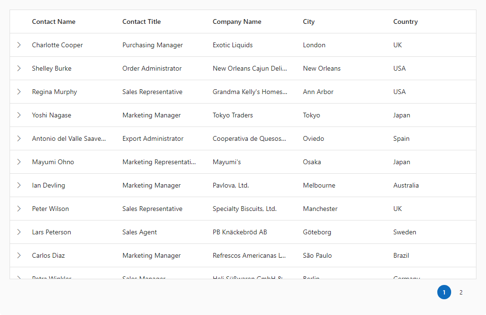

**Critérios de aceite Vortex (preencher na implementação):**

- [ ] Paridade de interação principal da demo
- [ ] API Signals documentada (`input`/`model`/`output`)
- [ ] Tema Fluent Light + Fluent Green sem regressão visual
- [ ] Storybook / Widgets Gallery Vortex com caso equivalente

### Resumos de dados (Data Summaries)

#### 052. Resumos totais / Total Summaries

- **Status Vortex:** TODO
- **Slug DX:** `GridSummaries`
- **URL:** https://js.devexpress.com/Angular/Demos/WidgetsGallery/Demo/DataGrid/GridSummaries/FluentBlueLight/
- **Imagem:** `images/052-DataGrid-GridSummaries.png`
- **Raw JSON:** `raw/052-DataGrid-GridSummaries.json`
- **Título página:** Angular Data Grid - Total Summaries
- **Descrição (EN, fonte DX):**

> To display total summaries, populate the summary.totalItems array with configuration objects. Each object should specify a column that supplies data for summary calculation and a summaryType—an aggregate function that should be applied to this data.

- **API Reference:**
  - [summary](https://js.devexpress.com/Angular/Documentation/ApiReference/UI_Components/dxDataGrid/Configuration/summary/)
  - [totalItems](https://js.devexpress.com/Angular/Documentation/ApiReference/UI_Components/dxDataGrid/Configuration/summary/totalItems/)
  - [column](https://js.devexpress.com/Angular/Documentation/ApiReference/UI_Components/dxDataGrid/Configuration/summary/totalItems/#column)
  - [summaryType](https://js.devexpress.com/Angular/Documentation/ApiReference/UI_Components/dxDataGrid/Configuration/summary/totalItems/#summaryType)
  - [customizeText](https://js.devexpress.com/Angular/Documentation/ApiReference/UI_Components/dxDataGrid/Configuration/summary/totalItems/#customizeText)
  - [valueFormat](https://js.devexpress.com/Angular/Documentation/ApiReference/UI_Components/dxDataGrid/Configuration/summary/totalItems/#valueFormat)

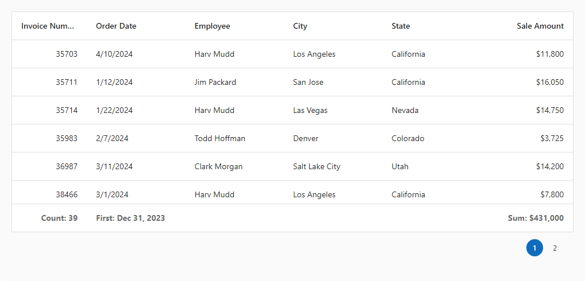

**Critérios de aceite Vortex (preencher na implementação):**

- [ ] Paridade de interação principal da demo
- [ ] API Signals documentada (`input`/`model`/`output`)
- [ ] Tema Fluent Light + Fluent Green sem regressão visual
- [ ] Storybook / Widgets Gallery Vortex com caso equivalente

#### 053. Resumos de grupo / Group Summaries

- **Status Vortex:** TODO
- **Slug DX:** `GroupSummaries`
- **URL:** https://js.devexpress.com/Angular/Demos/WidgetsGallery/Demo/DataGrid/GroupSummaries/FluentBlueLight/
- **Imagem:** `images/053-DataGrid-GroupSummaries.png`
- **Raw JSON:** `raw/053-DataGrid-GroupSummaries.json`
- **Título página:** Angular Data Grid - Group Summaries
- **Descrição (EN, fonte DX):**

> To configure group summaries, populate the summary.groupItems array with summary configuration objects. Each object should specify a column that supplies data for summary calculation and a summaryType—an aggregate function that should be applied to this data.

- **API Reference:**
  - [summary](https://js.devexpress.com/Angular/Documentation/ApiReference/UI_Components/dxDataGrid/Configuration/summary/)
  - [groupItems](https://js.devexpress.com/Angular/Documentation/ApiReference/UI_Components/dxDataGrid/Configuration/summary/groupItems/)
  - [column](https://js.devexpress.com/Angular/Documentation/ApiReference/UI_Components/dxDataGrid/Configuration/summary/totalItems/#column)
  - [summaryType](https://js.devexpress.com/Angular/Documentation/ApiReference/UI_Components/dxDataGrid/Configuration/summary/totalItems/#summaryType)
  - [alignByColumn](https://js.devexpress.com/Angular/Documentation/ApiReference/UI_Components/dxDataGrid/Configuration/summary/groupItems/#alignByColumn)
  - [showInColumn](https://js.devexpress.com/Angular/Documentation/ApiReference/UI_Components/dxDataGrid/Configuration/summary/groupItems/#showInColumn)
  - [showInGroupFooter](https://js.devexpress.com/Angular/Documentation/ApiReference/UI_Components/dxDataGrid/Configuration/summary/groupItems/#showInGroupFooter)
  - [showInColumn](https://js.devexpress.com/Angular/Documentation/ApiReference/UI_Components/dxDataGrid/Configuration/summary/groupItems/#showInColumn)

**Critérios de aceite Vortex (preencher na implementação):**

- [ ] Paridade de interação principal da demo
- [ ] API Signals documentada (`input`/`model`/`output`)
- [ ] Tema Fluent Light + Fluent Green sem regressão visual
- [ ] Storybook / Widgets Gallery Vortex com caso equivalente

#### 054. Resumos personalizados / Custom Summaries

- **Status Vortex:** TODO
- **Slug DX:** `CustomSummaries`
- **URL:** https://js.devexpress.com/Angular/Demos/WidgetsGallery/Demo/DataGrid/CustomSummaries/FluentBlueLight/
- **Imagem:** `images/054-DataGrid-CustomSummaries.png`
- **Raw JSON:** `raw/054-DataGrid-CustomSummaries.json`
- **Título página:** Angular Data Grid - Custom Summaries
- **Descrição (EN, fonte DX):**

> The DataGrid can calculate custom summaries on the client or server side. In this demo, we have implemented client-side logic. The instructions below explain how to do this in your code.

- **Docs Guide:**
  - [Server-Side Data Aggregation](https://js.devexpress.com/Angular/Documentation/Guide/UI_Components/DataGrid/Summaries/Custom_Aggregate_Function/#Server-Side_Data_Aggregation)
- **API Reference:**
  - [summary](https://js.devexpress.com/Angular/Documentation/ApiReference/UI_Components/dxDataGrid/Configuration/remoteOperations/#summary)
  - [groupPaging](https://js.devexpress.com/Angular/Documentation/ApiReference/UI_Components/dxDataGrid/Configuration/remoteOperations/#groupPaging)
  - [remoteOperations](https://js.devexpress.com/Angular/Documentation/ApiReference/UI_Components/dxDataGrid/Configuration/remoteOperations/)
  - [summary](https://js.devexpress.com/Angular/Documentation/ApiReference/UI_Components/dxDataGrid/Configuration/summary/)
  - [groupItems](https://js.devexpress.com/Angular/Documentation/ApiReference/UI_Components/dxDataGrid/Configuration/summary/groupItems/)
  - [summary](https://js.devexpress.com/Angular/Documentation/ApiReference/UI_Components/dxDataGrid/Configuration/summary/)
  - [totalItems](https://js.devexpress.com/Angular/Documentation/ApiReference/UI_Components/dxDataGrid/Configuration/summary/totalItems/)
  - [summaryType](https://js.devexpress.com/Angular/Documentation/ApiReference/UI_Components/dxDataGrid/Configuration/summary/totalItems/#summaryType)

**Critérios de aceite Vortex (preencher na implementação):**

- [ ] Paridade de interação principal da demo
- [ ] API Signals documentada (`input`/`model`/`output`)
- [ ] Tema Fluent Light + Fluent Green sem regressão visual
- [ ] Storybook / Widgets Gallery Vortex com caso equivalente

#### 055. Recalcular durante a edição / Recalculate While Editing

- **Status Vortex:** TODO
- **Slug DX:** `RecalculateWhileEditing`
- **URL:** https://js.devexpress.com/Angular/Demos/WidgetsGallery/Demo/DataGrid/RecalculateWhileEditing/FluentBlueLight/
- **Imagem:** `images/055-DataGrid-RecalculateWhileEditing.png`
- **Raw JSON:** `raw/055-DataGrid-RecalculateWhileEditing.json`
- **Título página:** Angular Data Grid - Recalculate While Editing
- **Descrição (EN, fonte DX):**

> In this demo, the DataGrid recalculates summaries when you edit data. To enable this feature, the recalculateWhileEditing property is set to true. You can add, delete, or update rows to change the summaries.

- **API Reference:**
  - [recalculateWhileEditing](https://js.devexpress.com/Angular/Documentation/ApiReference/UI_Components/dxDataGrid/Configuration/summary/#recalculateWhileEditing)

**Critérios de aceite Vortex (preencher na implementação):**

- [ ] Paridade de interação principal da demo
- [ ] API Signals documentada (`input`/`model`/`output`)
- [ ] Tema Fluent Light + Fluent Green sem regressão visual
- [ ] Storybook / Widgets Gallery Vortex com caso equivalente

### Arrastar e soltar (Drag & Drop)

#### 056. Reabastecimento local (reordenação local) / Local Reordering

- **Status Vortex:** TODO
- **Slug DX:** `LocalReordering`
- **URL:** https://js.devexpress.com/Angular/Demos/WidgetsGallery/Demo/DataGrid/LocalReordering/FluentBlueLight/
- **Imagem:** `images/056-DataGrid-LocalReordering.png`
- **Raw JSON:** `raw/056-DataGrid-LocalReordering.json`
- **Título página:** Angular Data Grid - Local Reordering
- **Descrição (EN, fonte DX):**

> The DataGrid allows users to drag and drop rows. Use the icon to the left of the row as the drag handle. To enable this feature, set the allowReordering property to true and change the row index in the onReorder function. Use the rowDragging object to configure the row drag and drop feature.

- **API Reference:**
  - [allowReordering](https://js.devexpress.com/Angular/Documentation/ApiReference/UI_Components/dxDataGrid/Configuration/rowDragging/#allowReordering)
  - [onReorder](https://js.devexpress.com/Angular/Documentation/ApiReference/UI_Components/dxDataGrid/Configuration/rowDragging/#onReorder)
  - [rowDragging](https://js.devexpress.com/Angular/Documentation/ApiReference/UI_Components/dxDataGrid/Configuration/rowDragging/)

**Critérios de aceite Vortex (preencher na implementação):**

- [ ] Paridade de interação principal da demo
- [ ] API Signals documentada (`input`/`model`/`output`)
- [ ] Tema Fluent Light + Fluent Green sem regressão visual
- [ ] Storybook / Widgets Gallery Vortex com caso equivalente

#### 057. Reordenação remota / Remote Reordering

- **Status Vortex:** TODO
- **Slug DX:** `RemoteReordering`
- **URL:** https://js.devexpress.com/Angular/Demos/WidgetsGallery/Demo/DataGrid/RemoteReordering/FluentBlueLight/
- **Imagem:** `images/057-DataGrid-RemoteReordering.png`
- **Raw JSON:** `raw/057-DataGrid-RemoteReordering.json`
- **Título página:** Angular Data Grid - Remote Reordering
- **Descrição (EN, fonte DX):**

> This demo shows how to use drag and drop to reorder records stored on the server. This functionality requires that records' order indexes are in an individual data field (OrderIndex in this demo) and sorted against that field. Row drag and drop is configured in the rowDragging object. Set allowReordering to true to enable this feature. To specify the highlight mode of the row's drop position, use the dropFeedbackMode property. In this demo, it is set to "push": rows move up or down with animation to create space for the new position of the row.

- **API Reference:**
  - [rowDragging](https://js.devexpress.com/Angular/Documentation/ApiReference/UI_Components/dxDataGrid/Configuration/rowDragging/)
  - [allowReordering](https://js.devexpress.com/Angular/Documentation/ApiReference/UI_Components/dxDataGrid/Configuration/rowDragging/#allowReordering)
  - [dropFeedbackMode](https://js.devexpress.com/Angular/Documentation/ApiReference/UI_Components/dxDataGrid/Configuration/rowDragging/#dropFeedbackMode)
  - [onReorder](https://js.devexpress.com/Angular/Documentation/ApiReference/UI_Components/dxDataGrid/Configuration/rowDragging/#onReorder)
  - [update](https://js.devexpress.com/Angular/Documentation/ApiReference/Data_Layer/CustomStore/Configuration/#update)

**Critérios de aceite Vortex (preencher na implementação):**

- [ ] Paridade de interação principal da demo
- [ ] API Signals documentada (`input`/`model`/`output`)
- [ ] Tema Fluent Light + Fluent Green sem regressão visual
- [ ] Storybook / Widgets Gallery Vortex com caso equivalente

#### 058. Arrastar e soltar entre duas grades / Drag & Drop Between Two Grids

- **Status Vortex:** TODO
- **Slug DX:** `DnDBetweenGrids`
- **URL:** https://js.devexpress.com/Angular/Demos/WidgetsGallery/Demo/DataGrid/DnDBetweenGrids/FluentBlueLight/
- **Imagem:** `images/058-DataGrid-DnDBetweenGrids.png`
- **Raw JSON:** `raw/058-DataGrid-DnDBetweenGrids.json`
- **Título página:** Angular Data Grid - Drag & Drop Between Two Grids
- **Descrição (EN, fonte DX):**

> This functionality requires that data objects have a data field that identifies which grid they belong to. In this demo, this data field is Status.

- **API Reference:**
  - [rowDragging](https://js.devexpress.com/Angular/Documentation/ApiReference/UI_Components/dxDataGrid/Configuration/rowDragging/)
  - [data](https://js.devexpress.com/Angular/Documentation/ApiReference/UI_Components/dxDataGrid/Configuration/rowDragging/#data)
  - [filterValue](https://js.devexpress.com/Angular/Documentation/ApiReference/UI_Components/dxDataGrid/Configuration/#filterValue)
  - [group](https://js.devexpress.com/Angular/Documentation/ApiReference/UI_Components/dxDataGrid/Configuration/rowDragging/#group)
  - [onAdd](https://js.devexpress.com/Angular/Documentation/ApiReference/UI_Components/dxDataGrid/Configuration/rowDragging/#onAdd)
  - [update](https://js.devexpress.com/Angular/Documentation/ApiReference/Data_Layer/CustomStore/Methods/#updatekey_values)
  - [push](https://js.devexpress.com/Angular/Documentation/ApiReference/Data_Layer/CustomStore/Methods/#pushchanges)
  - [reshapeOnPush](https://js.devexpress.com/Angular/Documentation/ApiReference/Data_Layer/DataSource/Configuration/#reshapeOnPush)

**Critérios de aceite Vortex (preencher na implementação):**

- [ ] Paridade de interação principal da demo
- [ ] API Signals documentada (`input`/`model`/`output`)
- [ ] Tema Fluent Light + Fluent Green sem regressão visual
- [ ] Storybook / Widgets Gallery Vortex com caso equivalente

### Exportar para PDF (Export to PDF)

#### 059. Visão geral / Overview

- **Status Vortex:** TODO
- **Slug DX:** `PDFOverview`
- **URL:** https://js.devexpress.com/Angular/Demos/WidgetsGallery/Demo/DataGrid/PDFOverview/FluentBlueLight/
- **Imagem:** `images/059-DataGrid-PDFOverview.png`
- **Raw JSON:** `raw/059-DataGrid-PDFOverview.json`
- **Título página:** Angular Data Grid - Overview
- **Descrição (EN, fonte DX):**

> The DataGrid allows you to export its contents to a PDF document. To enable PDF export operations, import the jsPDF library and set the export.enabled property to true. Call the exportDataGrid(options) method that belongs to the pdfExporter module. Specify at least two required properties: jsPDFDocument Specifies the jsPDF instance. component Specifies the DataGrid's instance. To review implementation details, see the exportDataGrid(options) method call in onExporting handler. You can also set allowExportSelectedData to true to export only selected rows.

- **API Reference:**
  - [DataGrid](https://js.devexpress.com/Angular/Documentation/ApiReference/UI_Components/dxDataGrid/)
  - [enabled](https://js.devexpress.com/Angular/Documentation/ApiReference/UI_Components/dxDataGrid/Configuration/export/#enabled)
  - [exportDataGrid(options)](https://js.devexpress.com/Angular/Documentation/ApiReference/Common/Utils/pdfExporter/#exportDataGridoptions)
  - [pdfExporter](https://js.devexpress.com/Angular/Documentation/ApiReference/Common/Utils/pdfExporter/)
  - [jsPDFDocument](https://js.devexpress.com/Angular/Documentation/ApiReference/Common/Object_Structures/PdfExportDataGridProps/#jsPDFDocument)
  - [component](https://js.devexpress.com/Angular/Documentation/ApiReference/Common/Object_Structures/PdfExportDataGridProps/#component)
  - [exportDataGrid(options)](https://js.devexpress.com/Angular/Documentation/ApiReference/Common/Utils/pdfExporter/#exportDataGridoptions)
  - [onExporting](https://js.devexpress.com/Angular/Documentation/ApiReference/UI_Components/dxDataGrid/Configuration/#onExporting)

**Critérios de aceite Vortex (preencher na implementação):**

- [ ] Paridade de interação principal da demo
- [ ] API Signals documentada (`input`/`model`/`output`)
- [ ] Tema Fluent Light + Fluent Green sem regressão visual
- [ ] Storybook / Widgets Gallery Vortex com caso equivalente

#### 060. Personalização de células / Cell Customization

- **Status Vortex:** TODO
- **Slug DX:** `PDFCellCustomization`
- **URL:** https://js.devexpress.com/Angular/Demos/WidgetsGallery/Demo/DataGrid/PDFCellCustomization/FluentBlueLight/
- **Imagem:** `images/060-DataGrid-PDFCellCustomization.png`
- **Raw JSON:** `raw/060-DataGrid-PDFCellCustomization.json`
- **Título página:** Angular Data Grid - Cell Customization
- **Descrição (EN, fonte DX):**

> DataGrid allows you to modify cell style settings and custom paint cells in a PDF document. Use the customizeCell function to customize the appearance settings of DataGrid cells in a PDF document. For example, you can change the text alignment and the background color of cells. The following function parameters are available: gridCell Contains information about the source DataGrid cell. pdfCell Contains settings applied to a cell in a PDF document.

- **API Reference:**
  - [customizeCell](https://js.devexpress.com/Angular/Documentation/ApiReference/Common/Object_Structures/PdfExportDataGridProps/#customizeCell)
  - [customizeCell](https://js.devexpress.com/Angular/Documentation/ApiReference/Common/Object_Structures/PdfExportDataGridProps/#customizeCell)
  - [customDrawCell](https://js.devexpress.com/Angular/Documentation/ApiReference/Common/Object_Structures/PdfExportDataGridProps/#customDrawCell)
  - [jsPDFDocument](https://js.devexpress.com/api-reference/50%20Common/Object%20Structures/PdfExportDataGridProps/jsPDFDocument.md%20'/Documentation/ApiReference/Common/Object_Structures/PdfExportDataGridProps/#jsPDFDocument')
  - [customDrawCell](https://js.devexpress.com/Angular/Documentation/ApiReference/Common/Object_Structures/PdfExportDataGridProps/#customDrawCell)

**Critérios de aceite Vortex (preencher na implementação):**

- [ ] Paridade de interação principal da demo
- [ ] API Signals documentada (`input`/`model`/`output`)
- [ ] Tema Fluent Light + Fluent Green sem regressão visual
- [ ] Storybook / Widgets Gallery Vortex com caso equivalente

#### 061. Cabeçalho e rodapé / Header and Footer

- **Status Vortex:** TODO
- **Slug DX:** `PDFHeaderAndFooter`
- **URL:** https://js.devexpress.com/Angular/Demos/WidgetsGallery/Demo/DataGrid/PDFHeaderAndFooter/FluentBlueLight/
- **Imagem:** `images/061-DataGrid-PDFHeaderAndFooter.png`
- **Raw JSON:** `raw/061-DataGrid-PDFHeaderAndFooter.json`
- **Título página:** Angular Data Grid - Header and Footer
- **Descrição (EN, fonte DX):**

> The DataGrid allows you to customize a header and a footer in the exported PDF file.

- **API Reference:**
  - [exportDataGrid(options)](https://js.devexpress.com/Angular/Documentation/ApiReference/Common/Utils/pdfExporter/#exportDataGridoptions)
  - [topLeft](https://js.devexpress.com/Angular/Documentation/ApiReference/Common/Object_Structures/PdfExportDataGridProps/topLeft/)
  - [customDrawCell](https://js.devexpress.com/Angular/Documentation/ApiReference/Common/Object_Structures/PdfExportDataGridProps/#customDrawCell)
  - [exportDataGrid(options)](https://js.devexpress.com/Angular/Documentation/ApiReference/Common/Utils/pdfExporter/#exportDataGridoptions)

**Critérios de aceite Vortex (preencher na implementação):**

- [ ] Paridade de interação principal da demo
- [ ] API Signals documentada (`input`/`model`/`output`)
- [ ] Tema Fluent Light + Fluent Green sem regressão visual
- [ ] Storybook / Widgets Gallery Vortex com caso equivalente

#### 062. Exportação de múltiplas grades / Multiple Grids Export

- **Status Vortex:** TODO
- **Slug DX:** `PDFExportMultipleGrids`
- **URL:** https://js.devexpress.com/Angular/Demos/WidgetsGallery/Demo/DataGrid/PDFExportMultipleGrids/FluentBlueLight/
- **Imagem:** `images/062-DataGrid-PDFExportMultipleGrids.png`
- **Raw JSON:** `raw/062-DataGrid-PDFExportMultipleGrids.json`
- **Título página:** Angular Data Grid - Multiple Grids Export
- **Descrição (EN, fonte DX):**

> This demo shows two DataGrids in different tabs. Click the Export multiple grids button to export two grids and arrange them on different pages of the PDF document. To implement this functionality, call the exportDataGrid(options) methods in a chain of Promises, one after another. Use the jsPDF.addPage() method to add a page in the PDF document. You can use the customizeCell function to customize cell appearance in the PDF document. In this demo, the customizeCell function highlights alternate (even) rows.

- **API Reference:**
  - [exportDataGrid(options)](https://js.devexpress.com/Angular/Documentation/ApiReference/Common/Utils/pdfExporter/#exportDataGridoptions)
  - [customizeCell](https://js.devexpress.com/Angular/Documentation/ApiReference/Common/Object_Structures/PdfExportDataGridProps/#customizeCell)
  - [customizeCell](https://js.devexpress.com/Angular/Documentation/ApiReference/Common/Object_Structures/PdfExportDataGridProps/#customizeCell)

**Critérios de aceite Vortex (preencher na implementação):**

- [ ] Paridade de interação principal da demo
- [ ] API Signals documentada (`input`/`model`/`output`)
- [ ] Tema Fluent Light + Fluent Green sem regressão visual
- [ ] Storybook / Widgets Gallery Vortex com caso equivalente

#### 063. Exportar imagem / Image Export

- **Status Vortex:** TODO
- **Slug DX:** `PDFExportImages`
- **URL:** https://js.devexpress.com/Angular/Demos/WidgetsGallery/Demo/DataGrid/PDFExportImages/FluentBlueLight/
- **Imagem:** `images/063-DataGrid-PDFExportImages.png`
- **Raw JSON:** `raw/063-DataGrid-PDFExportImages.json`
- **Título página:** Angular Data Grid - Image Export
- **Descrição (EN, fonte DX):**

> This demo shows how to configure the DataGrid to export data with images to a PDF document. Use the customDrawCell function to redraw the content of the cell. Inside this function, implement the jsPDF.addImage() method that specifies image data. Specify the onRowExporting function to change the height of the rows to fit the images.

- **API Reference:**
  - [customDrawCell](https://js.devexpress.com/Angular/Documentation/ApiReference/Common/Object_Structures/PdfExportDataGridProps/#customDrawCell)
  - [onRowExporting](https://js.devexpress.com/Angular/Documentation/ApiReference/Common/Object_Structures/PdfExportDataGridProps/#onRowExporting)

**Critérios de aceite Vortex (preencher na implementação):**

- [ ] Paridade de interação principal da demo
- [ ] API Signals documentada (`input`/`model`/`output`)
- [ ] Tema Fluent Light + Fluent Green sem regressão visual
- [ ] Storybook / Widgets Gallery Vortex com caso equivalente

### Exportar para o Excel (Export to Excel)

#### 064. Visão geral / Overview

- **Status Vortex:** TODO
- **Slug DX:** `ExcelJSOverview`
- **URL:** https://js.devexpress.com/Angular/Demos/WidgetsGallery/Demo/DataGrid/ExcelJSOverview/FluentBlueLight/
- **Imagem:** `images/064-DataGrid-ExcelJSOverview.png`
- **Raw JSON:** `raw/064-DataGrid-ExcelJSOverview.json`
- **Título página:** Angular Data Grid - Overview
- **Descrição (EN, fonte DX):**

> To enable export in the DataGrid, reference or import the DevExtreme ExcelJS and FileSaver libraries. Set export.enabled to true. Once the conditions above are met, use the exportDataGrid(options) method to export the DataGrid to an Excel workbook. Review the onExporting handler to see the data export code. DataGrid is exported as is to a single worksheet. You can also set allowExportSelectedData to true to export only selected rows. You can export DataGrid to CSV. Call the exportDataGrid(options) method as shown in the following ticket: Export PivotGrid into CSV file.

- **API Reference:**
  - [enabled](https://js.devexpress.com/Angular/Documentation/ApiReference/UI_Components/dxDataGrid/Configuration/export/#enabled)
  - [exportDataGrid(options)](https://js.devexpress.com/Angular/Documentation/ApiReference/Common/Utils/excelExporter/#exportDataGridoptions)
  - [onExporting](https://js.devexpress.com/Angular/Documentation/ApiReference/UI_Components/dxDataGrid/Configuration/#onExporting)
  - [allowExportSelectedData](https://js.devexpress.com/Angular/Documentation/ApiReference/UI_Components/dxDataGrid/Configuration/export/#allowExportSelectedData)

**Critérios de aceite Vortex (preencher na implementação):**

- [ ] Paridade de interação principal da demo
- [ ] API Signals documentada (`input`/`model`/`output`)
- [ ] Tema Fluent Light + Fluent Green sem regressão visual
- [ ] Storybook / Widgets Gallery Vortex com caso equivalente

#### 065. Personalização de células / Cell Customization

- **Status Vortex:** TODO
- **Slug DX:** `ExcelJSCellCustomization`
- **URL:** https://js.devexpress.com/Angular/Demos/WidgetsGallery/Demo/DataGrid/ExcelJSCellCustomization/FluentBlueLight/
- **Imagem:** `images/065-DataGrid-ExcelJSCellCustomization.png`
- **Raw JSON:** `raw/065-DataGrid-ExcelJSCellCustomization.json`
- **Título página:** Angular Data Grid - Cell Customization
- **Descrição (EN, fonte DX):**

> The customizeCell function allows you to modify cell data and value formatting in exported worksheets. You can access and change the following attributes: Font properties Cell background Cell values Text alignment Formatting properties The customizeCell function also allows you to identify row types. For example, this demo changes the background color and font weight for cells with the "group" rowType.

- **API Reference:**
  - [customizeCell](https://js.devexpress.com/Angular/Documentation/ApiReference/Common/Object_Structures/ExportDataGridProps/#customizeCell)
  - [customizeCell](https://js.devexpress.com/Angular/Documentation/ApiReference/Common/Object_Structures/ExportDataGridProps/#customizeCell)
  - [rowType](https://js.devexpress.com/Angular/Documentation/ApiReference/UI_Components/dxDataGrid/Row/#rowType)

**Critérios de aceite Vortex (preencher na implementação):**

- [ ] Paridade de interação principal da demo
- [ ] API Signals documentada (`input`/`model`/`output`)
- [ ] Tema Fluent Light + Fluent Green sem regressão visual
- [ ] Storybook / Widgets Gallery Vortex com caso equivalente

#### 066. Cabeçalho e rodapé / Header and Footer

- **Status Vortex:** TODO
- **Slug DX:** `ExcelJSHeaderAndFooter`
- **URL:** https://js.devexpress.com/Angular/Demos/WidgetsGallery/Demo/DataGrid/ExcelJSHeaderAndFooter/FluentBlueLight/
- **Imagem:** `images/066-DataGrid-ExcelJSHeaderAndFooter.png`
- **Raw JSON:** `raw/066-DataGrid-ExcelJSHeaderAndFooter.json`
- **Título página:** Angular Data Grid - Header and Footer
- **Descrição (EN, fonte DX):**

> DevExtreme ExcelJS library allows you to customize worksheets outside the exported cell area. This demo uses this functionality to add a header (a title before exported data) and a footer (a note after exported data). Review the onExporting handler to see the data export code. The functions that create header and footer sections utilize the following customization features: Merged cells Cell values formatting Font properties Text alignment

- **API Reference:**
  - [onExporting](https://js.devexpress.com/Angular/Documentation/ApiReference/UI_Components/dxDataGrid/Configuration/#onExporting)

**Critérios de aceite Vortex (preencher na implementação):**

- [ ] Paridade de interação principal da demo
- [ ] API Signals documentada (`input`/`model`/`output`)
- [ ] Tema Fluent Light + Fluent Green sem regressão visual
- [ ] Storybook / Widgets Gallery Vortex com caso equivalente

#### 067. Exportação de múltiplas grades / Multiple Grids Export

- **Status Vortex:** TODO
- **Slug DX:** `ExcelJSExportMultipleGrids`
- **URL:** https://js.devexpress.com/Angular/Demos/WidgetsGallery/Demo/DataGrid/ExcelJSExportMultipleGrids/FluentBlueLight/
- **Imagem:** `images/067-DataGrid-ExcelJSExportMultipleGrids.png`
- **Raw JSON:** `raw/067-DataGrid-ExcelJSExportMultipleGrids.json`
- **Título página:** Angular Data Grid - Multiple Grids Export
- **Descrição (EN, fonte DX):**

> The exportDataGrid() method allows users to export multiple grids to one Excel document. Grids are exported consequently in a chain of Promises. In this demo, this functionality is used to export two DataGrids into separate worksheets in the same workbook. Starting position of each exported grid is set using the topLeftCell property. Use the customizeCell method to customize the exported worksheets.

- **API Reference:**
  - [exportDataGrid()](https://js.devexpress.com/Angular/Documentation/ApiReference/Common/Utils/excelExporter/#exportDataGridoptions)
  - [topLeftCell](https://js.devexpress.com/Angular/Documentation/ApiReference/Common/Object_Structures/ExportDataGridProps/topLeftCell/)
  - [customizeCell](https://js.devexpress.com/Angular/Documentation/ApiReference/Common/Object_Structures/ExportDataGridProps/#customizeCell)

**Critérios de aceite Vortex (preencher na implementação):**

- [ ] Paridade de interação principal da demo
- [ ] API Signals documentada (`input`/`model`/`output`)
- [ ] Tema Fluent Light + Fluent Green sem regressão visual
- [ ] Storybook / Widgets Gallery Vortex com caso equivalente

#### 068. Exportar imagem / Image Export

- **Status Vortex:** TODO
- **Slug DX:** `ExcelJSExportImages`
- **URL:** https://js.devexpress.com/Angular/Demos/WidgetsGallery/Demo/DataGrid/ExcelJSExportImages/FluentBlueLight/
- **Imagem:** `images/068-DataGrid-ExcelJSExportImages.png`
- **Raw JSON:** `raw/068-DataGrid-ExcelJSExportImages.json`
- **Título página:** Angular Data Grid - Image Export
- **Descrição (EN, fonte DX):**

> This demo shows how you can use DevExtreme ExcelJS API to export images to Excel worksheets. See the customizeCell callback for implementation details. The workbook.addImage() method specifies image data and encoding. tl and br parameters are used to specify image location and span.

- **API Reference:**
  - [customizeCell](https://js.devexpress.com/Angular/Documentation/ApiReference/Common/Object_Structures/ExportDataGridProps/#customizeCell)

**Critérios de aceite Vortex (preencher na implementação):**

- [ ] Paridade de interação principal da demo
- [ ] API Signals documentada (`input`/`model`/`output`)
- [ ] Tema Fluent Light + Fluent Green sem regressão visual
- [ ] Storybook / Widgets Gallery Vortex com caso equivalente

### Aparência (Appearance)

#### 069. Aparência / Appearance

- **Status Vortex:** TODO
- **Slug DX:** `Appearance`
- **URL:** https://js.devexpress.com/Angular/Demos/WidgetsGallery/Demo/DataGrid/Appearance/FluentBlueLight/
- **Imagem:** `images/069-DataGrid-Appearance.png`
- **Raw JSON:** `raw/069-DataGrid-Appearance.json`
- **Título página:** Angular Data Grid - Appearance
- **Descrição (EN, fonte DX):**

> This example demonstrates the following properties: showBorders Specifies whether the outer borders of the DataGrid are visible. showColumnLines Specifies whether vertical lines that separate columns are visible. showRowLines Specifies whether horizontal lines that separate rows are visible. rowAlternationEnabled Specifies whether rows should be in alternate colors. To toggle these properties, select the corresponding checkbox under the DataGrid.

- **API Reference:**
  - [showBorders](https://js.devexpress.com/Angular/Documentation/ApiReference/UI_Components/dxDataGrid/Configuration/#showBorders)
  - [showColumnLines](https://js.devexpress.com/Angular/Documentation/ApiReference/UI_Components/dxDataGrid/Configuration/#showColumnLines)
  - [showRowLines](https://js.devexpress.com/Angular/Documentation/ApiReference/UI_Components/dxDataGrid/Configuration/#showRowLines)
  - [rowAlternationEnabled](https://js.devexpress.com/Angular/Documentation/ApiReference/UI_Components/dxDataGrid/Configuration/#rowAlternationEnabled)

**Critérios de aceite Vortex (preencher na implementação):**

- [ ] Paridade de interação principal da demo
- [ ] API Signals documentada (`input`/`model`/`output`)
- [ ] Tema Fluent Light + Fluent Green sem regressão visual
- [ ] Storybook / Widgets Gallery Vortex com caso equivalente

### Personalização (Customization)

#### 070. Coluna / Column

- **Status Vortex:** TODO
- **Slug DX:** `Column`
- **URL:** https://js.devexpress.com/Angular/Demos/WidgetsGallery/Demo/DataGrid/Column/FluentBlueLight/
- **Imagem:** `images/070-DataGrid-Column.png`
- **Raw JSON:** `raw/070-DataGrid-Column.json`
- **Título página:** Angular Data Grid - Column
- **Descrição (EN, fonte DX):**

> Column templates allow you to display custom content in column cells. Use the cellTemplate property (cellRender in React) to configure these templates. In this demo, a custom column template is configured to display employee photos in the Picture column.

- **API Reference:**
  - [cellTemplate](https://js.devexpress.com/Angular/Documentation/ApiReference/UI_Components/dxDataGrid/Configuration/columns/#cellTemplate)
  - [cellRender](https://js.devexpress.com/Angular/Documentation/ApiReference/UI_Components/dxDataGrid/Configuration/columns/#cellRender)

**Critérios de aceite Vortex (preencher na implementação):**

- [ ] Paridade de interação principal da demo
- [ ] API Signals documentada (`input`/`model`/`output`)
- [ ] Tema Fluent Light + Fluent Green sem regressão visual
- [ ] Storybook / Widgets Gallery Vortex com caso equivalente

#### 071. Linha / Row

- **Status Vortex:** TODO
- **Slug DX:** `Row`
- **URL:** https://js.devexpress.com/Angular/Demos/WidgetsGallery/Demo/DataGrid/Row/FluentBlueLight/
- **Imagem:** `images/071-DataGrid-Row.png`
- **Raw JSON:** `raw/071-DataGrid-Row.json`
- **Título página:** Angular Data Grid - Row
- **Descrição (EN, fonte DX):**

> Row templates allow you to display custom content in data rows. In this demo, a dataRowTemplate adds employee images and extra information to regular data rows. You should disable or implement certain DataGrid features manually to use row templates. Refer to the dataRowTemplate article for details.

- **API Reference:**
  - [dataRowTemplate](https://js.devexpress.com/Angular/Documentation/ApiReference/UI_Components/dxDataGrid/Configuration/#dataRowTemplate)
  - [dataRowTemplate](https://js.devexpress.com/Angular/Documentation/ApiReference/UI_Components/dxDataGrid/Configuration/#dataRowTemplate)

**Critérios de aceite Vortex (preencher na implementação):**

- [ ] Paridade de interação principal da demo
- [ ] API Signals documentada (`input`/`model`/`output`)
- [ ] Tema Fluent Light + Fluent Green sem regressão visual
- [ ] Storybook / Widgets Gallery Vortex com caso equivalente

#### 072. Célula / Cell

- **Status Vortex:** TODO
- **Slug DX:** `Cell`
- **URL:** https://js.devexpress.com/Angular/Demos/WidgetsGallery/Demo/DataGrid/Cell/FluentBlueLight/
- **Imagem:** `images/072-DataGrid-Cell.png`
- **Raw JSON:** `raw/072-DataGrid-Cell.json`
- **Título página:** Angular Data Grid - Cell
- **Descrição (EN, fonte DX):**

> The DataGrid comes with vast capabilities for setting up custom templates for grid cells. In this demo, you can see how the grid’s onCellPrepared property is used to provide a custom template for those cells that have the diff value specified in the data source. In addition, the cellTemplate property of the Dynamics column is specified to present data using the Sparkline component.

**Critérios de aceite Vortex (preencher na implementação):**

- [ ] Paridade de interação principal da demo
- [ ] API Signals documentada (`input`/`model`/`output`)
- [ ] Tema Fluent Light + Fluent Green sem regressão visual
- [ ] Storybook / Widgets Gallery Vortex com caso equivalente

#### 073. Barra de ferramentas / Toolbar

- **Status Vortex:** TODO
- **Slug DX:** `Toolbar`
- **URL:** https://js.devexpress.com/Angular/Demos/WidgetsGallery/Demo/DataGrid/Toolbar/FluentBlueLight/
- **Imagem:** `images/073-DataGrid-Toolbar.png`
- **Raw JSON:** `raw/073-DataGrid-Toolbar.json`
- **Título página:** Angular Data Grid - Toolbar
- **Descrição (EN, fonte DX):**

> The DataGrid includes an integrated toolbar that displays predefined and custom controls. To add or remove toolbar items, declare the toolbar.items[] array. If toolbar.items[] is specified, DataGrid does not display controls missing from the array. Ensure this array includes controls for all enabled features.

- **API Reference:**
  - [toolbar](https://js.devexpress.com/Angular/Documentation/ApiReference/UI_Components/dxDataGrid/Configuration/toolbar/)
  - [items[]](https://js.devexpress.com/Angular/Documentation/ApiReference/UI_Components/dxDataGrid/Configuration/toolbar/items/)
  - [name](https://js.devexpress.com/Angular/Documentation/ApiReference/UI_Components/dxDataGrid/Configuration/toolbar/items/#name)
  - [properties](https://js.devexpress.com/Angular/Documentation/ApiReference/UI_Components/dxDataGrid/Configuration/toolbar/items/)
  - [columnChooser](https://js.devexpress.com/Angular/Documentation/ApiReference/UI_Widgets/dxDataGrid/Configuration/columnChooser/)
  - [template](https://js.devexpress.com/Angular/Documentation/ApiReference/UI_Components/dxDataGrid/Configuration/toolbar/items/#template)

**Critérios de aceite Vortex (preencher na implementação):**

- [ ] Paridade de interação principal da demo
- [ ] API Signals documentada (`input`/`model`/`output`)
- [ ] Tema Fluent Light + Fluent Green sem regressão visual
- [ ] Storybook / Widgets Gallery Vortex com caso equivalente

### Persistência do Estado (State Persistence)

#### 074. Persistência do Estado / State Persistence

- **Status Vortex:** TODO
- **Slug DX:** `StatePersistence`
- **URL:** https://js.devexpress.com/Angular/Demos/WidgetsGallery/Demo/DataGrid/StatePersistence/FluentBlueLight/
- **Imagem:** `images/074-DataGrid-StatePersistence.png`
- **Raw JSON:** `raw/074-DataGrid-StatePersistence.json`
- **Título página:** Angular Data Grid - State Persistence
- **Descrição (EN, fonte DX):**

> The DataGrid can persist its state. If a user sorts and filters data, groups, reorders and resizes columns, or makes other changes, the component saves these modifications and restores them when a user reloads the page. Refer to the stateStoring article for a full list of modifications that can be saved.

- **API Reference:**
  - [stateStoring](https://js.devexpress.com/Angular/Documentation/ApiReference/UI_Components/dxDataGrid/Configuration/stateStoring/)
  - [enabled](https://js.devexpress.com/Angular/Documentation/ApiReference/UI_Components/dxDataGrid/Configuration/stateStoring/#enabled)
  - [storageKey](https://js.devexpress.com/Angular/Documentation/ApiReference/UI_Components/dxDataGrid/Configuration/stateStoring/#storageKey)
  - [type](https://js.devexpress.com/Angular/Documentation/ApiReference/UI_Components/dxDataGrid/Configuration/stateStoring/#type)
  - [customSave](https://js.devexpress.com/Angular/Documentation/ApiReference/UI_Components/dxDataGrid/Configuration/stateStoring/#customSave)
  - [customLoad](https://js.devexpress.com/Angular/Documentation/ApiReference/UI_Components/dxDataGrid/Configuration/stateStoring/#customLoad)

**Critérios de aceite Vortex (preencher na implementação):**

- [ ] Paridade de interação principal da demo
- [ ] API Signals documentada (`input`/`model`/`output`)
- [ ] Tema Fluent Light + Fluent Green sem regressão visual
- [ ] Storybook / Widgets Gallery Vortex com caso equivalente

### Adaptabilidade (Adaptability)

#### 075. Visão geral / Overview

- **Status Vortex:** TODO
- **Slug DX:** `GridAdaptabilityOverview`
- **URL:** https://js.devexpress.com/Angular/Demos/WidgetsGallery/Demo/DataGrid/GridAdaptabilityOverview/FluentBlueLight/
- **Imagem:** `images/075-DataGrid-GridAdaptabilityOverview.png`
- **Raw JSON:** `raw/075-DataGrid-GridAdaptabilityOverview.json`
- **Título página:** Angular Data Grid - Overview
- **Descrição (EN, fonte DX):**

> DataGrid automatically adapts its layout to screens with different sizes. In this demo, you can switch between horizontal and vertical screen orientations. If columns do not fit the selected orientation, the DataGrid hides them one by one, starting with the rightmost column. Information from the hidden columns is still available in adaptive detail rows. To enable this feature, set the columnHidingEnabled property to true.

- **API Reference:**
  - [columnHidingEnabled](https://js.devexpress.com/Angular/Documentation/ApiReference/UI_Components/dxDataGrid/Configuration/#columnHidingEnabled)

**Critérios de aceite Vortex (preencher na implementação):**

- [ ] Paridade de interação principal da demo
- [ ] API Signals documentada (`input`/`model`/`output`)
- [ ] Tema Fluent Light + Fluent Green sem regressão visual
- [ ] Storybook / Widgets Gallery Vortex com caso equivalente

#### 076. Colunas Ocultando Prioridade / Columns Hiding Priority

- **Status Vortex:** TODO
- **Slug DX:** `ColumnsHidingPriority`
- **URL:** https://js.devexpress.com/Angular/Demos/WidgetsGallery/Demo/DataGrid/ColumnsHidingPriority/FluentBlueLight/
- **Imagem:** `images/076-DataGrid-ColumnsHidingPriority.png`
- **Raw JSON:** `raw/076-DataGrid-ColumnsHidingPriority.json`
- **Título página:** Angular Data Grid - Columns Hiding Priority
- **Descrição (EN, fonte DX):**

> When the DataGrid adapts its layout to smaller screens, it hides columns based on the hidingPriority. Columns with lower values are hidden first. In this demo, the CustomerStoreCity column is hidden in vertical and horizontal orientation modes because its hidingPriority is 0. The CustomerStoreState and OrderDate columns have a priority of 1 and 2. The DataGrid hides these columns after the CustomerStoreCity column, only when the screen orientation is vertical.

- **API Reference:**
  - [hidingPriority](https://js.devexpress.com/Angular/Documentation/ApiReference/UI_Components/dxDataGrid/Configuration/columns/#hidingPriority)

**Critérios de aceite Vortex (preencher na implementação):**

- [ ] Paridade de interação principal da demo
- [ ] API Signals documentada (`input`/`model`/`output`)
- [ ] Tema Fluent Light + Fluent Green sem regressão visual
- [ ] Storybook / Widgets Gallery Vortex com caso equivalente

### Navegação por teclado (Keyboard Navigation)

#### 077. Navegação por teclado / Keyboard Navigation

- **Status Vortex:** TODO
- **Slug DX:** `KeyboardNavigation`
- **URL:** https://js.devexpress.com/Angular/Demos/WidgetsGallery/Demo/DataGrid/KeyboardNavigation/FluentBlueLight/
- **Imagem:** `images/077-DataGrid-KeyboardNavigation.png`
- **Raw JSON:** `raw/077-DataGrid-KeyboardNavigation.json`
- **Título página:** Angular Data Grid - Keyboard Navigation
- **Descrição (EN, fonte DX):**

> To see all available keyboard shortcuts, refer to the DataGrid accessibility documentation: Keyboard Navigation.

- **Docs Guide:**
  - [Keyboard Navigation](https://js.devexpress.com/Angular/Documentation/Guide/UI_Components/DataGrid/Accessibility/#Keyboard_Navigation)

**Critérios de aceite Vortex (preencher na implementação):**

- [ ] Paridade de interação principal da demo
- [ ] API Signals documentada (`input`/`model`/`output`)
- [ ] Tema Fluent Light + Fluent Green sem regressão visual
- [ ] Storybook / Widgets Gallery Vortex com caso equivalente

#### 078. Personalizar a navegação do teclado / Customize Keyboard Navigation

- **Status Vortex:** TODO
- **Slug DX:** `CustomizeKeyboardNavigation`
- **URL:** https://js.devexpress.com/Angular/Demos/WidgetsGallery/Demo/DataGrid/CustomizeKeyboardNavigation/FluentBlueLight/
- **Imagem:** `images/078-DataGrid-CustomizeKeyboardNavigation.png`
- **Raw JSON:** `raw/078-DataGrid-CustomizeKeyboardNavigation.json`
- **Título página:** Angular Data Grid - Customize Keyboard Navigation
- **Descrição (EN, fonte DX):**

> The following properties customize keyboard navigation: enterKeyAction Specifies the DataGrid's actions when a user presses Enter key: "moveFocus" - moves focus in the enterKeyDirection "startEdit" (default) - switches the cell to the editing state enterKeyDirection Specifies the direction in which to move focus when a user presses Enter: "row" "column" "none" (default) editOnKeyPress Specifies whether to start entering a new cell value on a key press. In this demo, you can use the controls under the DataGrid to change any of these properties.

- **API Reference:**
  - [enterKeyAction](https://js.devexpress.com/Angular/Documentation/ApiReference/UI_Components/dxDataGrid/Configuration/keyboardNavigation/#enterKeyAction)
  - [enterKeyDirection](https://js.devexpress.com/Angular/Documentation/ApiReference/UI_Components/dxDataGrid/Configuration/keyboardNavigation/#enterKeyDirection)
  - [editOnKeyPress](https://js.devexpress.com/Angular/Documentation/ApiReference/UI_Components/dxDataGrid/Configuration/keyboardNavigation/#editOnKeyPress)

**Critérios de aceite Vortex (preencher na implementação):**

- [ ] Paridade de interação principal da demo
- [ ] API Signals documentada (`input`/`model`/`output`)
- [ ] Tema Fluent Light + Fluent Green sem regressão visual
- [ ] Storybook / Widgets Gallery Vortex com caso equivalente

### Suporte da direita para a esquerda (Right-To-Left Support)

#### 079. Suporte da direita para a esquerda / Right-To-Left Support

- **Status Vortex:** TODO
- **Slug DX:** `RightToLeftSupport`
- **URL:** https://js.devexpress.com/Angular/Demos/WidgetsGallery/Demo/DataGrid/RightToLeftSupport/FluentBlueLight/
- **Imagem:** `images/079-DataGrid-RightToLeftSupport.png`
- **Raw JSON:** `raw/079-DataGrid-RightToLeftSupport.json`
- **Título página:** Angular Data Grid - Right-To-Left Support
- **Descrição (EN, fonte DX):**

> DevExtreme supports right-to-left layouts. To change a layout to RTL, set the DataGrid's rtlEnabled property to true. You can also set rtlEnabled to true in the project's globalConfig to apply RTL to all DevExtreme components in your application. In this demo, you can use the drop-down menu to switch between the different layouts. Note that this demo updates the dataField and caption properties to display translated content when you change the rtlEnabled value.

- **API Reference:**
  - [rtlEnabled](https://js.devexpress.com/Angular/Documentation/ApiReference/UI_Components/dxDataGrid/Configuration/#rtlEnabled)
  - [globalConfig](https://js.devexpress.com/Angular/Documentation/ApiReference/Common/Object_Structures/globalConfig/)
  - [dataField](https://js.devexpress.com/Angular/Documentation/ApiReference/UI_Components/dxDataGrid/Configuration/columns/#dataField)
  - [caption](https://js.devexpress.com/Angular/Documentation/ApiReference/UI_Components/dxDataGrid/Configuration/columns/#caption)

**Critérios de aceite Vortex (preencher na implementação):**

- [ ] Paridade de interação principal da demo
- [ ] API Signals documentada (`input`/`model`/`output`)
- [ ] Tema Fluent Light + Fluent Green sem regressão visual
- [ ] Storybook / Widgets Gallery Vortex com caso equivalente

## Lista de árvores (`TreeList` / Tree List)

### Visão geral (Overview)

#### 080. Visão geral / Overview

- **Status Vortex:** TODO
- **Slug DX:** `Overview`
- **URL:** https://js.devexpress.com/Angular/Demos/WidgetsGallery/Demo/TreeList/Overview/FluentBlueLight/
- **Imagem:** `images/080-TreeList-Overview.png`
- **Raw JSON:** `raw/080-TreeList-Overview.json`
- **Título página:** Angular Tree List - Overview
- **Descrição (EN, fonte DX):**

> DevExtreme Angular Tree List is a client-side control for displaying hierarchical data. You can use it as an Angular component. It is so flexible that you do not need to feed it hierarchical data structures. Even with a collection of linked plain objects, the Tree List can still build a tree hierarchy. It supports native Angular features as well: AOT compilation, declarative configuration, TypeScript compile-time checking, and more. To get started with the DevExtreme TreeList component, refer to the following tutorial for step-by-step instructions: Getting Started with TreeList.

- **Docs Guide:**
  - [Getting Started with TreeList](https://js.devexpress.com/Angular/Documentation/Guide/UI_Components/TreeList/Getting_Started_with_TreeList/)

**Critérios de aceite Vortex (preencher na implementação):**

- [ ] Paridade de interação principal da demo
- [ ] API Signals documentada (`input`/`model`/`output`)
- [ ] Tema Fluent Light + Fluent Green sem regressão visual
- [ ] Storybook / Widgets Gallery Vortex com caso equivalente

### Vinculação de dados (Data Binding)

#### 081. Matriz simples: estrutura simples / Simple Array: Plain Structure

- **Status Vortex:** TODO
- **Slug DX:** `SimpleArrayPlainStructure`
- **URL:** https://js.devexpress.com/Angular/Demos/WidgetsGallery/Demo/TreeList/SimpleArrayPlainStructure/FluentBlueLight/
- **Imagem:** `images/081-TreeList-SimpleArrayPlainStructure.png`
- **Raw JSON:** `raw/081-TreeList-SimpleArrayPlainStructure.json`
- **Título página:** Angular Tree List - Simple Array: Plain Structure
- **Descrição (EN, fonte DX):**

> To bind the TreeList to an array that contains plain-structured data objects, do the following: Assign the array to the dataSource property. Specify the data fields that contain node keys in the keyExpr property and parent node keys in the parentIdExpr property. Specify the root node's key in the rootValue property if it is not 0. If each data item has a Boolean field that specifies whether this data item nests other items, assign the field's name to the hasItemsExpr property. The TreeList uses this information to render the expand button. This is required only if the UI component is bound to a remote data source.

- **API Reference:**
  - [dataSource](https://js.devexpress.com/Angular/Documentation/ApiReference/UI_Components/dxTreeList/Configuration/#dataSource)
  - [keyExpr](https://js.devexpress.com/Angular/Documentation/ApiReference/UI_Components/dxTreeList/Configuration/#keyExpr)
  - [parentIdExpr](https://js.devexpress.com/Angular/Documentation/ApiReference/UI_Components/dxTreeList/Configuration/#parentIdExpr)
  - [rootValue](https://js.devexpress.com/Angular/Documentation/ApiReference/UI_Components/dxTreeList/Configuration/#rootValue)
  - [hasItemsExpr](https://js.devexpress.com/Angular/Documentation/ApiReference/UI_Components/dxTreeList/Configuration/#hasItemsExpr)

**Critérios de aceite Vortex (preencher na implementação):**

- [ ] Paridade de interação principal da demo
- [ ] API Signals documentada (`input`/`model`/`output`)
- [ ] Tema Fluent Light + Fluent Green sem regressão visual
- [ ] Storybook / Widgets Gallery Vortex com caso equivalente

#### 082. Matriz simples: Estrutura hierárquica / Simple Array: Hierarchical Structure

- **Status Vortex:** TODO
- **Slug DX:** `SimpleArrayHierarchicalStructure`
- **URL:** https://js.devexpress.com/Angular/Demos/WidgetsGallery/Demo/TreeList/SimpleArrayHierarchicalStructure/FluentBlueLight/
- **Imagem:** `images/082-TreeList-SimpleArrayHierarchicalStructure.png`
- **Raw JSON:** `raw/082-TreeList-SimpleArrayHierarchicalStructure.json`
- **Título página:** Angular Tree List - Simple Array: Hierarchical Structure
- **Descrição (EN, fonte DX):**

> To bind the TreeList to a hierarchical array, do the following: Assign the array to the dataSource property. Set the dataStructure property to "tree". Use the itemsExpr property to specify the data field that contains nested items. If each data item has a Boolean field that specifies whether this data item nests other items, assign the field's name to the hasItemsExpr property. The TreeList uses this information to render the expand button. This is required only if the UI component is bound to a remote data source.

- **API Reference:**
  - [dataSource](https://js.devexpress.com/Angular/Documentation/ApiReference/UI_Components/dxTreeList/Configuration/#dataSource)
  - [dataStructure](https://js.devexpress.com/Angular/Documentation/ApiReference/UI_Components/dxTreeList/Configuration/#dataStructure)
  - [itemsExpr](https://js.devexpress.com/Angular/Documentation/ApiReference/UI_Components/dxTreeList/Configuration/#itemsExpr)
  - [hasItemsExpr](https://js.devexpress.com/Angular/Documentation/ApiReference/UI_Components/dxTreeList/Configuration/#hasItemsExpr)

**Critérios de aceite Vortex (preencher na implementação):**

- [ ] Paridade de interação principal da demo
- [ ] API Signals documentada (`input`/`model`/`output`)
- [ ] Tema Fluent Light + Fluent Green sem regressão visual
- [ ] Storybook / Widgets Gallery Vortex com caso equivalente

#### 083. Carregar dados sob demanda / Load Data on Demand

- **Status Vortex:** TODO
- **Slug DX:** `LoadDataOnDemand`
- **URL:** https://js.devexpress.com/Angular/Demos/WidgetsGallery/Demo/TreeList/LoadDataOnDemand/FluentBlueLight/
- **Imagem:** `images/083-TreeList-LoadDataOnDemand.png`
- **Raw JSON:** `raw/083-TreeList-LoadDataOnDemand.json`
- **Título página:** Angular Tree List - Load Data on Demand
- **Descrição (EN, fonte DX):**

> The TreeList can load a remote dataset dynamically as a user expands nodes. The dataset must have a plain structure.

- **API Reference:**
  - [plain structure](https://js.devexpress.com/Angular/Documentation/ApiReference/UI_Components/dxTreeList/Configuration/#dataStructure)
  - [load](https://js.devexpress.com/Angular/Documentation/ApiReference/Data_Layer/CustomStore/Configuration/#load)
  - [dataSource](https://js.devexpress.com/Angular/Documentation/ApiReference/UI_Components/dxTreeList/Configuration/#dataSource)
  - [filtering](https://js.devexpress.com/Angular/Documentation/ApiReference/UI_Components/dxTreeList/Configuration/remoteOperations/#filtering)
  - [hasItemsExpr](https://js.devexpress.com/Angular/Documentation/ApiReference/UI_Components/dxTreeList/Configuration/#hasItemsExpr)

**Critérios de aceite Vortex (preencher na implementação):**

- [ ] Paridade de interação principal da demo
- [ ] API Signals documentada (`input`/`model`/`output`)
- [ ] Tema Fluent Light + Fluent Green sem regressão visual
- [ ] Storybook / Widgets Gallery Vortex com caso equivalente

#### 084. Serviço de API Web / Web API Service

- **Status Vortex:** TODO
- **Slug DX:** `WebAPIService`
- **URL:** https://js.devexpress.com/Angular/Demos/WidgetsGallery/Demo/TreeList/WebAPIService/FluentBlueLight/
- **Imagem:** `images/084-TreeList-WebAPIService.png`
- **Raw JSON:** `raw/084-TreeList-WebAPIService.json`
- **Título página:** Angular Tree List - Web API Service
- **Descrição (EN, fonte DX):**

> To access a Web API service from the client, use the createStore method from the DevExtreme.AspNet.Data extension. This extension also allows you to process data for DevExtreme components on the server. The server-side implementation is available under the TreeListTasksController.cs tab in the ASP.NET MVC and ASP.NET Core versions of this demo. To notify the TreeList that data is processed on the server, set the remoteOperations property to true.

- **API Reference:**
  - [remoteOperations](https://js.devexpress.com/Angular/Documentation/ApiReference/UI_Components/dxTreeList/Configuration/remoteOperations/)

**Critérios de aceite Vortex (preencher na implementação):**

- [ ] Paridade de interação principal da demo
- [ ] API Signals documentada (`input`/`model`/`output`)
- [ ] Tema Fluent Light + Fluent Green sem regressão visual
- [ ] Storybook / Widgets Gallery Vortex com caso equivalente

### Filtragem (Filtering)

#### 085. Painel de pesquisa / Search Panel

- **Status Vortex:** TODO
- **Slug DX:** `SearchPanel`
- **URL:** https://js.devexpress.com/Angular/Demos/WidgetsGallery/Demo/TreeList/SearchPanel/FluentBlueLight/
- **Imagem:** `images/085-TreeList-SearchPanel.png`
- **Raw JSON:** `raw/085-TreeList-SearchPanel.json`
- **Título página:** Angular Tree List - Search Panel
- **Descrição (EN, fonte DX):**

> If you want users to search data, display the searchPanel. Set its visible property to true. The TreeList searches in all columns, regardless of whether they are visible or hidden. To exclude hidden columns from search, enable the searchPanel.searchVisibleColumnsOnly property. You can also exclude any specific column. To do this, set its allowSearch property to false.

- **API Reference:**
  - [searchPanel](https://js.devexpress.com/Angular/Documentation/ApiReference/UI_Components/dxTreeList/Configuration/searchPanel/)
  - [visible](https://js.devexpress.com/Angular/Documentation/ApiReference/UI_Components/dxTreeList/Configuration/searchPanel/#visible)
  - [visible](https://js.devexpress.com/Angular/Documentation/ApiReference/UI_Components/dxTreeList/Configuration/columns/#visible)
  - [searchVisibleColumnsOnly](https://js.devexpress.com/Angular/Documentation/ApiReference/UI_Components/dxTreeList/Configuration/searchPanel/#searchVisibleColumnsOnly)
  - [allowSearch](https://js.devexpress.com/Angular/Documentation/ApiReference/UI_Components/dxTreeList/Configuration/columns/#allowSearch)
  - [text](https://js.devexpress.com/Angular/Documentation/ApiReference/UI_Components/dxTreeList/Configuration/searchPanel/#text)
  - [searchByText(text)](https://js.devexpress.com/Angular/Documentation/ApiReference/UI_Components/dxTreeList/Methods/#searchByTexttext)

**Critérios de aceite Vortex (preencher na implementação):**

- [ ] Paridade de interação principal da demo
- [ ] API Signals documentada (`input`/`model`/`output`)
- [ ] Tema Fluent Light + Fluent Green sem regressão visual
- [ ] Storybook / Widgets Gallery Vortex com caso equivalente

#### 086. Linha de filtro / Filter Row

- **Status Vortex:** TODO
- **Slug DX:** `FilterRow`
- **URL:** https://js.devexpress.com/Angular/Demos/WidgetsGallery/Demo/TreeList/FilterRow/FluentBlueLight/
- **Imagem:** `images/086-TreeList-FilterRow.png`
- **Raw JSON:** `raw/086-TreeList-FilterRow.json`
- **Título página:** Angular Tree List - Filter Row
- **Descrição (EN, fonte DX):**

> The filter row allows users to enter a value for each column and filter grid data by those values. To display the filter row, set the filterRow.visible property to true. If you need to disable a filter row cell for a specific column, set the column's allowFiltering property to false. Depending on a column's dataType, its filter row cell contains different editors: dataType Editor "string", "number", "object" Text box "boolean" Drop-down list "date" Date picker "datetime" Date and time picker

- **API Reference:**
  - [visible](https://js.devexpress.com/Angular/Documentation/ApiReference/UI_Components/dxTreeList/Configuration/filterRow/#visible)
  - [allowFiltering](https://js.devexpress.com/Angular/Documentation/ApiReference/UI_Components/dxTreeList/Configuration/columns/#allowFiltering)
  - [dataType](https://js.devexpress.com/Angular/Documentation/ApiReference/UI_Components/dxTreeList/Configuration/columns/#dataType)
  - [filterOperations](https://js.devexpress.com/Angular/Documentation/ApiReference/UI_Components/dxTreeList/Configuration/columns/#filterOperations)
  - [selectedFilterOperation](https://js.devexpress.com/Angular/Documentation/ApiReference/UI_Components/dxTreeList/Configuration/columns/#selectedFilterOperation)
  - [filterValue](https://js.devexpress.com/Angular/Documentation/ApiReference/UI_Components/dxTreeList/Configuration/columns/#filterValue)

**Critérios de aceite Vortex (preencher na implementação):**

- [ ] Paridade de interação principal da demo
- [ ] API Signals documentada (`input`/`model`/`output`)
- [ ] Tema Fluent Light + Fluent Green sem regressão visual
- [ ] Storybook / Widgets Gallery Vortex com caso equivalente

#### 087. Filtro de cabeçalho de coluna / Column Header Filter

- **Status Vortex:** TODO
- **Slug DX:** `ColumnHeaderFilter`
- **URL:** https://js.devexpress.com/Angular/Demos/WidgetsGallery/Demo/TreeList/ColumnHeaderFilter/FluentBlueLight/
- **Imagem:** `images/087-TreeList-ColumnHeaderFilter.png`
- **Raw JSON:** `raw/087-TreeList-ColumnHeaderFilter.json`
- **Título página:** Angular Tree List - Column Header Filter
- **Descrição (EN, fonte DX):**

> A header filter allows users to select values from a predefined set and filter rows by these values. The values are listed in a pop-up menu. To open this menu, users can click header filter icons in column headers.

- **API Reference:**
  - [visible](https://js.devexpress.com/Angular/Documentation/ApiReference/UI_Components/dxTreeList/Configuration/headerFilter/#visible)
  - [allowHeaderFiltering](https://js.devexpress.com/Angular/Documentation/ApiReference/UI_Components/dxTreeList/Configuration/columns/#allowHeaderFiltering)
  - [enabled](https://js.devexpress.com/Angular/Documentation/ApiReference/UI_Components/dxTreeList/Configuration/headerFilter/search/#enabled)
  - [headerFilter](https://js.devexpress.com/Angular/Documentation/ApiReference/UI_Components/dxTreeList/Configuration/headerFilter/)
  - [headerFilter](https://js.devexpress.com/Angular/Documentation/ApiReference/UI_Components/dxTreeList/Configuration/columns/headerFilter/)
  - [mode](https://js.devexpress.com/Angular/Documentation/ApiReference/UI_Components/dxTreeList/Configuration/columns/headerFilter/search/#mode)
  - [groupInterval](https://js.devexpress.com/Angular/Documentation/ApiReference/UI_Components/dxTreeList/Configuration/columns/headerFilter/#groupInterval)
  - [dataSource](https://js.devexpress.com/Angular/Documentation/ApiReference/UI_Components/dxTreeList/Configuration/columns/headerFilter/#dataSource)

**Critérios de aceite Vortex (preencher na implementação):**

- [ ] Paridade de interação principal da demo
- [ ] API Signals documentada (`input`/`model`/`output`)
- [ ] Tema Fluent Light + Fluent Green sem regressão visual
- [ ] Storybook / Widgets Gallery Vortex com caso equivalente

#### 088. Painel de filtro / Filter Panel

- **Status Vortex:** TODO
- **Slug DX:** `FilterPanel`
- **URL:** https://js.devexpress.com/Angular/Demos/WidgetsGallery/Demo/TreeList/FilterPanel/FluentBlueLight/
- **Imagem:** `images/088-TreeList-FilterPanel.png`
- **Raw JSON:** `raw/088-TreeList-FilterPanel.json`
- **Título página:** Angular Tree List - Filter Panel
- **Descrição (EN, fonte DX):**

> The filterPanel displays the combined filter in the bottom of the TreeList. This filter is stored in the filterValue property and consists of conditions that a user applied in the following UI elements: filter row, header filter, filterBuilder. Users can deselect the checkbox in the filter panel to temporarily deactivate the current filter. To display the filter panel, set the filterPanel.visible property to true. A click on the combined filter calls the integrated filter builder. You can configure it in the filterBuilder object.

- **API Reference:**
  - [filterPanel](https://js.devexpress.com/Angular/Documentation/ApiReference/UI_Components/dxTreeList/Configuration/filterPanel/)
  - [filterValue](https://js.devexpress.com/Angular/Documentation/ApiReference/UI_Components/dxTreeList/Configuration/#filterValue)
  - [filter row](https://js.devexpress.com/Angular/Documentation/ApiReference/UI_Components/dxTreeList/Configuration/filterRow/)
  - [header filter](https://js.devexpress.com/Angular/Documentation/ApiReference/UI_Components/dxTreeList/Configuration/headerFilter/)
  - [filterBuilder](https://js.devexpress.com/Angular/Documentation/ApiReference/UI_Components/dxTreeList/Configuration/#filterBuilder)
  - [visible](https://js.devexpress.com/Angular/Documentation/ApiReference/UI_Components/dxTreeList/Configuration/filterPanel/#visible)
  - [filterBuilder](https://js.devexpress.com/Angular/Documentation/ApiReference/UI_Components/dxTreeList/Configuration/#filterBuilder)
  - [Popup](https://js.devexpress.com/Angular/Documentation/ApiReference/UI_Components/dxPopup/)

**Critérios de aceite Vortex (preencher na implementação):**

- [ ] Paridade de interação principal da demo
- [ ] API Signals documentada (`input`/`model`/`output`)
- [ ] Tema Fluent Light + Fluent Green sem regressão visual
- [ ] Storybook / Widgets Gallery Vortex com caso equivalente

#### 089. Modos de filtro / Filter Modes

- **Status Vortex:** TODO
- **Slug DX:** `FilterModes`
- **URL:** https://js.devexpress.com/Angular/Demos/WidgetsGallery/Demo/TreeList/FilterModes/FluentBlueLight/
- **Imagem:** `images/089-TreeList-FilterModes.png`
- **Raw JSON:** `raw/089-TreeList-FilterModes.json`
- **Título página:** Angular Tree List - Filter Modes
- **Descrição (EN, fonte DX):**

> Filter and search results depend on the filterMode property. The TreeList supports the following modes: "matchOnly" The results include only rows that meet the filter condition. "withAncestors" The results include rows that meet the filter condition and their ancestors. "fullBranch" The results include rows that meet the filter condition and their ancestors and descendants.

- **API Reference:**
  - [filterMode](https://js.devexpress.com/Angular/Documentation/ApiReference/UI_Components/dxTreeList/Configuration/#filterMode)

**Critérios de aceite Vortex (preencher na implementação):**

- [ ] Paridade de interação principal da demo
- [ ] API Signals documentada (`input`/`model`/`output`)
- [ ] Tema Fluent Light + Fluent Green sem regressão visual
- [ ] Storybook / Widgets Gallery Vortex com caso equivalente

### Classificação (Sorting)

#### 090. Classificação / Sorting

- **Status Vortex:** TODO
- **Slug DX:** `MultipleSorting`
- **URL:** https://js.devexpress.com/Angular/Demos/WidgetsGallery/Demo/TreeList/MultipleSorting/FluentBlueLight/
- **Imagem:** `images/090-TreeList-MultipleSorting.png`
- **Raw JSON:** `raw/090-TreeList-MultipleSorting.json`
- **Título página:** Angular Tree List - Multiple Sorting
- **Descrição (EN, fonte DX):**

> The TreeList component can sort values by a single or multiple columns. Use the sorting.mode property to specify the sort mode. Single sort mode A user can click the column header to sort by this column and click it again to change the sort order. An arrow icon in the column's header indicates the sort order. Multiple sort mode A user can hold the Shift key and click column headers in the order the user wants to apply sorting. A number in the column's header indicates the sort index. To cancel a column's sort settings, a user should hold the Ctrl key and click the column header.

- **API Reference:**
  - [mode](https://js.devexpress.com/Angular/Documentation/ApiReference/UI_Components/dxTreeList/Configuration/sorting/#mode)
  - [allowSorting](https://js.devexpress.com/Angular/Documentation/ApiReference/UI_Components/dxTreeList/Configuration/columns/#allowSorting)
  - [sortOrder](https://js.devexpress.com/Angular/Documentation/ApiReference/UI_Components/dxTreeList/Configuration/columns/#sortOrder)
  - [sortIndex](https://js.devexpress.com/Angular/Documentation/ApiReference/UI_Components/dxTreeList/Configuration/columns/#sortIndex)

**Critérios de aceite Vortex (preencher na implementação):**

- [ ] Paridade de interação principal da demo
- [ ] API Signals documentada (`input`/`model`/`output`)
- [ ] Tema Fluent Light + Fluent Green sem regressão visual
- [ ] Storybook / Widgets Gallery Vortex com caso equivalente

### Edição (Editing)

#### 091. Edição de linhas / Row Editing

- **Status Vortex:** TODO
- **Slug DX:** `RowEditing`
- **URL:** https://js.devexpress.com/Angular/Demos/WidgetsGallery/Demo/TreeList/RowEditing/FluentBlueLight/
- **Imagem:** `images/091-TreeList-RowEditing.png`
- **Raw JSON:** `raw/091-TreeList-RowEditing.json`
- **Título página:** Angular Tree List - Row Editing
- **Descrição (EN, fonte DX):**

> The TreeList allows users to edit data in multiple modes. This demo shows the "row" edit mode. To edit a row, click its "Edit" button. Only one row can be in the edit state at a time. To enable row edit mode, set the mode property to "row" and enable the editing object's allowUpdating, allowAdding, and allowDeleting properties to allow edit operations.

- **Docs Guide:**
  - [Customize the Edit Column](https://js.devexpress.com/Angular/Documentation/Guide/UI_Components/TreeList/Columns/Column_Types/Command_Columns/#Customize_the_Edit_Column)
  - [Editing Events](https://js.devexpress.com/Angular/Documentation/Guide/UI_Components/TreeList/Editing/#Events)
- **API Reference:**
  - [mode](https://js.devexpress.com/Angular/Documentation/ApiReference/UI_Components/dxTreeList/Configuration/editing/#mode)
  - [editing](https://js.devexpress.com/Angular/Documentation/ApiReference/UI_Components/dxTreeList/Configuration/editing/#mode)
  - [allowUpdating](https://js.devexpress.com/Angular/Documentation/ApiReference/UI_Components/dxTreeList/Configuration/editing/#allowUpdating)
  - [allowAdding](https://js.devexpress.com/Angular/Documentation/ApiReference/UI_Components/dxTreeList/Configuration/editing/#allowAdding)
  - [allowDeleting](https://js.devexpress.com/Angular/Documentation/ApiReference/UI_Components/dxTreeList/Configuration/editing/#allowDeleting)
  - [type](https://js.devexpress.com/Angular/Documentation/ApiReference/UI_Components/dxTreeList/Configuration/columns/#type)
  - [onInitNewRow](https://js.devexpress.com/Angular/Documentation/ApiReference/UI_Components/dxTreeList/Configuration/#onInitNewRow)
  - [onEditorPreparing](https://js.devexpress.com/Angular/Documentation/ApiReference/UI_Components/dxTreeList/Configuration/#onEditorPreparing)

**Critérios de aceite Vortex (preencher na implementação):**

- [ ] Paridade de interação principal da demo
- [ ] API Signals documentada (`input`/`model`/`output`)
- [ ] Tema Fluent Light + Fluent Green sem regressão visual
- [ ] Storybook / Widgets Gallery Vortex com caso equivalente

#### 092. Edição de células / Cell Editing

- **Status Vortex:** TODO
- **Slug DX:** `CellEditing`
- **URL:** https://js.devexpress.com/Angular/Demos/WidgetsGallery/Demo/TreeList/CellEditing/FluentBlueLight/
- **Imagem:** `images/092-TreeList-CellEditing.png`
- **Raw JSON:** `raw/092-TreeList-CellEditing.json`
- **Título página:** Angular Tree List - Cell Editing
- **Descrição (EN, fonte DX):**

> Users can modify TreeList data cell by cell. In this mode, only one cell can be in the edit state at a time. The TreeList saves changes immediately after the focus leaves cell.

- **API Reference:**
  - [mode](https://js.devexpress.com/Angular/Documentation/ApiReference/UI_Components/dxTreeList/Configuration/editing/#mode)
  - [editing](https://js.devexpress.com/Angular/Documentation/ApiReference/UI_Components/dxTreeList/Configuration/editing/)
  - [allowUpdating](https://js.devexpress.com/Angular/Documentation/ApiReference/UI_Components/dxTreeList/Configuration/editing/#allowUpdating)
  - [allowAdding](https://js.devexpress.com/Angular/Documentation/ApiReference/UI_Components/dxTreeList/Configuration/editing/#allowAdding)
  - [allowDeleting](https://js.devexpress.com/Angular/Documentation/ApiReference/UI_Components/dxTreeList/Configuration/editing/#allowDeleting)
  - [onInitNewRow](https://js.devexpress.com/Angular/Documentation/ApiReference/UI_Components/dxTreeList/Configuration/#onInitNewRow)

**Critérios de aceite Vortex (preencher na implementação):**

- [ ] Paridade de interação principal da demo
- [ ] API Signals documentada (`input`/`model`/`output`)
- [ ] Tema Fluent Light + Fluent Green sem regressão visual
- [ ] Storybook / Widgets Gallery Vortex com caso equivalente

#### 093. Edição em lote / Batch Editing

- **Status Vortex:** TODO
- **Slug DX:** `BatchEditing`
- **URL:** https://js.devexpress.com/Angular/Demos/WidgetsGallery/Demo/TreeList/BatchEditing/FluentBlueLight/
- **Imagem:** `images/093-TreeList-BatchEditing.png`
- **Raw JSON:** `raw/093-TreeList-BatchEditing.json`
- **Título página:** Angular Tree List - Batch Editing
- **Descrição (EN, fonte DX):**

> You can use batch edit mode to defer saving multiple cell changes. Changes are stored in a buffer and can be discarded before a user clicks the Save button.

- **API Reference:**
  - [mode](https://js.devexpress.com/Angular/Documentation/ApiReference/UI_Components/dxTreeList/Configuration/editing/#mode)
  - [editing](https://js.devexpress.com/Angular/Documentation/ApiReference/UI_Components/dxTreeList/Configuration/editing/#mode)
  - [allowUpdating](https://js.devexpress.com/Angular/Documentation/ApiReference/UI_Components/dxTreeList/Configuration/editing/#allowUpdating)
  - [allowAdding](https://js.devexpress.com/Angular/Documentation/ApiReference/UI_Components/dxTreeList/Configuration/editing/#allowAdding)
  - [allowDeleting](https://js.devexpress.com/Angular/Documentation/ApiReference/UI_Components/dxTreeList/Configuration/editing/#allowDeleting)
  - [onInitNewRow](https://js.devexpress.com/Angular/Documentation/ApiReference/UI_Components/dxTreeList/Configuration/#onInitNewRow)

**Critérios de aceite Vortex (preencher na implementação):**

- [ ] Paridade de interação principal da demo
- [ ] API Signals documentada (`input`/`model`/`output`)
- [ ] Tema Fluent Light + Fluent Green sem regressão visual
- [ ] Storybook / Widgets Gallery Vortex com caso equivalente

#### 094. Edição de formulários / Form Editing

- **Status Vortex:** TODO
- **Slug DX:** `FormEditing`
- **URL:** https://js.devexpress.com/Angular/Demos/WidgetsGallery/Demo/TreeList/FormEditing/FluentBlueLight/
- **Imagem:** `images/094-TreeList-FormEditing.png`
- **Raw JSON:** `raw/094-TreeList-FormEditing.json`
- **Título página:** Angular Tree List - Form Editing
- **Descrição (EN, fonte DX):**

> The TreeList can use the Form component to arrange cell editors when users modify a row. The Form allows users to edit values from visible and hidden columns. To enable form edit mode, configure the following properties: Set editing.mode to "form" Assign true to the editing object's allowAdding, allowUpdating, and allowDeleting properties.

- **Docs Guide:**
  - [Editing Events](https://js.devexpress.com/Angular/Documentation/Guide/UI_Components/TreeList/Editing/#Events)
- **API Reference:**
  - [Form](https://js.devexpress.com/Angular/Documentation/ApiReference/UI_Components/dxForm/)
  - [visible and hidden](https://js.devexpress.com/Angular/Documentation/ApiReference/UI_Components/dxTreeList/Configuration/columns/#visible)
  - [mode](https://js.devexpress.com/Angular/Documentation/ApiReference/UI_Components/dxTreeList/Configuration/editing/#mode)
  - [editing](https://js.devexpress.com/Angular/Documentation/ApiReference/UI_Components/dxTreeList/Configuration/editing/)
  - [allowAdding](https://js.devexpress.com/Angular/Documentation/ApiReference/UI_Components/dxTreeList/Configuration/editing/#allowAdding)
  - [allowUpdating](https://js.devexpress.com/Angular/Documentation/ApiReference/UI_Components/dxTreeList/Configuration/editing/#allowUpdating)
  - [allowDeleting](https://js.devexpress.com/Angular/Documentation/ApiReference/UI_Components/dxTreeList/Configuration/editing/#allowDeleting)
  - [dataType](https://js.devexpress.com/Angular/Documentation/ApiReference/UI_Components/dxTreeList/Configuration/columns/#dataType)

**Critérios de aceite Vortex (preencher na implementação):**

- [ ] Paridade de interação principal da demo
- [ ] API Signals documentada (`input`/`model`/`output`)
- [ ] Tema Fluent Light + Fluent Green sem regressão visual
- [ ] Storybook / Widgets Gallery Vortex com caso equivalente

#### 095. Edição Popup / Popup Editing

- **Status Vortex:** TODO
- **Slug DX:** `PopupEditing`
- **URL:** https://js.devexpress.com/Angular/Demos/WidgetsGallery/Demo/TreeList/PopupEditing/FluentBlueLight/
- **Imagem:** `images/095-TreeList-PopupEditing.png`
- **Raw JSON:** `raw/095-TreeList-PopupEditing.json`
- **Título página:** Angular Tree List - Popup Editing
- **Descrição (EN, fonte DX):**

> TreeList can display a popup edit form. The form can include any fields from the bound data source, regardless of whether the corresponding column is visible in the grid (see the Head column). To enable this behavior in your application, do the following: Set editing.mode to "popup". Set the editing object's allowUpdating, allowAdding, and allowDeleting properties to true.

- **API Reference:**
  - [mode](https://js.devexpress.com/Angular/Documentation/ApiReference/UI_Components/dxTreeList/Configuration/editing/#mode)
  - [editing](https://js.devexpress.com/Angular/Documentation/ApiReference/UI_Components/dxTreeList/Configuration/editing/)
  - [allowUpdating](https://js.devexpress.com/Angular/Documentation/ApiReference/UI_Components/dxTreeList/Configuration/editing/#allowUpdating)
  - [allowAdding](https://js.devexpress.com/Angular/Documentation/ApiReference/UI_Components/dxTreeList/Configuration/editing/#allowAdding)
  - [allowDeleting](https://js.devexpress.com/Angular/Documentation/ApiReference/UI_Components/dxTreeList/Configuration/editing/#allowDeleting)
  - [Form](https://js.devexpress.com/Angular/Documentation/ApiReference/UI_Components/dxForm/)
  - [Popup](https://js.devexpress.com/Angular/Documentation/ApiReference/UI_Components/dxPopup/)
  - [form](https://js.devexpress.com/Angular/Documentation/ApiReference/UI_Components/dxTreeList/Configuration/editing/#form)

**Critérios de aceite Vortex (preencher na implementação):**

- [ ] Paridade de interação principal da demo
- [ ] API Signals documentada (`input`/`model`/`output`)
- [ ] Tema Fluent Light + Fluent Green sem regressão visual
- [ ] Storybook / Widgets Gallery Vortex com caso equivalente

### Seleção (Selection)

#### 096. Seleção de linha única / Single Row Selection

- **Status Vortex:** TODO
- **Slug DX:** `SingleRowSelection`
- **URL:** https://js.devexpress.com/Angular/Demos/WidgetsGallery/Demo/TreeList/SingleRowSelection/FluentBlueLight/
- **Imagem:** `images/096-TreeList-SingleRowSelection.png`
- **Raw JSON:** `raw/096-TreeList-SingleRowSelection.json`
- **Título página:** Angular Tree List - Single Row Selection
- **Descrição (EN, fonte DX):**

> In this demo, the TreeList allows you to select only one row at a time. To enable this mode, set the selection.mode property to "single".

- **API Reference:**
  - [mode](https://js.devexpress.com/Angular/Documentation/ApiReference/UI_Components/dxTreeList/Configuration/selection/#mode)

**Critérios de aceite Vortex (preencher na implementação):**

- [ ] Paridade de interação principal da demo
- [ ] API Signals documentada (`input`/`model`/`output`)
- [ ] Tema Fluent Light + Fluent Green sem regressão visual
- [ ] Storybook / Widgets Gallery Vortex com caso equivalente

#### 097. Seleção de múltiplas linhas / Multiple Row Selection

- **Status Vortex:** TODO
- **Slug DX:** `MultipleRowSelection`
- **URL:** https://js.devexpress.com/Angular/Demos/WidgetsGallery/Demo/TreeList/MultipleRowSelection/FluentBlueLight/
- **Imagem:** `images/097-TreeList-MultipleRowSelection.png`
- **Raw JSON:** `raw/097-TreeList-MultipleRowSelection.json`
- **Título página:** Angular Tree List - Multiple Row Selection
- **Descrição (EN, fonte DX):**

> This demo enables multiple selection mode. This mode allows users to press keyboard shortcuts or click checkboxes to select multiple rows. The checkbox in the leftmost column header selects all rows. You can set the allowSelectAll property to false to disable the checkbox. Multiple selection mode is non-recursive (when a row is selected, nested rows remain unselected). If users should select rows recursively, set the selection.recursive property to true. In this demo, you can use the checkbox under the TreeList component to toggle this property.

- **Docs Guide:**
  - [Selection API](https://js.devexpress.com/Angular/Documentation/Guide/UI_Components/TreeList/Selection/#API)
- **API Reference:**
  - [mode](https://js.devexpress.com/Angular/Documentation/ApiReference/UI_Components/dxTreeList/Configuration/selection/#mode)
  - [allowSelectAll](https://js.devexpress.com/Angular/Documentation/ApiReference/UI_Components/dxTreeList/Configuration/selection/#allowSelectAll)
  - [recursive](https://js.devexpress.com/Angular/Documentation/ApiReference/UI_Components/dxTreeList/Configuration/selection/#recursive)

**Critérios de aceite Vortex (preencher na implementação):**

- [ ] Paridade de interação principal da demo
- [ ] API Signals documentada (`input`/`model`/`output`)
- [ ] Tema Fluent Light + Fluent Green sem regressão visual
- [ ] Storybook / Widgets Gallery Vortex com caso equivalente

#### 098. Linha focada / Focused Row

- **Status Vortex:** TODO
- **Slug DX:** `FocusedRow`
- **URL:** https://js.devexpress.com/Angular/Demos/WidgetsGallery/Demo/TreeList/FocusedRow/FluentBlueLight/
- **Imagem:** `images/098-TreeList-FocusedRow.png`
- **Raw JSON:** `raw/098-TreeList-FocusedRow.json`
- **Título página:** Angular Tree List - Focused Row
- **Descrição (EN, fonte DX):**

> The TreeList component can highlight the focused row. To enable this feature, set the focusedRowEnabled property to true. To focus a row programmatically, specify the focusedRowKey property. The TreeList automatically scrolls to the focused row. You can set the autoNavigateToFocusedRow property to false to deactivate this behavior. In the UI, users can click a row to focus it. The focused row is saved in the TreeList's state. You can use the onFocusedRowChanging and onFocusedRowChanged properties to specify a custom function that is executed before or after a row is focused.

- **API Reference:**
  - [focusedRowEnabled](https://js.devexpress.com/Angular/Documentation/ApiReference/UI_Components/dxTreeList/Configuration/#focusedRowEnabled)
  - [focusedRowKey](https://js.devexpress.com/Angular/Documentation/ApiReference/UI_Components/dxTreeList/Configuration/#focusedRowKey)
  - [autoNavigateToFocusedRow](https://js.devexpress.com/Angular/Documentation/ApiReference/UI_Components/dxTreeList/Configuration/#autoNavigateToFocusedRow)
  - [state](https://js.devexpress.com/Angular/Documentation/ApiReference/UI_Components/dxTreeList/Configuration/stateStoring/)
  - [onFocusedRowChanging](https://js.devexpress.com/Angular/Documentation/ApiReference/UI_Components/dxTreeList/Configuration/#onFocusedRowChanging)
  - [onFocusedRowChanged](https://js.devexpress.com/Angular/Documentation/ApiReference/UI_Components/dxTreeList/Configuration/#onFocusedRowChanged)

**Critérios de aceite Vortex (preencher na implementação):**

- [ ] Paridade de interação principal da demo
- [ ] API Signals documentada (`input`/`model`/`output`)
- [ ] Tema Fluent Light + Fluent Green sem regressão visual
- [ ] Storybook / Widgets Gallery Vortex com caso equivalente

### Chamada (Paging)

#### 099. Chamada (paginação) / Paging

- **Status Vortex:** TODO
- **Slug DX:** `Paging`
- **URL:** https://js.devexpress.com/Angular/Demos/WidgetsGallery/Demo/TreeList/Paging/FluentBlueLight/
- **Imagem:** `images/099-TreeList-Paging.png`
- **Raw JSON:** `raw/099-TreeList-Paging.json`
- **Título página:** Angular Tree List - Column Reordering
- **Descrição (EN, fonte DX):**

> DevExtreme DataGrid columns use the same display order as fields in the component's dataSource. You can specify a different display order with the columns[] array. To reorder a column at runtime, change the columns[].visibleIndex property.

- **API Reference:**
  - [dataSource](https://js.devexpress.com/Angular/Documentation/ApiReference/UI_Components/dxTreeList/Configuration/#dataSource)
  - [columns[]](https://js.devexpress.com/Angular/Documentation/ApiReference/UI_Components/dxTreeList/Configuration/columns/)
  - [visibleIndex](https://js.devexpress.com/Angular/Documentation/ApiReference/UI_Components/dxTreeList/Configuration/columns/#visibleIndex)

**Critérios de aceite Vortex (preencher na implementação):**

- [ ] Paridade de interação principal da demo
- [ ] API Signals documentada (`input`/`model`/`output`)
- [ ] Tema Fluent Light + Fluent Green sem regressão visual
- [ ] Storybook / Widgets Gallery Vortex com caso equivalente

### Colunas (Columns)

#### 100. Reordenação de colunas / Column Reordering

- **Status Vortex:** TODO
- **Slug DX:** `Reordering`
- **URL:** https://js.devexpress.com/Angular/Demos/WidgetsGallery/Demo/TreeList/Reordering/FluentBlueLight/
- **Imagem:** `images/100-TreeList-Reordering.png`
- **Raw JSON:** `raw/100-TreeList-Reordering.json`
- **Título página:** Angular Tree List - Column Reordering
- **Descrição (EN, fonte DX):**

> DevExtreme DataGrid columns use the same display order as fields in the component's dataSource. You can specify a different display order with the columns[] array. To reorder a column at runtime, change the columns[].visibleIndex property.

- **API Reference:**
  - [dataSource](https://js.devexpress.com/Angular/Documentation/ApiReference/UI_Components/dxTreeList/Configuration/#dataSource)
  - [columns[]](https://js.devexpress.com/Angular/Documentation/ApiReference/UI_Components/dxTreeList/Configuration/columns/)
  - [visibleIndex](https://js.devexpress.com/Angular/Documentation/ApiReference/UI_Components/dxTreeList/Configuration/columns/#visibleIndex)
  - [allowColumnReordering](https://js.devexpress.com/Angular/Documentation/ApiReference/UI_Components/dxTreeList/Configuration/#allowColumnReordering)
  - [allowReordering](https://js.devexpress.com/Angular/Documentation/ApiReference/UI_Components/dxTreeList/Configuration/columns/#allowReordering)
  - [fixed](https://js.devexpress.com/Angular/Documentation/ApiReference/UI_Components/dxTreeList/Configuration/columns/#fixed)
  - [position](https://js.devexpress.com/Angular/Documentation/ApiReference/UI_Components/dxTreeList/Configuration/columns/#fixedPosition)

**Critérios de aceite Vortex (preencher na implementação):**

- [ ] Paridade de interação principal da demo
- [ ] API Signals documentada (`input`/`model`/`output`)
- [ ] Tema Fluent Light + Fluent Green sem regressão visual
- [ ] Storybook / Widgets Gallery Vortex com caso equivalente

#### 101. Redimensionamento de colunas / Column Resizing

- **Status Vortex:** TODO
- **Slug DX:** `Resizing`
- **URL:** https://js.devexpress.com/Angular/Demos/WidgetsGallery/Demo/TreeList/Resizing/FluentBlueLight/
- **Imagem:** `images/101-TreeList-Resizing.png`
- **Raw JSON:** `raw/101-TreeList-Resizing.json`
- **Título página:** Angular Tree List - Column Resizing
- **Descrição (EN, fonte DX):**

> The TreeList sets the same width for all columns, but you can change column widths as described below.

- **API Reference:**
  - [columnWidth](https://js.devexpress.com/Angular/Documentation/ApiReference/UI_Components/dxTreeList/Configuration/#columnWidth)
  - [width](https://js.devexpress.com/Angular/Documentation/ApiReference/UI_Components/dxTreeList/Configuration/columns/#width)
  - [columnMinWidth](https://js.devexpress.com/Angular/Documentation/ApiReference/UI_Components/dxTreeList/Configuration/#columnMinWidth)
  - [minWidth](https://js.devexpress.com/Angular/Documentation/ApiReference/UI_Components/dxTreeList/Configuration/columns/#minWidth)
  - [columnAutoWidth](https://js.devexpress.com/Angular/Documentation/ApiReference/UI_Components/dxTreeList/Configuration/#columnAutoWidth)
  - [allowColumnResizing](https://js.devexpress.com/Angular/Documentation/ApiReference/UI_Components/dxTreeList/Configuration/#allowColumnResizing)
  - [columnResizingMode](https://js.devexpress.com/Angular/Documentation/ApiReference/UI_Components/dxTreeList/Configuration/#columnResizingMode)
  - [allowResizing](https://js.devexpress.com/Angular/Documentation/ApiReference/UI_Components/dxTreeList/Configuration/columns/#allowResizing)

**Critérios de aceite Vortex (preencher na implementação):**

- [ ] Paridade de interação principal da demo
- [ ] API Signals documentada (`input`/`model`/`output`)
- [ ] Tema Fluent Light + Fluent Green sem regressão visual
- [ ] Storybook / Widgets Gallery Vortex com caso equivalente

#### 102. Colunas fixas e adesivas / Fixed and Sticky Columns

- **Status Vortex:** TODO
- **Slug DX:** `FixedAndStickyColumns`
- **URL:** https://js.devexpress.com/Angular/Demos/WidgetsGallery/Demo/TreeList/FixedAndStickyColumns/FluentBlueLight/
- **Imagem:** `images/102-TreeList-FixedAndStickyColumns.png`
- **Raw JSON:** `raw/102-TreeList-FixedAndStickyColumns.json`
- **Título página:** Angular Tree List - Fixed and Sticky Columns
- **Descrição (EN, fonte DX):**

> A horizontal scrollbar appears when the total width of all grid columns exceeds the DevExtreme TreeList's overall width. To maintain column visibility when scrolling horizontally, set the columnFixing.enabled property to true.

- **API Reference:**
  - [enabled](https://js.devexpress.com/Angular/Documentation/ApiReference/UI_Components/dxTreeList/Configuration/columnFixing/#enabled)
  - [fixed](https://js.devexpress.com/Angular/Documentation/ApiReference/UI_Components/dxTreeList/Configuration/columns/#fixed)
  - [fixedPosition](https://js.devexpress.com/Angular/Documentation/ApiReference/UI_Components/dxTreeList/Configuration/columns/#fixedPosition)
  - [columns[]](https://js.devexpress.com/Angular/Documentation/ApiReference/UI_Components/dxTreeList/Configuration/columns/)
  - [allowFixing](https://js.devexpress.com/Angular/Documentation/ApiReference/UI_Components/dxTreeList/Configuration/columns/#allowFixing)

**Critérios de aceite Vortex (preencher na implementação):**

- [ ] Paridade de interação principal da demo
- [ ] API Signals documentada (`input`/`model`/`output`)
- [ ] Tema Fluent Light + Fluent Green sem regressão visual
- [ ] Storybook / Widgets Gallery Vortex com caso equivalente

#### 103. Seletor de colunas / Column Chooser

- **Status Vortex:** TODO
- **Slug DX:** `ColumnChooser`
- **URL:** https://js.devexpress.com/Angular/Demos/WidgetsGallery/Demo/TreeList/ColumnChooser/FluentBlueLight/
- **Imagem:** `images/103-TreeList-ColumnChooser.png`
- **Raw JSON:** `raw/103-TreeList-ColumnChooser.json`
- **Título página:** Angular Tree List - Column Chooser
- **Descrição (EN, fonte DX):**

> If you want users to change column visibility at runtime, enable the Column Chooser. Set the columnChooser.enabled property to true. Note that you can make sure that certain columns always stay visible. To do so, set the columns[].allowHiding property to false.

- **API Reference:**
  - [enabled](https://js.devexpress.com/Angular/Documentation/ApiReference/UI_Components/dxTreeList/Configuration/columnChooser/#enabled)
  - [allowHiding](https://js.devexpress.com/Angular/Documentation/ApiReference/UI_Components/dxTreeList/Configuration/columns/#allowHiding)
  - [mode](https://js.devexpress.com/Angular/Documentation/ApiReference/UI_Components/dxTreeList/Configuration/columnChooser/#mode)
  - [recursive](https://js.devexpress.com/Angular/Documentation/ApiReference/UI_Components/dxTreeList/Configuration/columnChooser/selection/#recursive)
  - [enabled](https://js.devexpress.com/Angular/Documentation/ApiReference/UI_Components/dxTreeList/Configuration/columnChooser/search/#enabled)
  - [visible](https://js.devexpress.com/Angular/Documentation/ApiReference/UI_Components/dxTreeList/Configuration/columns/#visible)

**Critérios de aceite Vortex (preencher na implementação):**

- [ ] Paridade de interação principal da demo
- [ ] API Signals documentada (`input`/`model`/`output`)
- [ ] Tema Fluent Light + Fluent Green sem regressão visual
- [ ] Storybook / Widgets Gallery Vortex com caso equivalente

#### 104. Colunas de IA / AI Columns · **AI**

- **Status Vortex:** TODO
- **Slug DX:** `AIColumns`
- **URL:** https://js.devexpress.com/Angular/Demos/WidgetsGallery/Demo/TreeList/AIColumns/FluentBlueLight/
- **Imagem:** `images/104-TreeList-AIColumns.png`
- **Raw JSON:** `raw/104-TreeList-AIColumns.json`
- **Título página:** Angular Tree List - AI Columns
- **Descrição (EN, fonte DX):**

> DevExtreme TreeList allows you to add multiple AI columns to the TreeList. These columns auto generate meaningful cell values based on component data and a custom prompt, transforming DevExtreme TreeList into an AI-powered data analysis tool. In this demo, an AI column is fixed to the right side of the component.

- **API Reference:**
  - [aiIntegration](https://js.devexpress.com/Angular/Documentation/ApiReference/UI_Components/dxTreeList/Configuration/#aiIntegration)
  - [aiIntegration](https://js.devexpress.com/Angular/Documentation/ApiReference/UI_Components/dxTreeList/Configuration/columns/ai/#aiIntegration)
  - [type](https://js.devexpress.com/Angular/Documentation/ApiReference/UI_Components/dxTreeList/Configuration/columns/#type)
  - [name](https://js.devexpress.com/Angular/Documentation/ApiReference/UI_Components/dxTreeList/Configuration/columns/#name)
  - [mode](https://js.devexpress.com/Angular/Documentation/ApiReference/UI_Components/dxTreeList/Configuration/columns/ai/#mode)
  - [prompt](https://js.devexpress.com/Angular/Documentation/ApiReference/UI_Components/dxTreeList/Configuration/columns/ai/#prompt)
  - [no data text](https://js.devexpress.com/Angular/Documentation/ApiReference/UI_Components/dxTreeList/Configuration/columns/ai/#noDataText)
  - [data](https://js.devexpress.com/Angular/Documentation/ApiReference/UI_Components/dxTreeList/Types/AIColumnRequestCreatingEvent/#data)

**Critérios de aceite Vortex (preencher na implementação):**

- [ ] Paridade de interação principal da demo
- [ ] API Signals documentada (`input`/`model`/`output`)
- [ ] Tema Fluent Light + Fluent Green sem regressão visual
- [ ] Storybook / Widgets Gallery Vortex com caso equivalente

### Arrastar e soltar (Drag & Drop)

#### 105. Arrastar e soltar / Drag & Drop

- **Status Vortex:** TODO
- **Slug DX:** `LocalReordering`
- **URL:** https://js.devexpress.com/Angular/Demos/WidgetsGallery/Demo/TreeList/LocalReordering/FluentBlueLight/
- **Imagem:** `images/105-TreeList-LocalReordering.png`
- **Raw JSON:** `raw/105-TreeList-LocalReordering.json`
- **Título página:** Angular Tree List - Node Drag & Drop
- **Descrição (EN, fonte DX):**

> The TreeList allows users to drag and drop nodes. Use the icons in the leftmost column as the drag handles.

- **API Reference:**
  - [rowDragging](https://js.devexpress.com/Angular/Documentation/ApiReference/UI_Components/dxTreeList/Configuration/rowDragging/)
  - [allowReordering](https://js.devexpress.com/Angular/Documentation/ApiReference/UI_Components/dxTreeList/Configuration/rowDragging/#allowReordering)
  - [allowDropInsideItem](https://js.devexpress.com/Angular/Documentation/ApiReference/UI_Components/dxTreeList/Configuration/rowDragging/#allowDropInsideItem)
  - [onReorder](https://js.devexpress.com/Angular/Documentation/ApiReference/UI_Components/dxTreeList/Configuration/rowDragging/#onReorder)
  - [Refresh()](https://js.devexpress.com/Angular/Documentation/ApiReference/UI_Components/dxTreeList/Methods/#refresh)
  - [showDragIcons](https://js.devexpress.com/Angular/Documentation/ApiReference/UI_Components/dxTreeList/Configuration/rowDragging/#showDragIcons)

**Critérios de aceite Vortex (preencher na implementação):**

- [ ] Paridade de interação principal da demo
- [ ] API Signals documentada (`input`/`model`/`output`)
- [ ] Tema Fluent Light + Fluent Green sem regressão visual
- [ ] Storybook / Widgets Gallery Vortex com caso equivalente

### Persistência do Estado (State Persistence)

#### 106. Persistência do Estado / State Persistence

- **Status Vortex:** TODO
- **Slug DX:** `StatePersistence`
- **URL:** https://js.devexpress.com/Angular/Demos/WidgetsGallery/Demo/TreeList/StatePersistence/FluentBlueLight/
- **Imagem:** `images/106-TreeList-StatePersistence.png`
- **Raw JSON:** `raw/106-TreeList-StatePersistence.json`
- **Título página:** Angular Tree List - State Persistence
- **Descrição (EN, fonte DX):**

> The TreeList can persist its state. If a user sorts and filters data, expands rows, groups, reorders and resizes columns, or makes other changes, the component saves these modifications and restores them when a user reloads the page. Refer to the stateStoring article for a full list of modifications that can be saved.

- **API Reference:**
  - [stateStoring](https://js.devexpress.com/Angular/Documentation/ApiReference/UI_Components/dxTreeList/Configuration/stateStoring/)
  - [enabled](https://js.devexpress.com/Angular/Documentation/ApiReference/UI_Components/dxTreeList/Configuration/stateStoring/#enabled)
  - [storageKey](https://js.devexpress.com/Angular/Documentation/ApiReference/UI_Components/dxTreeList/Configuration/stateStoring/#storageKey)
  - [type](https://js.devexpress.com/Angular/Documentation/ApiReference/UI_Components/dxTreeList/Configuration/stateStoring/#type)
  - [customSave](https://js.devexpress.com/Angular/Documentation/ApiReference/UI_Components/dxTreeList/Configuration/stateStoring/#customSave)
  - [customLoad](https://js.devexpress.com/Angular/Documentation/ApiReference/UI_Components/dxTreeList/Configuration/stateStoring/#customLoad)

**Critérios de aceite Vortex (preencher na implementação):**

- [ ] Paridade de interação principal da demo
- [ ] API Signals documentada (`input`/`model`/`output`)
- [ ] Tema Fluent Light + Fluent Green sem regressão visual
- [ ] Storybook / Widgets Gallery Vortex com caso equivalente

### Adaptabilidade (Adaptability)

#### 107. Adaptabilidade / Adaptability

- **Status Vortex:** TODO
- **Slug DX:** `Adaptability`
- **URL:** https://js.devexpress.com/Angular/Demos/WidgetsGallery/Demo/TreeList/Adaptability/FluentBlueLight/
- **Imagem:** `images/107-TreeList-Adaptability.png`
- **Raw JSON:** `raw/107-TreeList-Adaptability.json`
- **Título página:** Angular Tree List - Adaptability
- **Descrição (EN, fonte DX):**

> The TreeList automatically adapts its layout to screens with different sizes. In this demo, you can switch between horizontal and vertical screen orientations. If columns do not fit the selected orientation, the TreeList hides them one by one, starting with the rightmost column. Information from the hidden columns is still available in adaptive detail rows. To enable this feature, set the columnHidingEnabled property to true.

- **API Reference:**
  - [columnHidingEnabled](https://js.devexpress.com/Angular/Documentation/ApiReference/UI_Components/dxTreeList/Configuration/#columnHidingEnabled)
  - [hidingPriority](https://js.devexpress.com/Angular/Documentation/ApiReference/UI_Components/dxTreeList/Configuration/columns/#hidingPriority)

**Critérios de aceite Vortex (preencher na implementação):**

- [ ] Paridade de interação principal da demo
- [ ] API Signals documentada (`input`/`model`/`output`)
- [ ] Tema Fluent Light + Fluent Green sem regressão visual
- [ ] Storybook / Widgets Gallery Vortex com caso equivalente

### Navegação por teclado (Keyboard Navigation)

#### 108. Navegação por teclado / Keyboard Navigation

- **Status Vortex:** TODO
- **Slug DX:** `KeyboardNavigation`
- **URL:** https://js.devexpress.com/Angular/Demos/WidgetsGallery/Demo/TreeList/KeyboardNavigation/FluentBlueLight/
- **Imagem:** `images/108-TreeList-KeyboardNavigation.png`
- **Raw JSON:** `raw/108-TreeList-KeyboardNavigation.json`
- **Título página:** Angular Tree List - Keyboard Navigation
- **Descrição (EN, fonte DX):**

> To see all available keyboard shortcuts, refer to the TreeList accessibility documentation: Keyboard Navigation.

- **Docs Guide:**
  - [Keyboard Navigation](https://js.devexpress.com/Angular/Documentation/Guide/UI_Components/TreeList/Accessibility/#Keyboard_Navigation)

**Critérios de aceite Vortex (preencher na implementação):**

- [ ] Paridade de interação principal da demo
- [ ] API Signals documentada (`input`/`model`/`output`)
- [ ] Tema Fluent Light + Fluent Green sem regressão visual
- [ ] Storybook / Widgets Gallery Vortex com caso equivalente

#### 109. Personalizar a navegação do teclado / Customize Keyboard Navigation

- **Status Vortex:** TODO
- **Slug DX:** `CustomizeKeyboardNavigation`
- **URL:** https://js.devexpress.com/Angular/Demos/WidgetsGallery/Demo/TreeList/CustomizeKeyboardNavigation/FluentBlueLight/
- **Imagem:** `images/109-TreeList-CustomizeKeyboardNavigation.png`
- **Raw JSON:** `raw/109-TreeList-CustomizeKeyboardNavigation.json`
- **Título página:** Angular Tree List - Customize Keyboard Navigation
- **Descrição (EN, fonte DX):**

> The following properties customize keyboard navigation: enterKeyAction Specifies the TreeList's actions when a user presses Enter key: "moveFocus" - moves focus in the enterKeyDirection "startEdit" (default) - switches the cell to the editing state enterKeyDirection Specifies the direction in which to move focus when a user presses Enter: "row" "column" "none" (default) editOnKeyPress Specifies whether to start entering a new cell value on a key press. In this demo, you can use the controls under the TreeList to change any of these properties.

- **API Reference:**
  - [enterKeyAction](https://js.devexpress.com/Angular/Documentation/ApiReference/UI_Components/dxTreeList/Configuration/keyboardNavigation/#enterKeyAction)
  - [enterKeyDirection](https://js.devexpress.com/Angular/Documentation/ApiReference/UI_Components/dxTreeList/Configuration/keyboardNavigation/#enterKeyDirection)
  - [editOnKeyPress](https://js.devexpress.com/Angular/Documentation/ApiReference/UI_Components/dxTreeList/Configuration/keyboardNavigation/#editOnKeyPress)

**Critérios de aceite Vortex (preencher na implementação):**

- [ ] Paridade de interação principal da demo
- [ ] API Signals documentada (`input`/`model`/`output`)
- [ ] Tema Fluent Light + Fluent Green sem regressão visual
- [ ] Storybook / Widgets Gallery Vortex com caso equivalente

## Visualização do cartão (`CardView` / Card View)

### Visão geral (Overview)

#### 110. Visão geral / Overview

- **Status Vortex:** TODO
- **Slug DX:** `Overview`
- **URL:** https://js.devexpress.com/Angular/Demos/WidgetsGallery/Demo/CardView/Overview/FluentBlueLight/
- **Imagem:** `images/110-CardView-Overview.png`
- **Raw JSON:** `raw/110-CardView-Overview.json`
- **Título página:** Angular Card View - Overview
- **Descrição (EN, fonte DX):**

> The DevExtreme CardView component allows you to display business data using a 'card' UI metaphor — a visually engaging alternative to traditional grid views. Use it for employee directories, contact lists, product catalogs, or task boards. To get started with the CardView component, refer to the following step-by-step tutorial: Getting Started with CardView. For a complete overview of CardView options, refer to the CardView API Reference.

- **Docs Guide:**
  - [Getting Started with CardView](https://js.devexpress.com/Angular/Documentation/Guide/UI_Components/CardView/Getting_Started_with_CardView/)
- **API Reference:**
  - [CardView API Reference](https://js.devexpress.com/Angular/Documentation/ApiReference/UI_Components/dxCardView/)

**Critérios de aceite Vortex (preencher na implementação):**

- [ ] Paridade de interação principal da demo
- [ ] API Signals documentada (`input`/`model`/`output`)
- [ ] Tema Fluent Light + Fluent Green sem regressão visual
- [ ] Storybook / Widgets Gallery Vortex com caso equivalente

### Vinculação de dados (Data Binding)

#### 111. Matriz simples / Simple Array

- **Status Vortex:** TODO
- **Slug DX:** `SimpleArray`
- **URL:** https://js.devexpress.com/Angular/Demos/WidgetsGallery/Demo/CardView/SimpleArray/FluentBlueLight/
- **Imagem:** `images/111-CardView-SimpleArray.png`
- **Raw JSON:** `raw/111-CardView-SimpleArray.json`
- **Título página:** Angular Card View - Simple Array
- **Descrição (EN, fonte DX):**

> You can use the DevExtreme CardView to display/edit data from an array of objects. Use the dataSource and keyExpr properties to specify the bound array and its associated key field. Use the columns property to specify a list of data fields to display within the CardView as fields. If the columns property is not specified, the component creates columns for all data fields available in objects from the bound array.

- **API Reference:**
  - [dataSource](https://js.devexpress.com/Angular/Documentation/ApiReference/UI_Components/dxCardView/Configuration/#dataSource)
  - [keyExpr](https://js.devexpress.com/Angular/Documentation/ApiReference/UI_Components/dxCardView/Configuration/#keyExpr)
  - [columns](https://js.devexpress.com/Angular/Documentation/ApiReference/UI_Components/dxCardView/Configuration/columns/)

**Critérios de aceite Vortex (preencher na implementação):**

- [ ] Paridade de interação principal da demo
- [ ] API Signals documentada (`input`/`model`/`output`)
- [ ] Tema Fluent Light + Fluent Green sem regressão visual
- [ ] Storybook / Widgets Gallery Vortex com caso equivalente

#### 112. Serviço de API Web / Web API Service

- **Status Vortex:** TODO
- **Slug DX:** `WebAPIService`
- **URL:** https://js.devexpress.com/Angular/Demos/WidgetsGallery/Demo/CardView/WebAPIService/FluentBlueLight/
- **Imagem:** `images/112-CardView-WebAPIService.png`
- **Raw JSON:** `raw/112-CardView-WebAPIService.json`
- **Título página:** Angular Card View - Web API Service
- **Descrição (EN, fonte DX):**

> To access a Web API service from the client, use the createStore method which is part of the DevExtreme.AspNet.Data extension. This extension also allows you to process data for DevExtreme components on the server. To notify our CardView that data is processed on the server, set the remoteOperations property to true.

- **API Reference:**
  - [remoteOperations](https://js.devexpress.com/Angular/Documentation/ApiReference/UI_Components/dxDataGrid/Configuration/remoteOperations/)

**Critérios de aceite Vortex (preencher na implementação):**

- [ ] Paridade de interação principal da demo
- [ ] API Signals documentada (`input`/`model`/`output`)
- [ ] Tema Fluent Light + Fluent Green sem regressão visual
- [ ] Storybook / Widgets Gallery Vortex com caso equivalente

### Filtragem (Filtering)

#### 113. Filtro de cabeçalho de coluna / Column Header Filter

- **Status Vortex:** TODO
- **Slug DX:** `ColumnHeaderFilter`
- **URL:** https://js.devexpress.com/Angular/Demos/WidgetsGallery/Demo/CardView/ColumnHeaderFilter/FluentBlueLight/
- **Imagem:** `images/113-CardView-ColumnHeaderFilter.png`
- **Raw JSON:** `raw/113-CardView-ColumnHeaderFilter.json`
- **Título página:** Angular Card View - Column Header Filter
- **Descrição (EN, fonte DX):**

> DevExtreme CardView includes a header used to filter cards by field values. Click the filter icon in the field's header panel to open the pop-up CardView filter.

- **API Reference:**
  - [visible](https://js.devexpress.com/Angular/Documentation/ApiReference/UI_Components/dxCardView/Configuration/headerFilter/#visible)
  - [allowHeaderFiltering](https://js.devexpress.com/Angular/Documentation/ApiReference/UI_Components/dxCardView/Configuration/columns/#allowHeaderFiltering)
  - [search](https://js.devexpress.com/Angular/Documentation/ApiReference/UI_Components/dxCardView/Configuration/headerFilter/search/)
  - [headerFilter](https://js.devexpress.com/Angular/Documentation/ApiReference/UI_Components/dxCardView/Configuration/columns/headerFilter/)
  - [searchExpr](https://js.devexpress.com/Angular/Documentation/ApiReference/UI_Components/dxCardView/Configuration/columns/headerFilter/search/#searchExpr)
  - [mode](https://js.devexpress.com/Angular/Documentation/ApiReference/UI_Components/dxCardView/Configuration/columns/headerFilter/search/#mode)

**Critérios de aceite Vortex (preencher na implementação):**

- [ ] Paridade de interação principal da demo
- [ ] API Signals documentada (`input`/`model`/`output`)
- [ ] Tema Fluent Light + Fluent Green sem regressão visual
- [ ] Storybook / Widgets Gallery Vortex com caso equivalente

#### 114. Painel de filtro / Filter Panel

- **Status Vortex:** TODO
- **Slug DX:** `FilterPanel`
- **URL:** https://js.devexpress.com/Angular/Demos/WidgetsGallery/Demo/CardView/FilterPanel/FluentBlueLight/
- **Imagem:** `images/114-CardView-FilterPanel.png`
- **Raw JSON:** `raw/114-CardView-FilterPanel.json`
- **Título página:** Angular Card View - Filter Panel
- **Descrição (EN, fonte DX):**

> The filter panel UI element displays combined filter information on-screen. This filter is stored in the filterValue property and includes filters applied in other UI elements (header filter, filterBuilder).

- **API Reference:**
  - [filter panel](https://js.devexpress.com/Angular/Documentation/ApiReference/UI_Components/dxCardView/Configuration/filterPanel/)
  - [filterValue](https://js.devexpress.com/Angular/Documentation/ApiReference/UI_Components/dxCardView/Configuration/#filterValue)
  - [header filter](https://js.devexpress.com/Angular/Documentation/ApiReference/UI_Components/dxCardView/Configuration/headerFilter/)
  - [filterBuilder](https://js.devexpress.com/Angular/Documentation/ApiReference/UI_Components/dxCardView/Configuration/#filterBuilder)
  - [visible](https://js.devexpress.com/Angular/Documentation/ApiReference/UI_Components/dxCardView/Configuration/filterPanel/#visible)
  - [filterBuilder](https://js.devexpress.com/Angular/Documentation/ApiReference/UI_Components/dxCardView/Configuration/#filterBuilder)
  - [custom filter operations](https://js.devexpress.com/Angular/Documentation/ApiReference/UI_Components/dxFilterBuilder/Configuration/customOperations)
  - [Popup](https://js.devexpress.com/Angular/Documentation/ApiReference/UI_Components/dxPopup/)

**Critérios de aceite Vortex (preencher na implementação):**

- [ ] Paridade de interação principal da demo
- [ ] API Signals documentada (`input`/`model`/`output`)
- [ ] Tema Fluent Light + Fluent Green sem regressão visual
- [ ] Storybook / Widgets Gallery Vortex com caso equivalente

#### 115. Painel de pesquisa / Search Panel

- **Status Vortex:** TODO
- **Slug DX:** `SearchPanel`
- **URL:** https://js.devexpress.com/Angular/Demos/WidgetsGallery/Demo/CardView/SearchPanel/FluentBlueLight/
- **Imagem:** `images/115-CardView-SearchPanel.png`
- **Raw JSON:** `raw/115-CardView-SearchPanel.json`
- **Título página:** Angular Card View - Search Panel
- **Descrição (EN, fonte DX):**

> To enable user data search, activate the searchPanel by setting its visible property to true. CardView searches through all fields, whether visible or hidden. To limit search operations within visible fields, enable the searchPanel.searchVisibleColumnsOnly property. To omit specific fields, set the field’s allowSearch property to false.

- **API Reference:**
  - [searchPanel](https://js.devexpress.com/Angular/Documentation/ApiReference/UI_Components/dxCardView/Configuration/searchPanel/)
  - [visible](https://js.devexpress.com/Angular/Documentation/ApiReference/UI_Components/dxCardView/Configuration/searchPanel/#visible)
  - [visible](https://js.devexpress.com/Angular/Documentation/ApiReference/UI_Components/dxCardView/Configuration/columns/#visible)
  - [searchVisibleColumnsOnly](https://js.devexpress.com/Angular/Documentation/ApiReference/UI_Components/dxCardView/Configuration/searchPanel/#searchVisibleColumnsOnly)
  - [allowSearch](https://js.devexpress.com/Angular/Documentation/ApiReference/UI_Components/dxCardView/Configuration/columns/#allowSearch)
  - [text](https://js.devexpress.com/Angular/Documentation/ApiReference/UI_Components/dxCardView/Configuration/searchPanel/#text)
  - [searchByText(text)](https://js.devexpress.com/Angular/Documentation/ApiReference/UI_Components/dxCardView/Methods/#searchByTexttext)

**Critérios de aceite Vortex (preencher na implementação):**

- [ ] Paridade de interação principal da demo
- [ ] API Signals documentada (`input`/`model`/`output`)
- [ ] Tema Fluent Light + Fluent Green sem regressão visual
- [ ] Storybook / Widgets Gallery Vortex com caso equivalente

### Classificação (Sorting)

#### 116. Classificação / Sorting

- **Status Vortex:** TODO
- **Slug DX:** `Sorting`
- **URL:** https://js.devexpress.com/Angular/Demos/WidgetsGallery/Demo/CardView/Sorting/FluentBlueLight/
- **Imagem:** `images/116-CardView-Sorting.png`
- **Raw JSON:** `raw/116-CardView-Sorting.json`
- **Título página:** Angular Card View - Sorting
- **Descrição (EN, fonte DX):**

> The DevExtreme CardView component can sort values against one or more fields. Use the sorting.mode property to specify sort mode.

- **API Reference:**
  - [mode](https://js.devexpress.com/Angular/Documentation/ApiReference/UI_Components/dxCardView/Configuration/sorting/#mode)
  - [allowSorting](https://js.devexpress.com/Angular/Documentation/ApiReference/UI_Components/dxCardView/Configuration/columns/#allowSorting)
  - [sortOrder](https://js.devexpress.com/Angular/Documentation/ApiReference/UI_Components/dxCardView/Configuration/columns/#sortOrder)
  - [sortIndex](https://js.devexpress.com/Angular/Documentation/ApiReference/UI_Components/dxCardView/Configuration/columns/#sortIndex)

**Critérios de aceite Vortex (preencher na implementação):**

- [ ] Paridade de interação principal da demo
- [ ] API Signals documentada (`input`/`model`/`output`)
- [ ] Tema Fluent Light + Fluent Green sem regressão visual
- [ ] Storybook / Widgets Gallery Vortex com caso equivalente

### Edição (Editing)

#### 117. Edição Popup / Popup Editing

- **Status Vortex:** TODO
- **Slug DX:** `PopupEditing`
- **URL:** https://js.devexpress.com/Angular/Demos/WidgetsGallery/Demo/CardView/PopupEditing/FluentBlueLight/
- **Imagem:** `images/117-CardView-PopupEditing.png`
- **Raw JSON:** `raw/117-CardView-PopupEditing.json`
- **Título página:** Angular Card View - Popup Editing
- **Descrição (EN, fonte DX):**

> DevExtreme CardView allows users to edit data within a pop-up edit form. To start editing a card, click the Edit button within the card header (only one card can be edited at any point in time). The pop-up edit form can include any field from the component data source (the corresponding column does not need to be visible within the CardView - see the Notes field in this demo).

- **API Reference:**
  - [editing](https://js.devexpress.com/Angular/Documentation/ApiReference/UI_Components/dxCardView/Configuration/editing/)
  - [allowUpdating](https://js.devexpress.com/Angular/Documentation/ApiReference/UI_Components/dxCardView/Configuration/editing/#allowUpdating)
  - [allowAdding](https://js.devexpress.com/Angular/Documentation/ApiReference/UI_Components/dxCardView/Configuration/editing/#allowAdding)
  - [allowDeleting](https://js.devexpress.com/Angular/Documentation/ApiReference/UI_Components/dxCardView/Configuration/editing/#allowDeleting)
  - [Form](https://js.devexpress.com/Angular/Documentation/ApiReference/UI_Components/dxForm/)
  - [Popup](https://js.devexpress.com/Angular/Documentation/ApiReference/UI_Components/dxPopup/)
  - [form](https://js.devexpress.com/Angular/Documentation/ApiReference/UI_Components/dxCardView/Configuration/editing/#form)
  - [popup](https://js.devexpress.com/Angular/Documentation/ApiReference/UI_Components/dxCardView/Configuration/editing/#popup)

**Critérios de aceite Vortex (preencher na implementação):**

- [ ] Paridade de interação principal da demo
- [ ] API Signals documentada (`input`/`model`/`output`)
- [ ] Tema Fluent Light + Fluent Green sem regressão visual
- [ ] Storybook / Widgets Gallery Vortex com caso equivalente

#### 118. Validação de dados / Data Validation

- **Status Vortex:** TODO
- **Slug DX:** `DataValidation`
- **URL:** https://js.devexpress.com/Angular/Demos/WidgetsGallery/Demo/CardView/DataValidation/FluentBlueLight/
- **Imagem:** `images/118-CardView-DataValidation.png`
- **Raw JSON:** `raw/118-CardView-DataValidation.json`
- **Título página:** Angular Card View - Data Validation
- **Descrição (EN, fonte DX):**

> DevExtreme CardView allows you to validate user input as necessary. You can apply pre-defined validation rules or custom rules to individual columns.

- **API Reference:**
  - [validation rules](https://js.devexpress.com/Angular/Documentation/ApiReference/UI_Components/dxCardView/Configuration/columns/#validationRules)
  - [required](https://js.devexpress.com/Angular/Documentation/ApiReference/UI_Components/dxValidator/Validation_Rules/RequiredRule/)
  - [pattern](https://js.devexpress.com/Angular/Documentation/ApiReference/UI_Components/dxValidator/Validation_Rules/PatternRule/)
  - [email](https://js.devexpress.com/Angular/Documentation/ApiReference/UI_Components/dxValidator/Validation_Rules/EmailRule/)
  - [async](https://js.devexpress.com/Angular/Documentation/ApiReference/UI_Components/dxValidator/Validation_Rules/AsyncRule/)
  - [custom](https://js.devexpress.com/Angular/Documentation/ApiReference/UI_Components/dxValidator/Validation_Rules/CustomRule/)

**Critérios de aceite Vortex (preencher na implementação):**

- [ ] Paridade de interação principal da demo
- [ ] API Signals documentada (`input`/`model`/`output`)
- [ ] Tema Fluent Light + Fluent Green sem regressão visual
- [ ] Storybook / Widgets Gallery Vortex com caso equivalente

### Seleção (Selection)

#### 119. Seleção / Selection

- **Status Vortex:** TODO
- **Slug DX:** `Selection`
- **URL:** https://js.devexpress.com/Angular/Demos/WidgetsGallery/Demo/CardView/Selection/FluentBlueLight/
- **Imagem:** `images/119-CardView-Selection.png`
- **Raw JSON:** `raw/119-CardView-Selection.json`
- **Título página:** Angular Card View - Selection
- **Descrição (EN, fonte DX):**

> DevExtreme CardView supports single select and multiselect modes. Set selection.mode to either "single" or "multiple" to enable this capability.

- **API Reference:**
  - [selection](https://js.devexpress.com/Angular/Documentation/ApiReference/UI_Components/dxCardView/Configuration/selection/)
  - [mode](https://js.devexpress.com/Angular/Documentation/ApiReference/UI_Components/dxCardView/Configuration/selection/#mode)
  - [allowSelectAll](https://js.devexpress.com/Angular/Documentation/ApiReference/UI_Components/dxCardView/Configuration/selection/#allowSelectAll)
  - [selectAllMode](https://js.devexpress.com/Angular/Documentation/ApiReference/UI_Components/dxCardView/Configuration/selection/#selectAllMode)
  - [showCheckBoxesMode](https://js.devexpress.com/Angular/Documentation/ApiReference/UI_Components/dxCardView/Configuration/selection/#showCheckBoxesMode)

**Critérios de aceite Vortex (preencher na implementação):**

- [ ] Paridade de interação principal da demo
- [ ] API Signals documentada (`input`/`model`/`output`)
- [ ] Tema Fluent Light + Fluent Green sem regressão visual
- [ ] Storybook / Widgets Gallery Vortex com caso equivalente

### Colunas (Columns)

#### 120. Reordenação de colunas / Column Reordering

- **Status Vortex:** TODO
- **Slug DX:** `ColumnReordering`
- **URL:** https://js.devexpress.com/Angular/Demos/WidgetsGallery/Demo/CardView/ColumnReordering/FluentBlueLight/
- **Imagem:** `images/120-CardView-ColumnReordering.png`
- **Raw JSON:** `raw/120-CardView-ColumnReordering.json`
- **Título página:** Angular Card View - Column Reordering
- **Descrição (EN, fonte DX):**

> DevExtreme CardView fields use the same display order as data fields in the component's dataSource. You can specify a different display order with the columns[] array. To reorder a field at runtime, change the columns[].visibleIndex property.

- **API Reference:**
  - [dataSource](https://js.devexpress.com/Angular/Documentation/ApiReference/UI_Components/dxCardView/Configuration/#dataSource)
  - [columns[]](https://js.devexpress.com/Angular/Documentation/ApiReference/UI_Components/dxCardView/Configuration/columns/)
  - [visibleIndex](https://js.devexpress.com/Angular/Documentation/ApiReference/UI_Components/dxCardView/Configuration/columns/#visibleIndex)
  - [allowColumnReordering](https://js.devexpress.com/Angular/Documentation/ApiReference/UI_Components/dxCardView/Configuration/#allowColumnReordering)
  - [allowReordering](https://js.devexpress.com/Angular/Documentation/ApiReference/UI_Components/dxCardView/Configuration/columns/#allowReordering)

**Critérios de aceite Vortex (preencher na implementação):**

- [ ] Paridade de interação principal da demo
- [ ] API Signals documentada (`input`/`model`/`output`)
- [ ] Tema Fluent Light + Fluent Green sem regressão visual
- [ ] Storybook / Widgets Gallery Vortex com caso equivalente

#### 121. Seletor de colunas / Column Chooser

- **Status Vortex:** TODO
- **Slug DX:** `ColumnChooser`
- **URL:** https://js.devexpress.com/Angular/Demos/WidgetsGallery/Demo/CardView/ColumnChooser/FluentBlueLight/
- **Imagem:** `images/121-CardView-ColumnChooser.png`
- **Raw JSON:** `raw/121-CardView-ColumnChooser.json`
- **Título página:** Angular Card View - Column Chooser
- **Descrição (EN, fonte DX):**

> To change field visibility at runtime, set the columnChooser.enabled property to true. To ensure specific fields remain visible, set the columns[].allowHiding property to false. In this demo, allowHiding is disabled for "Full Name" and "Phone" columns. Set columnChooser.mode to specify how users toggle column visibility: "dragAndDrop" Users drag & drop fields between the header panel and column chooser. "select" Users toggle check boxes for field names.

- **API Reference:**
  - [enabled](https://js.devexpress.com/Angular/Documentation/ApiReference/UI_Components/dxCardView/Configuration/columnChooser/#enabled)
  - [allowHiding](https://js.devexpress.com/Angular/Documentation/ApiReference/UI_Components/dxCardView/Configuration/columns/#allowHiding)
  - [mode](https://js.devexpress.com/Angular/Documentation/ApiReference/UI_Components/dxCardView/Configuration/columnChooser/#mode)
  - [position](https://js.devexpress.com/Angular/Documentation/ApiReference/UI_Components/dxCardView/Configuration/columnChooser/#position)
  - [enabled](https://js.devexpress.com/Angular/Documentation/ApiReference/UI_Components/dxCardView/Configuration/columnChooser/search/#enabled)
  - [visible](https://js.devexpress.com/Angular/Documentation/ApiReference/UI_Components/dxCardView/Configuration/columns/#visible)

**Critérios de aceite Vortex (preencher na implementação):**

- [ ] Paridade de interação principal da demo
- [ ] API Signals documentada (`input`/`model`/`output`)
- [ ] Tema Fluent Light + Fluent Green sem regressão visual
- [ ] Storybook / Widgets Gallery Vortex com caso equivalente

### Personalização (Customization)

#### 122. Modelo de cartão / Card Template

- **Status Vortex:** TODO
- **Slug DX:** `CardTemplate`
- **URL:** https://js.devexpress.com/Angular/Demos/WidgetsGallery/Demo/CardView/CardTemplate/FluentBlueLight/
- **Imagem:** `images/122-CardView-CardTemplate.png`
- **Raw JSON:** `raw/122-CardView-CardTemplate.json`
- **Título página:** Angular Card View - Card Template
- **Descrição (EN, fonte DX):**

> Card templates allow you to display custom card content. This demo uses a cardTemplate to display car images, car info, and a custom button within cards.

- **API Reference:**
  - [cardTemplate](https://js.devexpress.com/Angular/Documentation/ApiReference/UI_Components/dxCardView/Configuration/#cardTemplate)

**Critérios de aceite Vortex (preencher na implementação):**

- [ ] Paridade de interação principal da demo
- [ ] API Signals documentada (`input`/`model`/`output`)
- [ ] Tema Fluent Light + Fluent Green sem regressão visual
- [ ] Storybook / Widgets Gallery Vortex com caso equivalente

#### 123. Modelo de campo / Field Template

- **Status Vortex:** TODO
- **Slug DX:** `FieldTemplate`
- **URL:** https://js.devexpress.com/Angular/Demos/WidgetsGallery/Demo/CardView/FieldTemplate/FluentBlueLight/
- **Imagem:** `images/123-CardView-FieldTemplate.png`
- **Raw JSON:** `raw/123-CardView-FieldTemplate.json`
- **Título página:** Angular Card View - Field Template
- **Descrição (EN, fonte DX):**

> Field templates allow you to display custom content for field elements. Use the fieldTemplate property to configure these templates. This demo uses field templates to customize the appearance of 'Priority', 'Assigned to', and 'Completed' fields. It also adds custom card headers with cardHeader.template.

- **API Reference:**
  - [fieldTemplate](https://js.devexpress.com/Angular/Documentation/ApiReference/UI_Components/dxCardView/Configuration/columns/#fieldTemplate)
  - [template](https://js.devexpress.com/Angular/Documentation/ApiReference/UI_Components/dxCardView/Configuration/cardHeader/#template)

**Critérios de aceite Vortex (preencher na implementação):**

- [ ] Paridade de interação principal da demo
- [ ] API Signals documentada (`input`/`model`/`output`)
- [ ] Tema Fluent Light + Fluent Green sem regressão visual
- [ ] Storybook / Widgets Gallery Vortex com caso equivalente

## Grade Pivô (`PivotGrid` / Pivot Grid)

### Visão geral (Overview)

#### 124. Visão geral / Overview

- **Status Vortex:** TODO
- **Slug DX:** `Overview`
- **URL:** https://js.devexpress.com/Angular/Demos/WidgetsGallery/Demo/PivotGrid/Overview/FluentBlueLight/
- **Imagem:** `images/124-PivotGrid-Overview.png`
- **Raw JSON:** `raw/124-PivotGrid-Overview.json`
- **Título página:** Angular Pivot Grid - Overview
- **Descrição (EN, fonte DX):**

> DevExtreme Angular Pivot Grid is a client-side control for multi-dimensional data analysis. Its key features are: multiple summary calculation modes, customizable layout, exporting to Excel, integration with the DevExtreme Chart component. In addition, Pivot Grid supports TypeScript and AOT compilation and can be configured declaratively. To get started with the DevExtreme PivotGrid component, refer to the following tutorial for step-by-step instructions: Getting Started with PivotGrid.

- **Docs Guide:**
  - [Getting Started with PivotGrid](https://js.devexpress.com/Angular/Documentation/Guide/UI_Components/PivotGrid/Getting_Started_with_PivotGrid/)

**Critérios de aceite Vortex (preencher na implementação):**

- [ ] Paridade de interação principal da demo
- [ ] API Signals documentada (`input`/`model`/`output`)
- [ ] Tema Fluent Light + Fluent Green sem regressão visual
- [ ] Storybook / Widgets Gallery Vortex com caso equivalente

### Vinculação de dados (Data Binding)

#### 125. Matriz simples / Simple Array

- **Status Vortex:** TODO
- **Slug DX:** `SimpleArray`
- **URL:** https://js.devexpress.com/Angular/Demos/WidgetsGallery/Demo/PivotGrid/SimpleArray/FluentBlueLight/
- **Imagem:** `images/125-PivotGrid-SimpleArray.png`
- **Raw JSON:** `raw/125-PivotGrid-SimpleArray.json`
- **Título página:** Angular Pivot Grid - Simple Array
- **Descrição (EN, fonte DX):**

> The PivotGrid component can display data from an array of objects. Use the dataSource property to bind the PivotGrid to data. This property accepts a PivotGridDataSource instance or its configuration object. Assign your array to the store property of PivotGridDataSource. To display data in the PivotGrid, assign an array to the fields[] property. Each object in this array configures a single pivot grid field. Assign a field name to the dataField property to populate the pivot grid field with data.

- **Docs Guide:**
  - [Fields and Areas](https://js.devexpress.com/Angular/Documentation/Guide/UI_Components/PivotGrid/Fields_and_Areas/)
- **API Reference:**
  - [dataSource](https://js.devexpress.com/Angular/Documentation/ApiReference/UI_Components/dxPivotGrid/Configuration/#dataSource)
  - [PivotGridDataSource](https://js.devexpress.com/Angular/Documentation/ApiReference/Data_Layer/PivotGridDataSource/)
  - [store](https://js.devexpress.com/Angular/Documentation/ApiReference/Data_Layer/PivotGridDataSource/Configuration/store/)
  - [fields[]](https://js.devexpress.com/Angular/Documentation/ApiReference/Data_Layer/PivotGridDataSource/Configuration/fields/)
  - [dataField](https://js.devexpress.com/Angular/Documentation/ApiReference/Data_Layer/PivotGridDataSource/Configuration/fields/#dataField)
  - [area](https://js.devexpress.com/Angular/Documentation/ApiReference/Data_Layer/PivotGridDataSource/Configuration/fields/#area)

**Critérios de aceite Vortex (preencher na implementação):**

- [ ] Paridade de interação principal da demo
- [ ] API Signals documentada (`input`/`model`/`output`)
- [ ] Tema Fluent Light + Fluent Green sem regressão visual
- [ ] Storybook / Widgets Gallery Vortex com caso equivalente

#### 126. Fonte de dados OLAP / OLAP Data Source

- **Status Vortex:** TODO
- **Slug DX:** `OLAPDataSource`
- **URL:** https://js.devexpress.com/Angular/Demos/WidgetsGallery/Demo/PivotGrid/OLAPDataSource/FluentBlueLight/
- **Imagem:** `images/126-PivotGrid-OLAPDataSource.png`
- **Raw JSON:** `raw/126-PivotGrid-OLAPDataSource.json`
- **Título página:** Angular Pivot Grid - OLAP Data Source
- **Descrição (EN, fonte DX):**

> The PivotGrid component supports OLAP services (Microsoft SQL Server Analysis Services). This demo shows how to use a remote OLAP cube as the PivotGrid's data source.

- **API Reference:**
  - [XmlaStore](https://js.devexpress.com/Angular/Documentation/ApiReference/Data_Layer/XmlaStore/)
  - [url](https://js.devexpress.com/Angular/Documentation/ApiReference/Data_Layer/XmlaStore/Configuration/#url)
  - [catalog](https://js.devexpress.com/Angular/Documentation/ApiReference/Data_Layer/XmlaStore/Configuration/#catalog)
  - [cube](https://js.devexpress.com/Angular/Documentation/ApiReference/Data_Layer/XmlaStore/Configuration/#cube)
  - [store](https://js.devexpress.com/Angular/Documentation/ApiReference/Data_Layer/PivotGridDataSource/Configuration/store/)
  - [PivotGridDataSource](https://js.devexpress.com/Angular/Documentation/ApiReference/Data_Layer/PivotGridDataSource/)
  - [dataSource](https://js.devexpress.com/Angular/Documentation/ApiReference/UI_Components/dxPivotGrid/Configuration/#dataSource)
  - [fields[]](https://js.devexpress.com/Angular/Documentation/ApiReference/Data_Layer/PivotGridDataSource/Configuration/fields/)

**Critérios de aceite Vortex (preencher na implementação):**

- [ ] Paridade de interação principal da demo
- [ ] API Signals documentada (`input`/`model`/`output`)
- [ ] Tema Fluent Light + Fluent Green sem regressão visual
- [ ] Storybook / Widgets Gallery Vortex com caso equivalente

#### 127. Serviço de API Web / Web API Service

- **Status Vortex:** TODO
- **Slug DX:** `WebAPIService`
- **URL:** https://js.devexpress.com/Angular/Demos/WidgetsGallery/Demo/PivotGrid/WebAPIService/FluentBlueLight/
- **Imagem:** `images/127-PivotGrid-WebAPIService.png`
- **Raw JSON:** `raw/127-PivotGrid-WebAPIService.json`
- **Título página:** Angular Pivot Grid - Web API Service
- **Descrição (EN, fonte DX):**

> The PivotGrid can communicate with a Web API service. The quantity of aggregated data is irrelevant when aggregation is performed on the server. For example, the PivotGrid works with a million aggregated records in this demo. To configure access to a Web API service from the client, use the createStore method, which is part of the DevExtreme.AspNet.Data extension. This extension also allows you to configure server-side data processing for DevExtreme components. You should also set the remoteOperations property to true to notify the PivotGrid that data is aggregated on the server.

- **API Reference:**
  - [remoteOperations](https://js.devexpress.com/Angular/Documentation/ApiReference/Data_Layer/PivotGridDataSource/Configuration/#remoteOperations)

**Critérios de aceite Vortex (preencher na implementação):**

- [ ] Paridade de interação principal da demo
- [ ] API Signals documentada (`input`/`model`/`output`)
- [ ] Tema Fluent Light + Fluent Green sem regressão visual
- [ ] Storybook / Widgets Gallery Vortex com caso equivalente

### Gestão de Campo (Field Management)

#### 128. Seletor de Campos Integrado / Integrated Field Chooser

- **Status Vortex:** TODO
- **Slug DX:** `IntegratedFieldChooser`
- **URL:** https://js.devexpress.com/Angular/Demos/WidgetsGallery/Demo/PivotGrid/IntegratedFieldChooser/FluentBlueLight/
- **Imagem:** `images/128-PivotGrid-IntegratedFieldChooser.png`
- **Raw JSON:** `raw/128-PivotGrid-IntegratedFieldChooser.json`
- **Título página:** Angular Pivot Grid - Integrated Field Chooser
- **Descrição (EN, fonte DX):**

> The field chooser allows users to manage pivot grid fields. You can configure the field chooser integrated into the PivotGrid or use it as a standalone component. This example demonstrates the integrated field chooser. To open the field chooser window, click the icon in the top-left corner or right-click a row or column header and select Show Field Chooser from the context menu.

- **API Reference:**
  - [fieldChooser](https://js.devexpress.com/Angular/Documentation/ApiReference/UI_Components/dxPivotGrid/Configuration/fieldChooser/)
  - [enabled](https://js.devexpress.com/Angular/Documentation/ApiReference/UI_Components/dxPivotGrid/Configuration/fieldChooser/#enabled)
  - [layout](https://js.devexpress.com/Angular/Documentation/ApiReference/UI_Components/dxPivotGrid/Configuration/fieldChooser/#layout)
  - [fields[]](https://js.devexpress.com/Angular/Documentation/ApiReference/Data_Layer/PivotGridDataSource/Configuration/fields/)
  - [dataSource](https://js.devexpress.com/Angular/Documentation/ApiReference/UI_Components/dxPivotGrid/Configuration/#dataSource)
  - [retrieveFields](https://js.devexpress.com/Angular/Documentation/ApiReference/Data_Layer/PivotGridDataSource/Configuration/#retrieveFields)
  - [visible](https://js.devexpress.com/Angular/Documentation/ApiReference/Data_Layer/PivotGridDataSource/Configuration/fields/#visible)
  - [displayFolder](https://js.devexpress.com/Angular/Documentation/ApiReference/Data_Layer/PivotGridDataSource/Configuration/fields/#displayFolder)

**Critérios de aceite Vortex (preencher na implementação):**

- [ ] Paridade de interação principal da demo
- [ ] API Signals documentada (`input`/`model`/`output`)
- [ ] Tema Fluent Light + Fluent Green sem regressão visual
- [ ] Storybook / Widgets Gallery Vortex com caso equivalente

#### 129. Seletor de Campo Independente / Standalone Field Chooser

- **Status Vortex:** TODO
- **Slug DX:** `StandaloneFieldChooser`
- **URL:** https://js.devexpress.com/Angular/Demos/WidgetsGallery/Demo/PivotGrid/StandaloneFieldChooser/FluentBlueLight/
- **Imagem:** `images/129-PivotGrid-StandaloneFieldChooser.png`
- **Raw JSON:** `raw/129-PivotGrid-StandaloneFieldChooser.json`
- **Título página:** Angular Pivot Grid - Standalone Field Chooser
- **Descrição (EN, fonte DX):**

> DevExtreme includes a standalone PivotGridFieldChooser component. Unlike its integrated counterpart, the standalone field chooser can remain visible on the page at all times.

- **API Reference:**
  - [PivotGridFieldChooser](https://js.devexpress.com/Angular/Documentation/ApiReference/UI_Components/dxPivotGridFieldChooser/)
  - [PivotGridDataSource](https://js.devexpress.com/Angular/Documentation/ApiReference/Data_Layer/PivotGridDataSource/)
  - [dataSource](https://js.devexpress.com/Angular/Documentation/ApiReference/UI_Components/dxPivotGridFieldChooser/Configuration/#dataSource)
  - [fieldChooser](https://js.devexpress.com/Angular/Documentation/ApiReference/UI_Components/dxPivotGrid/Configuration/fieldChooser/)
  - [enabled](https://js.devexpress.com/Angular/Documentation/ApiReference/UI_Components/dxPivotGrid/Configuration/fieldChooser/#enabled)
  - [applyChangesMode](https://js.devexpress.com/Angular/Documentation/ApiReference/UI_Components/dxPivotGridFieldChooser/Configuration/#applyChangesMode)
  - [applyChanges()](https://js.devexpress.com/Angular/Documentation/ApiReference/UI_Components/dxPivotGridFieldChooser/Methods/#applyChanges)
  - [cancelChanges()](https://js.devexpress.com/Angular/Documentation/ApiReference/UI_Components/dxPivotGridFieldChooser/Methods/#cancelChanges)

**Critérios de aceite Vortex (preencher na implementação):**

- [ ] Paridade de interação principal da demo
- [ ] API Signals documentada (`input`/`model`/`output`)
- [ ] Tema Fluent Light + Fluent Green sem regressão visual
- [ ] Storybook / Widgets Gallery Vortex com caso equivalente

#### 130. Painel de Campo / Field Panel

- **Status Vortex:** TODO
- **Slug DX:** `FieldPanel`
- **URL:** https://js.devexpress.com/Angular/Demos/WidgetsGallery/Demo/PivotGrid/FieldPanel/FluentBlueLight/
- **Imagem:** `images/130-PivotGrid-FieldPanel.png`
- **Raw JSON:** `raw/130-PivotGrid-FieldPanel.json`
- **Título página:** Angular Pivot Grid - Field Panel
- **Descrição (EN, fonte DX):**

> A field panel is an element that displays pivot grid fields involved in summary calculation. This panel consists of four field areas: column, row, data, and filter. Users can drag and drop fields between these areas, similar to the field chooser. You can use the field panel and the field chooser simultaneously, as shown in this demo. Enable the fieldPanel.visible property to display the field panel. If you want to hide fields from specific areas, disable the corresponding properties in the fieldPanel object: showColumnFields showRowFields showDataFields showFilterFields

- **API Reference:**
  - [fieldPanel](https://js.devexpress.com/Angular/Documentation/ApiReference/UI_Components/dxPivotGrid/Configuration/fieldPanel/)
  - [visible](https://js.devexpress.com/Angular/Documentation/ApiReference/UI_Components/dxPivotGrid/Configuration/fieldPanel/#visible)
  - [showColumnFields](https://js.devexpress.com/Angular/Documentation/ApiReference/UI_Components/dxPivotGrid/Configuration/fieldPanel/#showColumnFields)
  - [showRowFields](https://js.devexpress.com/Angular/Documentation/ApiReference/UI_Components/dxPivotGrid/Configuration/fieldPanel/#showRowFields)
  - [showDataFields](https://js.devexpress.com/Angular/Documentation/ApiReference/UI_Components/dxPivotGrid/Configuration/fieldPanel/#showDataFields)
  - [showFilterFields](https://js.devexpress.com/Angular/Documentation/ApiReference/UI_Components/dxPivotGrid/Configuration/fieldPanel/#showFilterFields)
  - [allowFieldDragging](https://js.devexpress.com/Angular/Documentation/ApiReference/UI_Components/dxPivotGrid/Configuration/fieldPanel/#allowFieldDragging)
  - [allowSorting](https://js.devexpress.com/Angular/Documentation/ApiReference/UI_Components/dxPivotGrid/Configuration/#allowSorting)

**Critérios de aceite Vortex (preencher na implementação):**

- [ ] Paridade de interação principal da demo
- [ ] API Signals documentada (`input`/`model`/`output`)
- [ ] Tema Fluent Light + Fluent Green sem regressão visual
- [ ] Storybook / Widgets Gallery Vortex com caso equivalente

### Resumos de dados (Data Summaries)

#### 131. Totais acumulados / Running Totals

- **Status Vortex:** TODO
- **Slug DX:** `RunningTotals`
- **URL:** https://js.devexpress.com/Angular/Demos/WidgetsGallery/Demo/PivotGrid/RunningTotals/FluentBlueLight/
- **Imagem:** `images/131-PivotGrid-RunningTotals.png`
- **Raw JSON:** `raw/131-PivotGrid-RunningTotals.json`
- **Título página:** Angular Pivot Grid - Running Totals
- **Descrição (EN, fonte DX):**

> The PivotGrid can calculate running totals by rows or columns. Assign "row" or "column" to a field's runningTotal property to specify how running totals are calculated. This property is available only for data fields. Running totals are calculated from scratch for each group within a row or column. You can assign true to the allowCrossGroupCalculation property to calculate running totals across all groups.

- **API Reference:**
  - [runningTotal](https://js.devexpress.com/Angular/Documentation/ApiReference/Data_Layer/PivotGridDataSource/Configuration/fields/#runningTotal)
  - [group](https://js.devexpress.com/Angular/Documentation/ApiReference/Data_Layer/PivotGridDataSource/Configuration/fields/#groupName)
  - [allowCrossGroupCalculation](https://js.devexpress.com/Angular/Documentation/ApiReference/Data_Layer/PivotGridDataSource/Configuration/fields/#allowCrossGroupCalculation)

**Critérios de aceite Vortex (preencher na implementação):**

- [ ] Paridade de interação principal da demo
- [ ] API Signals documentada (`input`/`model`/`output`)
- [ ] Tema Fluent Light + Fluent Green sem regressão visual
- [ ] Storybook / Widgets Gallery Vortex com caso equivalente

#### 132. Modos de exibição resumidos / Summary Display Modes

- **Status Vortex:** TODO
- **Slug DX:** `SummaryDisplayModes`
- **URL:** https://js.devexpress.com/Angular/Demos/WidgetsGallery/Demo/PivotGrid/SummaryDisplayModes/FluentBlueLight/
- **Imagem:** `images/132-PivotGrid-SummaryDisplayModes.png`
- **Raw JSON:** `raw/132-PivotGrid-SummaryDisplayModes.json`
- **Título página:** Angular Pivot Grid - Summary Display Modes
- **Descrição (EN, fonte DX):**

> Summary display modes are post-processing functions that allow you to perform additional calculations on each summary value and take into account neighboring summary values. You can use summary display modes to present pivot data from different angles.

- **API Reference:**
  - [summaryDisplayMode](https://js.devexpress.com/Angular/Documentation/ApiReference/Data_Layer/PivotGridDataSource/Configuration/fields/#summaryDisplayMode)
  - [calculateSummaryValue](https://js.devexpress.com/Angular/Documentation/ApiReference/Data_Layer/PivotGridDataSource/Configuration/fields/#calculateSummaryValue)
  - [onContextMenuPreparing](https://js.devexpress.com/Angular/Documentation/ApiReference/UI_Components/dxPivotGrid/Configuration/#onContextMenuPreparing)
  - [caption](https://js.devexpress.com/Angular/Documentation/ApiReference/Data_Layer/PivotGridDataSource/Configuration/fields/#caption)
  - [format](https://js.devexpress.com/Angular/Documentation/ApiReference/Data_Layer/PivotGridDataSource/Configuration/fields/#format)

**Critérios de aceite Vortex (preencher na implementação):**

- [ ] Paridade de interação principal da demo
- [ ] API Signals documentada (`input`/`model`/`output`)
- [ ] Tema Fluent Light + Fluent Green sem regressão visual
- [ ] Storybook / Widgets Gallery Vortex com caso equivalente

### Detalhes (Drill Down)

#### 133. Detalhes (Drill Down) / Drill Down

- **Status Vortex:** TODO
- **Slug DX:** `DrillDown`
- **URL:** https://js.devexpress.com/Angular/Demos/WidgetsGallery/Demo/PivotGrid/DrillDown/FluentBlueLight/
- **Imagem:** `images/133-PivotGrid-DrillDown.png`
- **Raw JSON:** `raw/133-PivotGrid-DrillDown.json`
- **Título página:** Angular Pivot Grid - Drill Down
- **Descrição (EN, fonte DX):**

> PivotGrid supports the drill-down operation that allows you to retrieve individual facts (records) used to calculate a specific summary value. Call the createDrillDownDataSource(options) method to get a DataSource instance that contains a list of facts for a summary value. This demo displays a list of facts within a DataGrid in a Popup window. To open the window, click a pivot grid cell. We use the onCellClick event handler to retrieve the cell's data and pass it as an argument to the createDrillDownDataSource(options) method.

- **API Reference:**
  - [createDrillDownDataSource(options)](https://js.devexpress.com/Angular/Documentation/ApiReference/Data_Layer/PivotGridDataSource/Methods/#createDrillDownDataSourceoptions)
  - [DataSource](https://js.devexpress.com/Angular/Documentation/ApiReference/Data_Layer/DataSource/)
  - [DataGrid](https://js.devexpress.com/Angular/Documentation/ApiReference/UI_Components/dxDataGrid)
  - [Popup](https://js.devexpress.com/Angular/Documentation/ApiReference/UI_Components/dxPopup/)
  - [onCellClick](https://js.devexpress.com/Angular/Documentation/ApiReference/UI_Components/dxPivotGrid/Configuration/#onCellClick)

**Critérios de aceite Vortex (preencher na implementação):**

- [ ] Paridade de interação principal da demo
- [ ] API Signals documentada (`input`/`model`/`output`)
- [ ] Tema Fluent Light + Fluent Green sem regressão visual
- [ ] Storybook / Widgets Gallery Vortex com caso equivalente

### Filtragem (Filtering)

#### 134. Filtragem / Filtering

- **Status Vortex:** TODO
- **Slug DX:** `Filtering`
- **URL:** https://js.devexpress.com/Angular/Demos/WidgetsGallery/Demo/PivotGrid/Filtering/FluentBlueLight/
- **Imagem:** `images/134-PivotGrid-Filtering.png`
- **Raw JSON:** `raw/134-PivotGrid-Filtering.json`
- **Título página:** Angular Pivot Grid - Filtering
- **Descrição (EN, fonte DX):**

> A header filter allows a user to filter field values by including or excluding them from the applied filter. Click a header filter icon in the field chooser or on the field panel to open a popup menu that displays all unique field values. To display header filter icons, enable the allowFiltering property.

- **API Reference:**
  - [allowFiltering](https://js.devexpress.com/Angular/Documentation/ApiReference/UI_Components/dxPivotGrid/Configuration/#allowFiltering)
  - [headerFilter](https://js.devexpress.com/Angular/Documentation/ApiReference/UI_Components/dxPivotGrid/Configuration/headerFilter/)
  - [headerFilter](https://js.devexpress.com/Angular/Documentation/ApiReference/Data_Layer/PivotGridDataSource/Configuration/fields/headerFilter/)
  - [search](https://js.devexpress.com/Angular/Documentation/ApiReference/UI_Components/dxPivotGrid/Configuration/headerFilter/search/)
  - [showRelevantValues](https://js.devexpress.com/Angular/Documentation/ApiReference/UI_Components/dxPivotGrid/Configuration/headerFilter/#showRelevantValues)
  - [width](https://js.devexpress.com/Angular/Documentation/ApiReference/UI_Components/dxPivotGrid/Configuration/headerFilter/#width)
  - [height](https://js.devexpress.com/Angular/Documentation/ApiReference/UI_Components/dxPivotGrid/Configuration/headerFilter/#height)

**Critérios de aceite Vortex (preencher na implementação):**

- [ ] Paridade de interação principal da demo
- [ ] API Signals documentada (`input`/`model`/`output`)
- [ ] Tema Fluent Light + Fluent Green sem regressão visual
- [ ] Storybook / Widgets Gallery Vortex com caso equivalente

### Rolagem (Scrolling)

#### 135. Rolagem virtual / Virtual Scrolling

- **Status Vortex:** TODO
- **Slug DX:** `VirtualScrolling`
- **URL:** https://js.devexpress.com/Angular/Demos/WidgetsGallery/Demo/PivotGrid/VirtualScrolling/FluentBlueLight/
- **Imagem:** `images/135-PivotGrid-VirtualScrolling.png`
- **Raw JSON:** `raw/135-PivotGrid-VirtualScrolling.json`
- **Título página:** Angular Pivot Grid - Virtual Scrolling
- **Descrição (EN, fonte DX):**

> If the PivotGrid is bound to a large dataset, you can enable the virtual scrolling mode to optimize data load time and reduce resource consumption. In this mode, the PivotGrid loads only the cells that are in the viewport. When cells leave the viewport, the PivotGrid removes them from the DOM. To enable this mode, set the scrolling.mode to "virtual". In this demo, the PivotGrid stores approximately 4000 values locally. To see virtual scrolling in action, scroll the PivotGrid horizontally.

- **API Reference:**
  - [mode](https://js.devexpress.com/Angular/Documentation/ApiReference/UI_Components/dxPivotGrid/Configuration/scrolling/#mode)

**Critérios de aceite Vortex (preencher na implementação):**

- [ ] Paridade de interação principal da demo
- [ ] API Signals documentada (`input`/`model`/`output`)
- [ ] Tema Fluent Light + Fluent Green sem regressão visual
- [ ] Storybook / Widgets Gallery Vortex com caso equivalente

#### 136. Rolagem virtual remota / Remote Virtual Scrolling

- **Status Vortex:** TODO
- **Slug DX:** `RemoteVirtualScrolling`
- **URL:** https://js.devexpress.com/Angular/Demos/WidgetsGallery/Demo/PivotGrid/RemoteVirtualScrolling/FluentBlueLight/
- **Imagem:** `images/136-PivotGrid-RemoteVirtualScrolling.png`
- **Raw JSON:** `raw/136-PivotGrid-RemoteVirtualScrolling.json`
- **Título página:** Angular Pivot Grid - Remote Virtual Scrolling
- **Descrição (EN, fonte DX):**

> Remote virtual scrolling allows the PivotGrid to load data pages from the server when they enter the viewport. To enable remote virtual scrolling, set the component's scrolling.mode property to "virtual" and the PivotGridDataSource's paginate property to true. Refer to the paginate description for more information about paging specifics.

- **API Reference:**
  - [mode](https://js.devexpress.com/Angular/Documentation/ApiReference/UI_Components/dxPivotGrid/Configuration/scrolling/#mode)
  - [paginate](https://js.devexpress.com/Angular/Documentation/ApiReference/Data_Layer/PivotGridDataSource/Configuration/#paginate)

**Critérios de aceite Vortex (preencher na implementação):**

- [ ] Paridade de interação principal da demo
- [ ] API Signals documentada (`input`/`model`/`output`)
- [ ] Tema Fluent Light + Fluent Green sem regressão visual
- [ ] Storybook / Widgets Gallery Vortex com caso equivalente

### Exportar para o Excel (Export to Excel)

#### 137. Visão geral / Overview

- **Status Vortex:** TODO
- **Slug DX:** `ExcelJSOverview`
- **URL:** https://js.devexpress.com/Angular/Demos/WidgetsGallery/Demo/PivotGrid/ExcelJSOverview/FluentBlueLight/
- **Imagem:** `images/137-PivotGrid-ExcelJSOverview.png`
- **Raw JSON:** `raw/137-PivotGrid-ExcelJSOverview.json`
- **Título página:** Angular Pivot Grid - Overview
- **Descrição (EN, fonte DX):**

> Our PivotGrid allows you to easily and accurately export its contents to Microsoft Excel. To enable export operations, you must reference or import DevExtreme ExcelJS and FileSaver libraries. You must also set export.enabled to true. Once you've referenced/imported both files and set export.enabled to true, use the exportPivotGrid(options) method to export PivotGrid content to an Excel workbook. Please review the onExporting handler and its data export code to learn more. In this example, PivotGrid content is exported as is to a single worksheet.

- **API Reference:**
  - [enabled](https://js.devexpress.com/Angular/Documentation/ApiReference/UI_Components/dxPivotGrid/Configuration/export/#enabled)
  - [exportPivotGrid(options)](https://js.devexpress.com/Angular/Documentation/ApiReference/Common/Utils/excelExporter/#exportPivotGridoptions)
  - [onExporting](https://js.devexpress.com/Angular/Documentation/ApiReference/UI_Components/dxPivotGrid/Configuration/#onExporting)

**Critérios de aceite Vortex (preencher na implementação):**

- [ ] Paridade de interação principal da demo
- [ ] API Signals documentada (`input`/`model`/`output`)
- [ ] Tema Fluent Light + Fluent Green sem regressão visual
- [ ] Storybook / Widgets Gallery Vortex com caso equivalente

#### 138. Personalização de células / Cell Customization

- **Status Vortex:** TODO
- **Slug DX:** `ExcelJSCellCustomization`
- **URL:** https://js.devexpress.com/Angular/Demos/WidgetsGallery/Demo/PivotGrid/ExcelJSCellCustomization/FluentBlueLight/
- **Imagem:** `images/138-PivotGrid-ExcelJSCellCustomization.png`
- **Raw JSON:** `raw/138-PivotGrid-ExcelJSCellCustomization.json`
- **Título página:** Angular Pivot Grid - Cell Customization
- **Descrição (EN, fonte DX):**

> Our PivotGrid allows you to control and manage the data export process. You can use the PivotGrid's customizeCell callback to modify cell data and associated formatting prior to export operations (from the PivotGrid to an Excel file). Our PivotGrid gives you access and allows you to change the following attributes: Font properties Cell background Cell values Border properties Formatting properties The customizeCell function also allows you to identify cell area types.

- **API Reference:**
  - [customizeCell](https://js.devexpress.com/Angular/Documentation/ApiReference/Common/Object_Structures/ExcelExportPivotGridProps/#customizeCell)

**Critérios de aceite Vortex (preencher na implementação):**

- [ ] Paridade de interação principal da demo
- [ ] API Signals documentada (`input`/`model`/`output`)
- [ ] Tema Fluent Light + Fluent Green sem regressão visual
- [ ] Storybook / Widgets Gallery Vortex com caso equivalente

#### 139. Cabeçalho e rodapé / Header and Footer

- **Status Vortex:** TODO
- **Slug DX:** `ExcelJsHeaderAndFooter`
- **URL:** https://js.devexpress.com/Angular/Demos/WidgetsGallery/Demo/PivotGrid/ExcelJsHeaderAndFooter/FluentBlueLight/
- **Imagem:** `images/139-PivotGrid-ExcelJsHeaderAndFooter.png`
- **Raw JSON:** `raw/139-PivotGrid-ExcelJsHeaderAndFooter.json`
- **Título página:** Angular Pivot Grid - Header and Footer
- **Descrição (EN, fonte DX):**

> The PivotGrid allows you to customize a header and a footer in the exported Excel file. The DevExtreme ExcelJS library allows you to customize worksheets outside of exported cell regions. This, in turns, allows you to add a header (a title before exported data) and a footer (a note after exported data).

- **Docs Guide:**
  - [field panel](https://js.devexpress.com/Angular/Documentation/Guide/UI_Components/PivotGrid/Visual_Elements/#Field_Panel)
- **API Reference:**
  - [export](https://js.devexpress.com/Angular/Documentation/ApiReference/UI_Components/dxPivotGrid/Configuration/export/)
  - [enabled](https://js.devexpress.com/Angular/Documentation/ApiReference/UI_Components/dxPivotGrid/Configuration/export/#enabled)
  - [onExporting](https://js.devexpress.com/Angular/Documentation/ApiReference/UI_Components/dxPivotGrid/Configuration/#onExporting)
  - [exportPivotGrid(options)](https://js.devexpress.com/Angular/Documentation/ApiReference/Common/Utils/excelExporter/#exportPivotGridoptions)
  - [exportColumnFieldHeaders](https://js.devexpress.com/Angular/Documentation/ApiReference/Common/Object_Structures/ExcelExportPivotGridProps/#exportColumnFieldHeaders)
  - [exportDataFieldHeaders](https://js.devexpress.com/Angular/Documentation/ApiReference/Common/Object_Structures/ExcelExportPivotGridProps/#exportDataFieldHeaders)
  - [exportFilterFieldHeaders](https://js.devexpress.com/Angular/Documentation/ApiReference/Common/Object_Structures/ExcelExportPivotGridProps/#exportFilterFieldHeaders)
  - [exportRowFieldHeaders](https://js.devexpress.com/Angular/Documentation/ApiReference/Common/Object_Structures/ExcelExportPivotGridProps/#exportRowFieldHeaders)

**Critérios de aceite Vortex (preencher na implementação):**

- [ ] Paridade de interação principal da demo
- [ ] API Signals documentada (`input`/`model`/`output`)
- [ ] Tema Fluent Light + Fluent Green sem regressão visual
- [ ] Storybook / Widgets Gallery Vortex com caso equivalente

### Integração de gráficos (Chart Integration)

#### 140. Integração de gráficos / Chart Integration

- **Status Vortex:** TODO
- **Slug DX:** `ChartIntegration`
- **URL:** https://js.devexpress.com/Angular/Demos/WidgetsGallery/Demo/PivotGrid/ChartIntegration/FluentBlueLight/
- **Imagem:** `images/140-PivotGrid-ChartIntegration.png`
- **Raw JSON:** `raw/140-PivotGrid-ChartIntegration.json`
- **Título página:** Angular Pivot Grid - Chart Integration
- **Descrição (EN, fonte DX):**

> PivotGrid allows you to integrate the Chart component to visualize data. The Chart is synchronized with the PivotGrid and visualizes the currently displayed total summary values. Expand a row or column header in the PivotGrid below to see how it works.

- **Docs Guide:**
  - [row field](https://js.devexpress.com/Angular/Documentation/Guide/UI_Components/PivotGrid/Visual_Elements/#Headers)
  - [column field](https://js.devexpress.com/Angular/Documentation/Guide/UI_Components/PivotGrid/Visual_Elements/#Headers)
- **API Reference:**
  - [Chart](https://js.devexpress.com/Angular/Documentation/ApiReference/UI_Components/dxChart/)
  - [bindChart(chart, integrationOptions)](https://js.devexpress.com/Angular/Documentation/ApiReference/UI_Components/dxPivotGrid/Methods/#bindChartchart_integrationOptions)
  - [series](https://js.devexpress.com/Angular/Documentation/ApiReference/UI_Components/dxChart/Configuration/series/)
  - [arguments](https://js.devexpress.com/Angular/Documentation/ApiReference/UI_Components/dxChart/Configuration/argumentAxis/)
  - [value axis](https://js.devexpress.com/Angular/Documentation/ApiReference/UI_Components/dxChart/Configuration/valueAxis/)
  - [value axis](https://js.devexpress.com/Angular/Documentation/ApiReference/UI_Components/dxChart/Configuration/valueAxis/)
  - [pane](https://js.devexpress.com/Angular/Documentation/ApiReference/UI_Components/dxChart/Configuration/panes/)
  - [data fields](https://js.devexpress.com/Angular/Documentation/ApiReference/Data_Layer/PivotGridDataSource/Configuration/fields/)

**Critérios de aceite Vortex (preencher na implementação):**

- [ ] Paridade de interação principal da demo
- [ ] API Signals documentada (`input`/`model`/`output`)
- [ ] Tema Fluent Light + Fluent Green sem regressão visual
- [ ] Storybook / Widgets Gallery Vortex com caso equivalente

### Personalização (Customization)

#### 141. Personalização / Customization

- **Status Vortex:** TODO
- **Slug DX:** `Customization`
- **URL:** https://js.devexpress.com/Angular/Demos/WidgetsGallery/Demo/PivotGrid/Customization/FluentBlueLight/
- **Imagem:** `images/141-PivotGrid-Customization.png`
- **Raw JSON:** `raw/141-PivotGrid-Customization.json`
- **Título página:** Angular Pivot Grid - Customization
- **Descrição (EN, fonte DX):**

> PivotGrid allows you to customize its layout.

- **API Reference:**
  - [rowHeaderLayout](https://js.devexpress.com/Angular/Documentation/ApiReference/UI_Components/dxPivotGrid/Configuration/#rowHeaderLayout)
  - [showTotalsPrior](https://js.devexpress.com/Angular/Documentation/ApiReference/UI_Components/dxPivotGrid/Configuration/#showTotalsPrior)
  - [row totals](https://js.devexpress.com/Angular/Documentation/ApiReference/UI_Components/dxPivotGrid/Configuration/#showRowTotals)
  - [dataFieldArea](https://js.devexpress.com/Angular/Documentation/ApiReference/UI_Components/dxPivotGrid/Configuration/#dataFieldArea)
  - [area](https://js.devexpress.com/Angular/Documentation/ApiReference/Data_Layer/PivotGridDataSource/Configuration/fields/#area)

**Critérios de aceite Vortex (preencher na implementação):**

- [ ] Paridade de interação principal da demo
- [ ] API Signals documentada (`input`/`model`/`output`)
- [ ] Tema Fluent Light + Fluent Green sem regressão visual
- [ ] Storybook / Widgets Gallery Vortex com caso equivalente

### Persistência do Estado (State Persistence)

#### 142. Persistência do Estado / State Persistence

- **Status Vortex:** TODO
- **Slug DX:** `StatePersistence`
- **URL:** https://js.devexpress.com/Angular/Demos/WidgetsGallery/Demo/PivotGrid/StatePersistence/FluentBlueLight/
- **Imagem:** `images/142-PivotGrid-StatePersistence.png`
- **Raw JSON:** `raw/142-PivotGrid-StatePersistence.json`
- **Título página:** Angular Pivot Grid - State Persistence
- **Descrição (EN, fonte DX):**

> The PivotGrid can persist its state. If a user sorts and filters data, modifies summary display modes, expands headers, or makes other changes, the component saves these modifications and restores them when a user reloads the page. Refer to the stateStoring article for a full list of modifications that can be saved.

- **API Reference:**
  - [stateStoring](https://js.devexpress.com/Angular/Documentation/ApiReference/UI_Components/dxPivotGrid/Configuration/stateStoring/)
  - [enabled](https://js.devexpress.com/Angular/Documentation/ApiReference/UI_Components/dxPivotGrid/Configuration/stateStoring/#enabled)
  - [storageKey](https://js.devexpress.com/Angular/Documentation/ApiReference/UI_Components/dxPivotGrid/Configuration/stateStoring/#storageKey)
  - [type](https://js.devexpress.com/Angular/Documentation/ApiReference/UI_Components/dxPivotGrid/Configuration/stateStoring/#type)
  - [customSave](https://js.devexpress.com/Angular/Documentation/ApiReference/UI_Components/dxPivotGrid/Configuration/stateStoring/#customSave)
  - [customLoad](https://js.devexpress.com/Angular/Documentation/ApiReference/UI_Components/dxPivotGrid/Configuration/stateStoring/#customLoad)

**Critérios de aceite Vortex (preencher na implementação):**

- [ ] Paridade de interação principal da demo
- [ ] API Signals documentada (`input`/`model`/`output`)
- [ ] Tema Fluent Light + Fluent Green sem regressão visual
- [ ] Storybook / Widgets Gallery Vortex com caso equivalente

## Construtor de filtros (`FilterBuilder` / Filter Builder)

### Demos (Demos)

#### 143. Com grade de dados / With Data Grid

- **Status Vortex:** M1
- **Slug DX:** `WithDataGrid`
- **URL:** https://js.devexpress.com/Angular/Demos/WidgetsGallery/Demo/FilterBuilder/WithDataGrid/FluentBlueLight/
- **Imagem:** `images/143-FilterBuilder-WithDataGrid.png`
- **Raw JSON:** `raw/143-FilterBuilder-WithDataGrid.json`
- **Título página:** Angular Filter Builder - With Data Grid
- **Descrição (EN, fonte DX):**

> This demo shows how to use a standalone FilterBuilder to filter data in the DataGrid component. The DataGrid also has an integrated filter builder that can be invoked using the filter panel (see the Filter Panel demo).

**Critérios de aceite Vortex (preencher na implementação):**

- [ ] Paridade de interação principal da demo
- [ ] API Signals documentada (`input`/`model`/`output`)
- [ ] Tema Fluent Light + Fluent Green sem regressão visual
- [x] Storybook / Widgets Gallery Vortex com caso equivalente

#### 144. Com lista / With List

- **Status Vortex:** TODO
- **Slug DX:** `WithList`
- **URL:** https://js.devexpress.com/Angular/Demos/WidgetsGallery/Demo/FilterBuilder/WithList/FluentBlueLight/
- **Imagem:** `images/144-FilterBuilder-WithList.png`
- **Raw JSON:** `raw/144-FilterBuilder-WithList.json`
- **Título página:** Angular Filter Builder - With List
- **Descrição (EN, fonte DX):**

> This demo shows how to filter data in the List using the FilterBuilder component. Note that the DataSource does not support the "between" operation. Call the getFilterExpression() method to convert it into DataSource-compatible operations.

- **API Reference:**
  - [getFilterExpression()](https://js.devexpress.com/Angular/Documentation/ApiReference/UI_Components/dxFilterBuilder/Methods/#getFilterExpression)

**Critérios de aceite Vortex (preencher na implementação):**

- [ ] Paridade de interação principal da demo
- [ ] API Signals documentada (`input`/`model`/`output`)
- [ ] Tema Fluent Light + Fluent Green sem regressão visual
- [ ] Storybook / Widgets Gallery Vortex com caso equivalente

#### 145. Personalização / Customization

- **Status Vortex:** TODO
- **Slug DX:** `Customization`
- **URL:** https://js.devexpress.com/Angular/Demos/WidgetsGallery/Demo/FilterBuilder/Customization/FluentBlueLight/
- **Imagem:** `images/145-FilterBuilder-Customization.png`
- **Raw JSON:** `raw/145-FilterBuilder-Customization.json`
- **Título página:** Angular Filter Builder - Customization
- **Descrição (EN, fonte DX):**

> In this demo, a custom filter operation, "anyof", is implemented. The calculateFilterExpression function converts it into DataSource-compatible operations. The compatible and incompatible filter expressions are displayed under the FilterBuilder. The set of available group operations is limited to "and" and "or" using the groupOperations array, and the groups’ maximum nesting level is limited to one using the maxGroupLevel.

- **API Reference:**
  - [calculateFilterExpression](https://js.devexpress.com/Angular/Documentation/ApiReference/UI_Components/dxFilterBuilder/Configuration/customOperations/#calculateFilterExpression)
  - [groupOperations](https://js.devexpress.com/Angular/Documentation/ApiReference/UI_Components/dxFilterBuilder/Configuration/#groupOperations)
  - [maxGroupLevel](https://js.devexpress.com/Angular/Documentation/ApiReference/UI_Components/dxFilterBuilder/Configuration/#maxGroupLevel)

**Critérios de aceite Vortex (preencher na implementação):**

- [ ] Paridade de interação principal da demo
- [ ] API Signals documentada (`input`/`model`/`output`)
- [ ] Tema Fluent Light + Fluent Green sem regressão visual
- [ ] Storybook / Widgets Gallery Vortex com caso equivalente

## 3. Próximos passos recomendados para a IA

1. Diffar este catálogo contra `apps/docs` / stories atuais e marcar gaps.
2. Implementar gaps DataGrid M2→M3 (export PDF/Excel, AI Columns/Assistant, collaborative edit) antes de Pivot avançado.
3. Para cada `TODO`, abrir a imagem `images/NNN-*.png` e o `raw/NNN-*.json` antes de codar.
4. Não redistribuir screenshots DX em pacote npm — uso interno de pesquisa/paridade apenas.
5. Atualizar `VortexUI-PRD.md` § Data Management com link para este diretório.

## 4. Notas legais

- Conteúdo textual/descrições e screenshots são material de referência pública DevExpress para estudo de paridade de superfície.
- VortexUI deve entregar implementação própria; marcas/assets DX não devem ir para o design system de produto.
